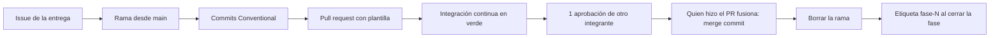

# Guía de contribución

Flujo de trabajo acordado por el equipo del **Sistema de Itinerarios Personales**. Aplica a los tres
integrantes y a cualquier cambio en el repositorio.

Las reglas técnicas del proyecto (arquitectura, fases, estándares de código) están en
[`CLAUDE.md`](CLAUDE.md) y en [`docs/`](docs/).

## Resumen del flujo



## 1. Configuración inicial (una vez por equipo)

Cada integrante usa el correo de **su cuenta de GitHub** para este repositorio, configurado **solo
para este repositorio** (sin `--global`), para que los commits queden asociados a su cuenta sin
cambiar la configuración de otros proyectos.

El comando es igual en PowerShell y en CMD, desde la raíz del proyecto:

```
git config user.name "Nombre Apellido"
git config user.email "correo-de-tu-cuenta-de-github@ejemplo.com"
```

Comprobar la configuración que usará este repositorio:

```
git config user.email
```

> Sin `--global`, el valor se guarda en `.git/config` del repositorio y solo afecta a este proyecto.
> Si GitHub muestra los commits sin tu avatar, el correo no coincide con ninguno de tu cuenta
> (*Settings → Emails* en GitHub).

## 2. Issues y milestones

- **Un issue por entrega** (por ejemplo, 2A, 2B, 2C), creado con la plantilla **Entrega**.
- Cada fase tiene un **milestone** (`Fase 2 — Resiliencia y caché`, etc.) y sus issues se asignan a él.
- El issue indica fase, objetivo, tareas, criterios de aceptación y responsable.

## 3. Ramas

- **Nunca se trabaja directamente en `main`.** Todo cambio entra por pull request.
- Rama por **fase**: `fase-N-nombre` (por ejemplo `fase-2-resiliencia`, `fase-3-itinerary-service`).
- Rama por **tarea** que no pertenece a una fase: `tipo/descripcion-corta`
  (por ejemplo `chore/github-practices`, `fix/coordenadas-mapa`, `docs/readme-gateway`).
- Las ramas se crean desde `main` actualizado:

```
git switch main
git pull --ff-only origin main
git switch -c fase-2-resiliencia
```

## 4. Commits: Conventional Commits

Formato: `tipo: descripción`, con el **prefijo en inglés** y la **descripción en español**, en
presente y en minúscula.

| Tipo | Uso | Ejemplo |
|---|---|---|
| `feat` | Nueva funcionalidad | `feat: agrega caché de aeropuertos con Redis` |
| `fix` | Corrección de un error | `fix: responde 502 cuando todos los aeropuertos son inválidos` |
| `docs` | Documentación | `docs: documenta los endpoints de Itinerary Service` |
| `test` | Pruebas | `test: agrega pruebas del circuit breaker` |
| `ci` | Integración continua | `ci: agrega el job de Itinerary Service` |
| `chore` | Configuración, dependencias, estructura | `chore: agrega plantillas de pull request e issue` |

- Un commit por entrega, o varios separados por tipo cuando el cambio lo justifique.
- Si el commit completa un issue, se puede incluir `Closes #N` en el cuerpo del mensaje.
- No se suben archivos `.env`, entornos virtuales (`.venv`) ni credenciales.

## 5. Pull requests

1. Subir la rama: `git push -u origin nombre-de-la-rama`.
2. Crear el pull request hacia `main` en GitHub. La descripción se llena con la **plantilla**:
   qué incluye, cómo probarlo, evidencias, decisiones tomadas, issues relacionados y la lista
   de verificación.
3. En "Issues relacionados" escribir `Closes #N` por cada issue que el PR complete: GitHub los
   cierra automáticamente al fusionar.

## 6. Revisión y merge

- **La integración continua debe pasar** (check "Pruebas" en verde) antes del merge.
- Se necesita **1 aprobación de otro integrante** (no del autor del PR).
  - Es un **acuerdo del equipo**: `main` todavía no tiene reglas de protección en GitHub, así que
    GitHub no lo impide. Más adelante se puede activar en *Settings → Branches* (o *Rulesets*)
    exigiendo 1 aprobación y el check "Pruebas".
- **Quien revisa aprueba; quien hizo el PR fusiona.**
- Método de merge: **"Create a merge commit"** (no *squash* ni *rebase*), para conservar los
  commits de cada entrega en el historial.
- Después del merge, **borrar la rama** (botón *Delete branch* en GitHub) y actualizar la copia local:

```
git switch main
git pull --ff-only origin main
git branch -d nombre-de-la-rama
```

## 7. Cierre de fase: etiqueta `fase-N`

Al terminar una fase y fusionarla en `main`, se crea una etiqueta anotada sobre el commit de merge:

```
git switch main
git pull --ff-only origin main
git tag -a fase-2 -m "Fase 2: Resiliencia y caché"
git push origin fase-2
```

Así se puede volver al estado exacto de cada fase (`git switch --detach fase-1`).

## 8. Rotación de fases

Las fases se rotan entre los **tres integrantes**: cada fase tiene un **responsable** distinto, en
orden, y al terminar la fase la responsabilidad pasa al siguiente integrante.

- El responsable de la fase crea los issues de sus entregas, la rama y el pull request.
- Los otros dos integrantes revisan y aprueban.
- El responsable de cada fase se registra en la descripción del milestone y en el campo
  "Responsable" de cada issue.

## 9. Lista rápida antes de pedir revisión

- [ ] La rama sale de `main` actualizado y tiene un nombre `fase-N-...` o `tipo/...`.
- [ ] Los commits siguen Conventional Commits.
- [ ] `pytest -v` pasa localmente en cada servicio modificado.
- [ ] `CLAUDE.md` y la documentación están actualizados si aplica.
- [ ] No hay `.env` ni `.venv` en el commit (`git status` antes de `git add`).
- [ ] El PR usa la plantilla y enlaza sus issues con `Closes #N`.
