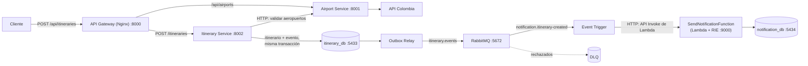
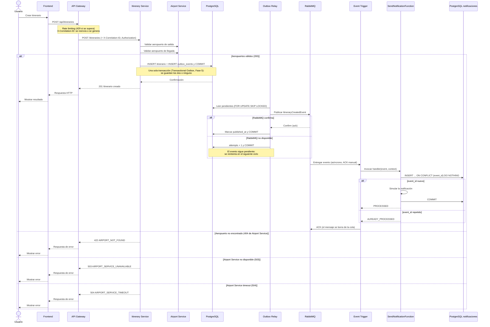
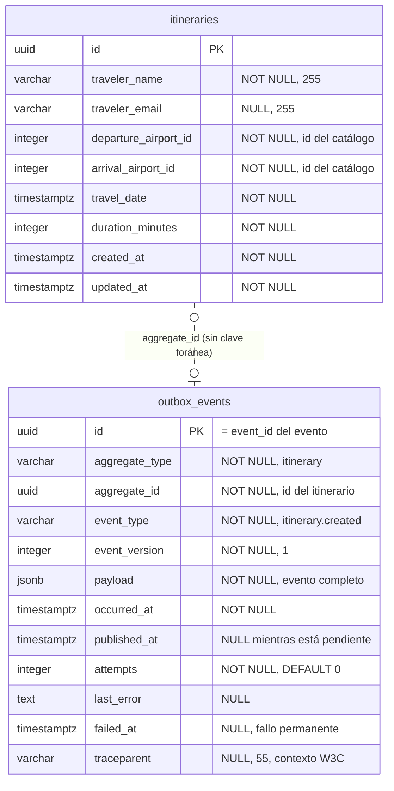
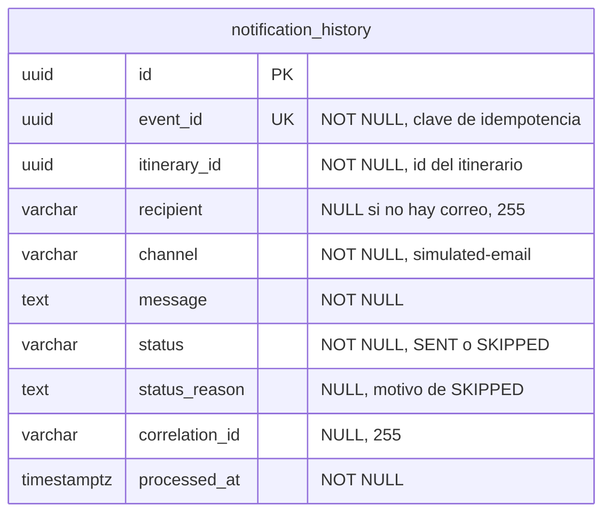
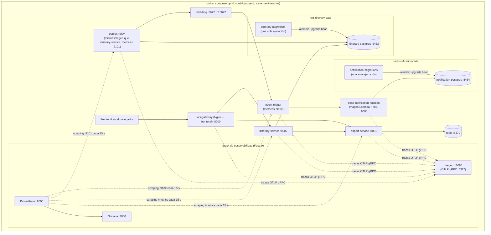
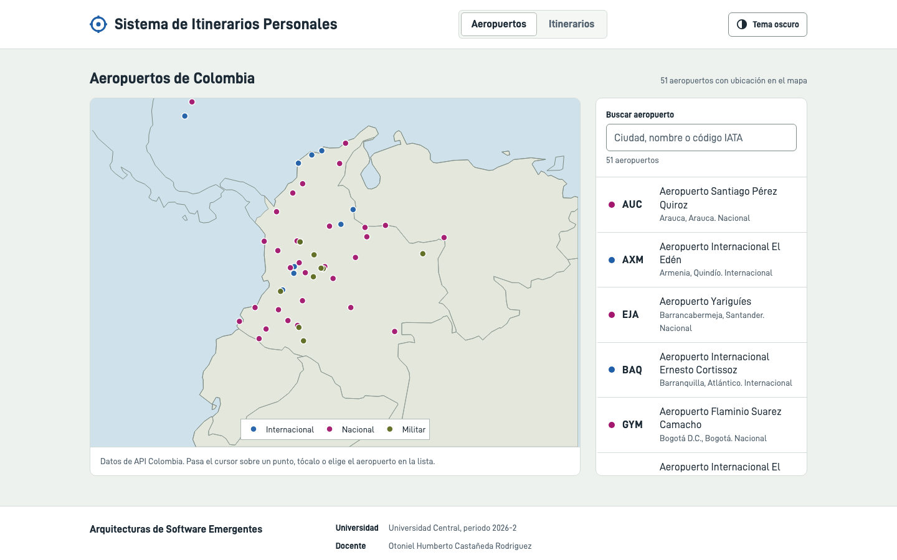
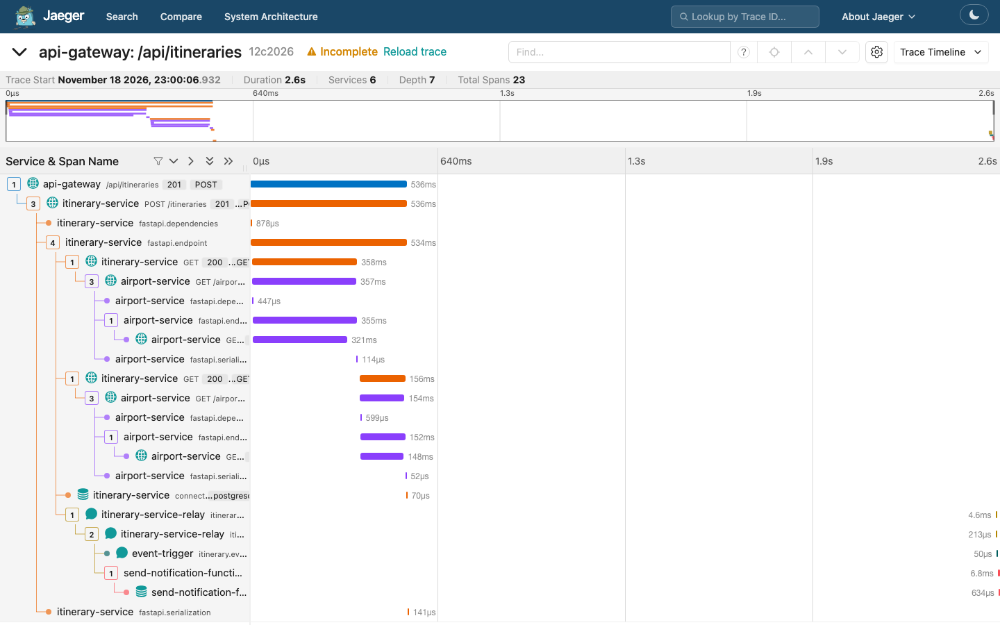

# Sistema de Itinerarios Personales

Sistema distribuido para planificar viajes entre aeropuertos colombianos: consulta los aeropuertos de
[API Colombia](https://api-colombia.com), los muestra en un mapa interactivo, gestiona itinerarios de viaje y envía una
notificación (simulada) cada vez que se crea uno.

Es el proyecto de la asignatura **Arquitecturas de Software Emergentes** y aplica tres arquitecturas en un mismo
flujo: **microservicios**, **arquitectura basada en eventos** y **serverless (FaaS)**, con arquitectura hexagonal,
DDD, Transactional Outbox, resiliencia y observabilidad.

```bash
docker compose up -d --build
```

Con ese comando se levantan los 15 contenedores del sistema; el frontend queda en <http://localhost:8000>
([Inicio rápido](#inicio-rápido)).

## Contenido

- [Descripción y objetivos](#descripción-y-objetivos)
- [Inicio rápido](#inicio-rápido)
- [Arquitectura](#arquitectura): las tres arquitecturas, componentes, hexagonal, DDD, Adapter, eventos, Outbox,
  serverless, API Gateway, resiliencia, observabilidad y tecnologías
- [Diagramas](#diagramas)
- [Instalación y ejecución](#instalación-y-ejecución)
- [Variables de entorno](#variables-de-entorno)
- [Endpoints](#endpoints)
- [Eventos](#eventos)
- [Pruebas](#pruebas)
- [Evidencias](#evidencias)
- [Limitaciones conocidas](#limitaciones-conocidas)
- [Decisiones de arquitectura](#decisiones-de-arquitectura)
- [Estructura del repositorio](#estructura-del-repositorio)
- [Documentación adicional](#documentación-adicional)
- [Desarrollo por fases, ramas y etiquetas](#desarrollo-por-fases-ramas-y-etiquetas)
- [Uso de Claude Code](#uso-de-claude-code)
- [Contexto académico](#contexto-académico)

## Descripción y objetivos

### Objetivo general

Diseñar e implementar un sistema distribuido que permita consultar aeropuertos colombianos, gestionar itinerarios de viaje y procesar notificaciones de forma asíncrona, aplicando principios de modularidad, desacoplamiento, resiliencia y observabilidad.

### Objetivos específicos

- Consultar aeropuertos colombianos mediante la API pública API Colombia.
- Desacoplar la integración externa mediante el patrón Adapter.
- Visualizar aeropuertos en un mapa interactivo con Plotly JS.
- Implementar operaciones CRUD para itinerarios.
- Validar aeropuertos mediante comunicación HTTP entre microservicios.
- Publicar eventos de integración mediante RabbitMQ.
- Procesar notificaciones con una función serverless.
- Aplicar arquitectura hexagonal y conceptos básicos de Domain-Driven Design (DDD).
- Incorporar persistencia independiente, migraciones, pruebas y documentación de API.
- Preparar mecanismos de resiliencia, caché y observabilidad.

### Alcance

El sistema está compuesto por:

1. **Airport Service:** consulta y normalización de información de aeropuertos.
2. **Itinerary Service:** creación, consulta, actualización y eliminación de itinerarios, con su Outbox Relay.
3. **Sistema de notificaciones:** Event Trigger + SendNotificationFunction (función serverless que simula la
   notificación y guarda el historial) + su base de datos.
4. **API Gateway (Nginx):** punto único de entrada en el puerto 8000; enruta, limita solicitudes y propaga headers, sin lógica de negocio.
5. **Frontend:** interfaz de gestión de itinerarios y visualización de aeropuertos, servida por el gateway.

El sistema se construyó en 13 fases (0 a 12); desde la Fase 1, cada una terminó con sus pruebas, un pull request y
una etiqueta `fase-N` ([Desarrollo por fases](#desarrollo-por-fases-ramas-y-etiquetas)).

## Inicio rápido

Requisitos: **Git** y **Docker Desktop** encendido (en Windows 11 con WSL 2; en macOS con Apple Silicon las imágenes se
construyen para `arm64` sin opciones adicionales). Los comandos son **iguales en PowerShell, CMD y la Terminal de macOS
(zsh)**:

```bash
git clone https://github.com/JUANGR12192004/sistema-itinerarios-personales.git
```

```bash
cd sistema-itinerarios-personales
```

```bash
docker compose up -d --build
```

```bash
docker compose ps
```

La primera vez tarda unos minutos (construye las imágenes). El sistema está listo cuando las dos migraciones
aparecen `Exited (0)` y `airport-service`, `itinerary-service` y `api-gateway` aparecen `healthy`. Después:

1. Abrir <http://localhost:8000>: pestaña de aeropuertos (mapa) y pestaña de itinerarios (crear, editar, eliminar).
2. Crear un itinerario con correo y ver la notificación en `notification_history`
   ([`docs/08-demostraciones.md`](docs/08-demostraciones.md) tiene el recorrido completo).
3. Ver la traza en Jaeger (<http://localhost:16686>) y las métricas en Grafana (<http://localhost:3000>).

Detalles, comandos del día a día y problemas frecuentes en [Instalación y ejecución](#instalación-y-ejecución).

## Arquitectura



Cada concepto de esta sección tiene un párrafo corto: qué es y por qué se usa, dónde está en el código y qué
documento lo explica a fondo.

### Cómo se integran las tres arquitecturas

Las tres arquitecturas no son partes separadas: se encadenan en **un mismo flujo**, el de crear un itinerario.

| Arquitectura | Dónde se aplica | Qué aporta |
|---|---|---|
| **Microservicios** | Airport Service e Itinerary Service: cada uno con su código, su API REST y sus datos | Cada servicio cambia, se despliega y falla por separado |
| **Basada en eventos** | `ItineraryCreatedEvent` viaja por RabbitMQ de Itinerary Service al sistema de notificaciones | Quien publica no espera ni conoce a quien consume |
| **Serverless (FaaS)** | `SendNotificationFunction`, que se ejecuta una vez por evento | Código sin servidor propio ni estado, activado por eventos |

El recorrido: el frontend llama al **gateway**; Itinerary Service valida los aeropuertos **por HTTP** contra Airport
Service (necesita la respuesta para seguir) y guarda el itinerario y su **evento** en la misma transacción. El Outbox
Relay publica el evento en **RabbitMQ**, el Event Trigger lo consume e invoca la **función**, que guarda la
notificación. La parte síncrona termina en el 201; todo lo demás ocurre después, sin que el usuario espere.

**A fondo:** [`docs/02-arquitectura.md`](docs/02-arquitectura.md) y la secuencia de la sección [Diagramas](#diagramas).

### Componentes y responsabilidades

| Componente | Responsabilidad | Carpeta | Puerto | Datos |
|---|---|---|---|---|
| API Gateway | Punto único de entrada: enrutar, limitar solicitudes, propagar headers y servir el frontend. Sin lógica de negocio | `gateway/` | 8000 | — |
| Frontend | Mapa de aeropuertos (Plotly JS) y CRUD de itinerarios; solo habla con el gateway | `frontend/` | (8000) | — |
| Airport Service | Consultar API Colombia mediante un Adapter, traducir al modelo interno, caché y resiliencia | `services/airport-service/` | 8001 | Redis (solo caché) |
| Itinerary Service | CRUD de itinerarios, reglas de negocio, validar aeropuertos y registrar el evento en la outbox | `services/itinerary-service/` | 8002 | `itinerary_db` |
| Outbox Relay | Proceso aparte (misma imagen) que publica en RabbitMQ los eventos pendientes de la outbox | `services/itinerary-service/` | 9101 (métricas) | `itinerary_db` |
| RabbitMQ | Transportar el evento de integración (exchange, cola, DLQ) | — | 5672 / 15672 | — |
| Event Trigger | Consumir la cola, invocar la función y decidir ACK, reintento o DLQ | `serverless/event-trigger/` | 9102 (métricas) | — |
| SendNotificationFunction | Simular la notificación y guardar el historial de forma idempotente | `serverless/send-notification-function/` | 9000 | `notification_db` |
| Observabilidad | Trazas (Jaeger), métricas (Prometheus) y dashboard (Grafana) | `observability/`, `libs/observability/` | 16686, 9090, 3000 | — |

El "sistema de notificaciones" es **Event Trigger + SendNotificationFunction + `notification_db`**: no hay un
microservicio de notificaciones adicional.

### Arquitectura hexagonal

La arquitectura hexagonal (puertos y adaptadores) separa las **reglas de negocio** de la **tecnología**. El dominio y
los casos de uso no saben que existen FastAPI, PostgreSQL, RabbitMQ ni API Colombia: hablan con **puertos**
(interfaces), y la infraestructura los implementa con **adaptadores**. Así se puede cambiar una tecnología, o probar el
negocio con dobles de prueba, sin tocar las reglas. La **regla de dependencias** dice que las dependencias apuntan
hacia el dominio: `api` e `infrastructure` → `application` → `domain`, nunca al revés.

| Capa | Contiene | Ejemplo |
|---|---|---|
| `domain` | Entidades, objetos de valor y reglas, en Python puro | `Itinerary.create(...)` rechaza una duración de 0 minutos |
| `application` | Casos de uso y puertos | `CreateItineraryUseCase` usa el puerto `AirportCatalog` |
| `infrastructure` | Adaptadores de salida | `HttpAirportCatalogAdapter` llama a Airport Service con httpx |
| `api` (o `handler.py` en la función) | Adaptador de entrada | La ruta `POST /itineraries` solo recibe, llama al caso de uso y traduce el error |

**En el código:** `app/domain`, `app/application`, `app/infrastructure` y `app/api` de cada servicio y de la función.
**A fondo:** diagramas de clases en [`docs/05-diagramas.md`](docs/05-diagramas.md#3-diagramas-de-clases) y ADR-002.

### DDD: contextos delimitados y lenguaje ubicuo

Domain-Driven Design organiza el código alrededor del negocio. Un **contexto delimitado** es una frontera dentro de la
cual cada término tiene un único significado y un único dueño; entre contextos solo se comparten **identificadores** y
**contratos** (un itinerario guarda el `id` del aeropuerto, no el objeto `Airport`).

| Contexto | Componente | Tipo | Relación |
|---|---|---|---|
| Catálogo de Aeropuertos | Airport Service | Soporte | Capa anticorrupción frente a API Colombia; su API REST es el lenguaje publicado |
| Planificación de Itinerarios | Itinerary Service | Principal (core) | Cliente del catálogo por REST; publica `ItineraryCreatedEvent` |
| Notificaciones | Event Trigger + SendNotificationFunction | Genérico | Suscriptor del evento; no conoce el modelo interno de itinerarios |

El **lenguaje ubicuo** es el vocabulario común del equipo y del código: el código está en inglés y la documentación en
español, con una traducción fija.

| Negocio | Código | | Negocio | Código |
|---|---|---|---|---|
| Aeropuerto | `Airport` | | Itinerario | `Itinerary` (raíz de agregado) |
| Coordenadas | `Coordinates` (objeto de valor) | | Viajero / correo | `traveler_name` / `traveler_email` |
| Aeropuerto de salida / llegada | `departure_airport_id` / `arrival_airport_id` | | Fecha de viaje | `travel_date` (con zona horaria) |
| Itinerario creado | `ItineraryCreatedEvent` | | Mensaje pendiente | `OutboxMessage` |
| Notificación | `NotificationRecord` | | Duración | `duration_minutes` |

**En el código:** `app/domain` de cada servicio. **A fondo:** [`docs/03-dominio.md`](docs/03-dominio.md).

### Patrón Adapter y capa anticorrupción

El patrón **Adapter** convierte una interfaz que no encaja (la de API Colombia) en la que espera el cliente (los casos
de uso). Así Airport Service no depende del formato del proveedor: si API Colombia cambia, solo cambia el Adapter.

| Rol | Clase | Archivo |
|---|---|---|
| Target (interfaz que espera el cliente) | `AirportProvider` | `services/airport-service/app/application/ports.py` |
| Client | `ListAirports`, `GetAirportById`, `GetAirportMapData` | `app/application/use_cases.py` |
| Adapter | `ApiColombiaAirportAdapter` (+ `mapper.py`) | `app/infrastructure/api_colombia/` |
| Adaptee (interfaz externa) | `ApiColombiaClient` y el JSON de API Colombia (`ApiColombiaAirportDto`) | `app/infrastructure/api_colombia/` |

El Adapter es además una **capa anticorrupción**: impide que los defectos del proveedor entren al dominio. Se
comprobaron con consultas reales (52 aeropuertos) y `mapper.py` los corrige:

- **Coordenadas intercambiadas** (51 de 52): `latitude` trae la longitud. El mapper detecta el intercambio (la latitud
  queda fuera del rango de Colombia, −5 a 14) y solo entonces las invierte; registra un único `WARNING` por respuesta.
- **`"N/A"`** en los códigos IATA/OACI faltantes → `None`.
- **`0, 0`** (aeropuerto en construcción) → `coordinates = None`: no se dibuja en el mapa (por eso el mapa muestra 51).
- **`deparmentId`** (con error ortográfico) solo existe en el DTO externo; el dominio usa nombres correctos.

La caché y la resiliencia se agregan como **Decorators** del mismo puerto, sin tocar el Adapter.
**A fondo:** ADR-003, [diagrama de clases de Airport Service](docs/05-diagramas.md#31-airport-service-patrón-adapter-y-decorators)
y [`services/airport-service/README.md`](services/airport-service/README.md).

### Arquitectura basada en eventos

Un **evento** anuncia un hecho que ya ocurrió ("se creó un itinerario"); quien lo publica no espera respuesta ni sabe
quién lo procesa. Por eso la notificación es un evento y la validación de aeropuertos es HTTP: para guardar el
itinerario *hace falta* la respuesta de Airport Service, pero la notificación puede ocurrir después y su fallo no debe
impedir crear el itinerario. En RabbitMQ, el relay publica en el **exchange** `itinerary.events` con la **routing
key** `itinerary.created`; el exchange copia el mensaje a la **cola** `notification.itinerary-created`, y los mensajes
que el consumidor rechaza pasan a la **DLQ** `notification.itinerary-created.dlq`.

`ItineraryCreatedEvent` es un **evento de integración**, no de dominio: es un contrato público con otro contexto, tiene
versión (`event_version`) y solo expone lo que promete. Por eso vive en `app/application/events.py` y no en el
dominio. Un evento de dominio sería interno al contexto y podría cambiar libremente (el agregado no emite eventos
internos). La entrega es **al menos una vez**: un mensaje puede llegar dos veces, y el consumidor es idempotente.

**A fondo:** [Eventos](#eventos), [`docs/04-comunicacion-y-eventos.md`](docs/04-comunicacion-y-eventos.md) (secciones 3
y 4) y [`docs/asyncapi/asyncapi.yaml`](docs/asyncapi/asyncapi.yaml).

### Transactional Outbox

**El problema (double write):** guardar el itinerario en PostgreSQL y publicar el evento en RabbitMQ son dos escrituras
en dos sistemas sin una transacción común. Si RabbitMQ está caído (o el proceso se detiene) justo después del commit,
el itinerario existe pero el evento se pierde. Eso pasaba en la Fase 4 y se demostró deteniendo RabbitMQ.

**La solución:** el evento se guarda como una fila de la tabla `outbox_events`, **en la misma transacción** que el
itinerario: se guardan los dos o ninguno. Un proceso aparte, el **Outbox Relay**, lee los pendientes
(`FOR UPDATE SKIP LOCKED`), los publica y los marca como publicados. Si RabbitMQ falla, el evento sigue pendiente y se
reintenta sin límite; un mensaje ilegible se aparta con `failed_at` para no bloquear a los demás. Como el relay publica
y después marca, puede haber duplicados: la función los absorbe con `event_id`.

**En el código:** `OutboxEventPublisher` (`app/infrastructure/persistence/outbox_event_publisher.py`), `OutboxRelay`
(`app/application/outbox_relay.py`) y el proceso `python -m app.outbox_relay`.
**A fondo:** ADR-006 y ADR-024 a ADR-027, y [`docs/04-comunicacion-y-eventos.md`](docs/04-comunicacion-y-eventos.md)
(secciones 6 y 7).

### Serverless: SendNotificationFunction y Event Trigger

**FaaS** (*Function as a Service*) es un modelo en el que el desarrollador escribe solo una **función** que la
plataforma ejecuta cuando llega un **evento**, sin administrar servidores ni guardar estado. `SendNotificationFunction`
es FaaS aunque corra en Docker porque:

- es un `handler(event, context)` corriendo en la **imagen oficial de AWS Lambda** con el *Runtime Interface Emulator*;
  la misma imagen se despliega sin cambios en AWS Lambda;
- no guarda estado entre invocaciones y no sabe que existe RabbitMQ: recibe un evento y responde `PROCESSED`,
  `ALREADY_PROCESSED` o `REJECTED`;
- es **idempotente**: `INSERT ... ON CONFLICT (event_id) DO NOTHING` evita notificar dos veces el mismo evento.

Lo que Docker no da en local es el escalado automático ni el apagado sin eventos (ver
[Limitaciones conocidas](#limitaciones-conocidas)).

El **Event Trigger** cumple el papel del *Event Source Mapping* de AWS: consume la cola, invoca la función y decide.
Si la función respondió `PROCESSED` o `ALREADY_PROCESSED`, confirma (ACK). Si el evento es inválido, lo manda a la
**DLQ** sin reintentar. Si falla la infraestructura (la función o su base caídas), reintenta sin límite y nunca usa la
DLQ, porque el evento es válido y funcionará cuando vuelva el servicio. Si falla la función (por ejemplo, falta una
migración), lo intenta 3 veces y después lo manda a la DLQ. La **DLQ** guarda los mensajes que no se pudieron
procesar, para revisarlos sin bloquear la cola; corregida la causa, `python -m app.replay_dlq` los devuelve a la cola.
**A fondo:** ADR-008 y ADR-028 a ADR-032, [`docs/04-comunicacion-y-eventos.md`](docs/04-comunicacion-y-eventos.md)
(sección 8) y los README de la [función](serverless/send-notification-function/README.md) y del
[trigger](serverless/event-trigger/README.md).

### API Gateway

Un **API Gateway** es el punto único de entrada de los clientes. Nginx enruta `/api/airports/...` a Airport Service y
`/api/itineraries/...` a Itinerary Service (quitando `/api`), limita a 10 solicitudes por segundo por IP (ráfaga de
20), reenvía o genera `X-Correlation-ID`, reenvía `Authorization` sin validarlo (preparación de JWT) y sirve el
frontend desde el mismo origen. **No tiene lógica de negocio:** si las reglas se copiaran en el gateway habría dos
fuentes de verdad, y un componente que comparten todos tendría que cambiar con cada regla nueva. La llamada Itinerary
→ Airport es interna y no pasa por él.

**En el código:** [`gateway/templates/default.conf.template`](gateway/templates/default.conf.template).
**A fondo:** ADR-009 y [`gateway/README.md`](gateway/README.md).

### Resiliencia

Airport Service depende de una API pública que puede tardar o fallar. Los mecanismos se aplican en este orden:
caché → circuit breaker → retry con backoff → llamada con timeout → fallback.

| Mecanismo | Qué es | Valor |
|---|---|---|
| Caché (Redis) | Guarda respuestas para no repetir consultas | Copia fresca 10 min, header `X-Cache: HIT` / `MISS` |
| Timeout | Tiempo máximo de espera de una llamada | 3 s; si se agota → 504 `AIRPORT_PROVIDER_TIMEOUT` |
| Retry con exponential backoff | Reintenta fallos temporales con esperas crecientes | 3 intentos, esperas de 0,5 s y 1 s; no reintenta 404 ni 502 |
| Circuit breaker | Tras varios fallos seguidos deja de llamar durante un tiempo | Se abre tras 3 fallos seguidos; durante 30 s responde de inmediato (copia de respaldo o 503) |
| Fallback | Respuesta alternativa cuando el proveedor no está | Copia de respaldo de 24 h, `X-Cache: STALE` |

Si Redis falla, el servicio sigue sin caché. Itinerary Service también distingue "el aeropuerto no existe" (422) de
"Airport Service no responde" (503/504).
**En el código:** `app/infrastructure/resilience/` y `app/infrastructure/cache/` de Airport Service.
**A fondo:** ADR-007 y ADR-014, y el [diagrama de resiliencia](docs/05-diagramas.md#6-flujo-de-resiliencia-de-airport-service).

### Observabilidad

En un sistema distribuido una operación pasa por muchos procesos; la observabilidad permite seguirla.

| Pilar | Cómo se implementa | Dónde se ve |
|---|---|---|
| Logs JSON | Cada línea con `timestamp`, `level`, `service`, `correlation_id`, `trace_id` y `span_id` | `docker compose logs -f <servicio>` |
| Correlation ID | `X-Correlation-ID`: lo genera o reenvía el gateway, viaja en el evento y queda en `notification_history` | Logs y tabla `notification_history` |
| Trazas | OpenTelemetry con contexto W3C (`traceparent`); se guarda en `outbox_events` para cruzar el relay y RabbitMQ | Jaeger: una traza con los seis componentes |
| Métricas | Prometheus: HTTP, `itineraries_created_total`, relay y trigger | Prometheus y el dashboard de Grafana |

El código común de los cuatro componentes Python está en el paquete `libs/observability` (*Microservice Chassis
Pattern*, ADR-040). **A fondo:** ADR-034 a ADR-040 y [`docs/02-arquitectura.md`](docs/02-arquitectura.md#6-observabilidad).

### Tecnologías

| Área | Tecnología |
|---|---|
| Backend | Python 3.12, FastAPI, Pydantic v2, pydantic-settings, httpx |
| Persistencia | PostgreSQL 16 (una base por servicio) |
| ORM y migraciones | SQLAlchemy 2 y Alembic |
| Comunicación síncrona | HTTP / REST |
| API Gateway | Nginx (imagen oficial `nginx:1.30.6-alpine-otel`, con el módulo de OpenTelemetry; ADR-009 y ADR-036) |
| Mensajería | RabbitMQ 3.13 (cliente `pika`) |
| Caché | Redis 7.4 |
| Serverless | Imagen oficial de AWS Lambda para Python 3.12 con el Runtime Interface Emulator (ADR-008) |
| Frontend | HTML, CSS y JavaScript (ES modules, sin build) con Plotly JS 4.3.0 |
| Contenedores | Docker y Docker Compose (`docker-compose.yml` en la raíz, ADR-041) |
| Observabilidad | OpenTelemetry, Jaeger 2.23, Prometheus 2.55 y Grafana 11.3 |
| Documentación de API | Swagger / OpenAPI y AsyncAPI 3.0 |
| Pruebas | pytest, TestClient de FastAPI y respx |
| Calidad de código | SonarCloud (Automatic Analysis, ADR-023) y GitHub Actions |

## Diagramas

Aquí están los cuatro diagramas principales. Los de **componentes** y **clases** son grandes y están en
[`docs/05-diagramas.md`](docs/05-diagramas.md), junto con los de fallos del consumidor, recorrido por el gateway,
resiliencia y observabilidad.

| Diagrama | Dónde |
|---|---|
| Arquitectura general | [Arquitectura](#arquitectura) (arriba) |
| Componentes (capas y puertos de cada componente) | [`docs/05-diagramas.md`, sección 2](docs/05-diagramas.md#2-diagrama-de-componentes) |
| Clases (Airport, Itinerary API, Outbox Relay y función) | [`docs/05-diagramas.md`, sección 3](docs/05-diagramas.md#3-diagramas-de-clases) |
| Relacional | [Abajo](#relacional) |
| Secuencia de creación de un itinerario | [Abajo](#secuencia-de-creación-de-un-itinerario) |
| Despliegue con Docker Compose | [Abajo](#despliegue) |

### Secuencia de creación de un itinerario



La solicitud HTTP termina en el 201; el relay, RabbitMQ, el trigger y la función trabajan después. Los fallos del
consumidor (reintentos, DLQ y reprocesamiento) están en la
[sección 5.1 de `docs/05`](docs/05-diagramas.md#51-fallos-en-el-consumidor-reintentos-dlq-y-reprocesamiento-fase-6).

### Relacional

Dos bases PostgreSQL independientes, cada una de un solo componente. Entre bases no hay claves foráneas: los datos
pasan de una a otra solo a través del evento.

**`itinerary_db`** (Itinerary Service):



**`notification_db`** (SendNotificationFunction): `event_id` es único, y esa restricción es la que hace idempotente a
la función.



Índices, restricciones y migraciones en la [sección 4 de `docs/05`](docs/05-diagramas.md#4-diagrama-relacional).

### Despliegue



Las bases de datos solo están en su red (`itinerary-data`, `notification-data`): ningún otro contenedor puede
conectarse a ellas. El orden de arranque está en la
[sección 7 de `docs/05`](docs/05-diagramas.md#7-despliegue-con-docker-compose-fase-10).

## Instalación y ejecución

El sistema se levanta con **Docker Compose** (camino recomendado). El arranque manual, componente por componente,
se conserva para desarrollar y está en un documento aparte.

### Con Docker Compose (recomendado)

Desde la Fase 10 todo el sistema (15 contenedores) se levanta con Docker Compose. Requisito: **Docker Desktop**
encendido (en Windows con WSL 2; en Mac con Apple Silicon las imágenes se construyen para `arm64` sin opciones
adicionales). Los comandos son **iguales en PowerShell, CMD y la Terminal de macOS (zsh)** y se ejecutan desde la
raíz del repositorio (o cualquier subcarpeta: Compose busca `docker-compose.yml` hacia arriba).

**Si antes se usó el modo manual**, detener esos contenedores, porque ocupan los mismos puertos:

```
docker stop api-gateway send-notification-function notification-postgres itinerary-rabbitmq itinerary-postgres airport-redis grafana prometheus jaeger
```

**Levantar todo** (la primera vez construye las imágenes, unos minutos; las siguientes, segundos):

```
docker compose up -d --build
docker compose ps
```

Listo cuando las dos migraciones aparecen `Exited (0)` y `airport-service`, `itinerary-service` y `api-gateway`
aparecen `healthy`. Entonces:

| Qué | Dónde |
|---|---|
| Frontend (mapa y CRUD) | http://localhost:8000 |
| Swagger de Airport e Itinerary Service | http://localhost:8001/docs y http://localhost:8002/docs |
| Panel de RabbitMQ (`guest` / `guest`) | http://localhost:15672 |
| Jaeger | http://localhost:16686 |
| Prometheus (destinos) | http://localhost:9090/targets |
| Grafana (`admin` / `admin`) | http://localhost:3000 |

**Comandos del día a día:**

| Acción | Comando |
|---|---|
| Ver el estado | `docker compose ps -a` |
| Ver los logs de un componente (Ctrl+C para salir) | `docker compose logs -f outbox-relay` |
| Detener y encender un componente | `docker compose stop event-trigger` / `docker compose start event-trigger` |
| Reconstruir tras un cambio de código | `docker compose up -d --build airport-service` |
| Consultar una base | `docker compose exec itinerary-postgres psql -U itinerary -d itinerary_db` |
| Reprocesar la DLQ | `docker compose run --rm event-trigger python -m app.replay_dlq --all` |
| Detener todo (conserva los datos) | `docker compose down` |
| Detener todo y **borrar** los datos | `docker compose down -v` |

Variables opcionales (nivel de log, trazas, rate limit del gateway, usuario de Grafana): copiar `.env.example` como
`.env` en la raíz (`Copy-Item` en PowerShell, `copy` en CMD, `cp` en zsh). Sin `.env` se usan los mismos valores
por defecto.

#### Qué hace Compose por nosotros

La tabla [Qué pasa si se omite un paso](docs/07-ejecucion-manual.md#qué-pasa-si-se-omite-un-paso) describe los errores del modo manual. Con
Compose, `depends_on` impone el orden: las migraciones esperan a su PostgreSQL, la API, el relay y la función esperan
a que su migración termine con éxito, y el relay y el trigger esperan a RabbitMQ. Si un componente se detiene después,
el comportamiento es el de esa tabla (por ejemplo, con `docker compose stop event-trigger` los mensajes se acumulan en
la cola). Detalles en ADR-041 y en el diagrama de despliegue de [`docs/05-diagramas.md`](docs/05-diagramas.md).

#### Problemas frecuentes

| Síntoma | Causa | Solución |
|---|---|---|
| `Bind for 0.0.0.0:5433 failed: port is already allocated` | Hay contenedores del modo manual (o un `uvicorn`) en ese puerto | Detenerlos (comando de arriba) o cerrar el `uvicorn` |
| `dependency failed to start: ... itinerary-migrations exited (1)` | La migración falló | `docker compose logs itinerary-migrations` |
| 502 `UPSTREAM_UNAVAILABLE` justo después de `up` | El servicio aún está arrancando | Esperar a que `docker compose ps` lo muestre `healthy` |
| 502 tras reconstruir un servicio (`up --build <servicio>`) | El contenedor nuevo puede tener otra IP y Nginx guardó la anterior (ADR-041) | `docker compose restart api-gateway` |
| Los datos del modo manual no aparecen | Compose usa sus propios volúmenes | Es lo esperado; las bases empiezan vacías |

### Modo manual (desarrollo)

Para desarrollar un componente con recarga automática o depurarlo desde su entorno virtual, el orden de arranque
completo (nueve pasos, con comandos para PowerShell, CMD y zsh) y la tabla de qué pasa si se omite un paso están en
[`docs/07-ejecucion-manual.md`](docs/07-ejecucion-manual.md). No se puede usar a la vez que Docker Compose: ocupan
los mismos puertos.

### Demostraciones

Con el sistema levantado, los recorridos para mostrarlo funcionando (crear un itinerario y seguirlo hasta
`notification_history`, evento duplicado, evento en la DLQ y su reprocesamiento, trazas en Jaeger y métricas en
Grafana) están en [`docs/08-demostraciones.md`](docs/08-demostraciones.md).

## Variables de entorno

Con **Docker Compose** no hace falta configurar nada: `docker-compose.yml` define todas las variables de cada
contenedor. Solo estas se pueden cambiar, copiando [`.env.example`](.env.example) como `.env` en la raíz
(`Copy-Item .env.example .env` en PowerShell, `copy .env.example .env` en CMD, `cp .env.example .env` en zsh):

| Variable | Por defecto | Para qué |
|---|---|---|
| `LOG_LEVEL` | `INFO` | Nivel de log de los cuatro procesos Python |
| `OTEL_ENABLED` | `true` | Envío de trazas a Jaeger desde los procesos Python |
| `GATEWAY_OTEL_TRACE` | `on` | Trazas del gateway |
| `GATEWAY_RATE_LIMIT` / `GATEWAY_RATE_BURST` | `10r/s` / `20` | Rate limiting del gateway por IP |
| `GRAFANA_ADMIN_USER` / `GRAFANA_ADMIN_PASSWORD` | `admin` / `admin` | Usuario de Grafana |

En el **modo manual** cada componente lee su propio `.env` (copia de su `.env.example`). Variables comunes a los
cuatro procesos Python: `LOG_LEVEL` y, desde el entorno del proceso (no desde `.env`), `OTEL_ENABLED` y
`OTEL_EXPORTER_OTLP_ENDPOINT` (por defecto `http://localhost:4317`).

| Componente | Variables (valor por defecto) | Archivo |
|---|---|---|
| Airport Service | `API_COLOMBIA_BASE_URL` (`https://api-colombia.com/api/v1`), `API_COLOMBIA_TIMEOUT_SECONDS` (3), `RETRY_MAX_ATTEMPTS` (3), `RETRY_BASE_DELAY_SECONDS` (0.5), `RETRY_MAX_DELAY_SECONDS` (4), `CIRCUIT_BREAKER_FAILURE_THRESHOLD` (3), `CIRCUIT_BREAKER_RECOVERY_SECONDS` (30), `REDIS_URL` (`redis://localhost:6379/0`), `REDIS_TIMEOUT_SECONDS` (0.5), `CACHE_TTL_SECONDS` (600), `CACHE_STALE_TTL_SECONDS` (86400), `SERVICE_NAME` | [`.env.example`](services/airport-service/.env.example) |
| Itinerary Service y Outbox Relay | `DATABASE_URL` (obligatoria), `DATABASE_CONNECT_TIMEOUT_SECONDS` (5), `AIRPORT_SERVICE_URL` (`http://localhost:8001`), `AIRPORT_SERVICE_TIMEOUT_SECONDS` (5), `RABBITMQ_URL`, `RABBITMQ_TIMEOUT_SECONDS` (3), `OUTBOX_RELAY_POLL_INTERVAL_SECONDS` (2), `OUTBOX_RELAY_BATCH_SIZE` (10), `OUTBOX_RELAY_METRICS_PORT` (9101), `HOST` (127.0.0.1), `PORT` (8002), `SERVICE_NAME` | [`.env.example`](services/itinerary-service/.env.example) |
| SendNotificationFunction | `DATABASE_URL` (obligatoria), `DATABASE_CONNECT_TIMEOUT_SECONDS` (3), `FUNCTION_NAME`; en la imagen, `AWS_LAMBDA_FUNCTION_TIMEOUT` (10 s) | [`.env.example`](serverless/send-notification-function/.env.example) |
| Event Trigger | `RABBITMQ_URL`, `RABBITMQ_TIMEOUT_SECONDS` (3), `RABBITMQ_RECONNECT_DELAY_SECONDS` (5), `FUNCTION_INVOKE_URL` (`http://localhost:9000/2015-03-31/functions/function/invocations`), `FUNCTION_TIMEOUT_SECONDS` (15), `TRIGGER_INFRASTRUCTURE_ATTEMPTS` (3), `TRIGGER_FUNCTION_ERROR_ATTEMPTS` (3), `TRIGGER_RETRY_BACKOFF_SECONDS` (1), `TRIGGER_RETRY_MAX_BACKOFF_SECONDS` (8), `TRIGGER_REQUEUE_DELAY_SECONDS` (10), `METRICS_PORT` (9102), `SERVICE_NAME` | [`.env.example`](serverless/event-trigger/.env.example) |
| API Gateway | `AIRPORT_SERVICE_UPSTREAM` / `ITINERARY_SERVICE_UPSTREAM` (`host.docker.internal:8001` / `:8002`), `GATEWAY_PROXY_CONNECT_TIMEOUT` (2s), `GATEWAY_PROXY_READ_TIMEOUT` (15s), `GATEWAY_RATE_LIMIT` (10r/s), `GATEWAY_RATE_BURST` (20), `OTEL_EXPORTER_OTLP_HOST`, `GATEWAY_OTEL_TRACE` (on) | [`.env.example`](gateway/.env.example) |

Cada `.env.example` explica cada variable. Los archivos `.env` nunca se suben al repositorio.

## Endpoints

Los clientes entran por el **API Gateway** (`http://localhost:8000`). Todas las respuestas de error usan el mismo
formato:

```json
{
  "error": {"code": "AIRPORT_NOT_FOUND", "message": "El aeropuerto con id 999 no existe", "details": {"airport_id": 999}},
  "correlation_id": "3f2a..."
}
```

| Método | Ruta en el gateway | Éxito | Errores del servicio |
|---|---|---|---|
| `GET` | `/api/airports` | 200: lista de aeropuertos (header `X-Cache`) | 502, 503, 504 |
| `GET` | `/api/airports/{id}` | 200: un aeropuerto | 404 `AIRPORT_NOT_FOUND`, 422 `VALIDATION_ERROR` (id no es un entero mayor que 0), 502, 503, 504 |
| `GET` | `/api/airports/map-data` | 200: arrays para Plotly (`ids`, `names`, `latitudes`, `longitudes`...) | 502, 503, 504 |
| `POST` | `/api/itineraries` | 201: itinerario creado | 422 (`VALIDATION_ERROR`, `INVALID_ITINERARY`, `AIRPORT_NOT_FOUND`), 503 `AIRPORT_SERVICE_UNAVAILABLE`, 504 `AIRPORT_SERVICE_TIMEOUT` |
| `GET` | `/api/itineraries` | 200: lista | — |
| `GET` | `/api/itineraries/{id}` | 200: un itinerario | 404 `ITINERARY_NOT_FOUND`, 422 `VALIDATION_ERROR` (id no es UUID) |
| `PUT` | `/api/itineraries/{id}` | 200: itinerario actualizado | 404, 422, 503, 504 |
| `DELETE` | `/api/itineraries/{id}` | 204 | 404, 422 (id no es UUID) |
| `GET` | `/health` | 200 (del propio gateway) | — |
| `GET` | `/` | Frontend | 404 `ROUTE_NOT_FOUND` si el archivo no existe |

En Airport Service, 502 es `AIRPORT_PROVIDER_BAD_RESPONSE` (API Colombia respondió algo inválido), 503
`AIRPORT_PROVIDER_UNAVAILABLE` y 504 `AIRPORT_PROVIDER_TIMEOUT`. Los errores de los servicios pasan por el gateway
**sin cambios**. El gateway agrega sus propios errores en cualquier ruta `/api/`:

| Código | `code` | Cuándo |
|---|---|---|
| 404 | `ROUTE_NOT_FOUND` | La ruta no existe en el gateway |
| 413 | `PAYLOAD_TOO_LARGE` | El cuerpo supera 1 MB |
| 429 | `RATE_LIMIT_EXCEEDED` | Se superaron 10 solicitudes/s (+20 de ráfaga) desde la misma IP; con `Retry-After: 1` |
| 502 | `UPSTREAM_UNAVAILABLE` | El servicio no acepta la conexión (`details.service` dice cuál) |
| 504 | `UPSTREAM_TIMEOUT` | El servicio no responde en 15 s |

Cuerpo de `POST` y `PUT /api/itineraries` (el ejemplo está en
[`serverless/event-trigger/demo/create-itinerary.json`](serverless/event-trigger/demo/create-itinerary.json)):

```json
{
  "traveler_name": "Ana Pérez",
  "traveler_email": "ana@example.com",
  "departure_airport_id": 1,
  "arrival_airport_id": 5,
  "travel_date": "2026-12-15T08:00:00-05:00",
  "duration_minutes": 75
}
```

**Fuera del gateway** (solo para desarrollo y observabilidad): Swagger en `http://localhost:8001/docs` y
`http://localhost:8002/docs`; `GET /health` y `GET /metrics` en los puertos 8001 y 8002; métricas del relay en 9101 y
del trigger en 9102; invocación de la función en
`POST http://localhost:9000/2015-03-31/functions/function/invocations`. El contrato HTTP publicado de Airport Service
está en [`docs/openapi/airport-service.json`](docs/openapi/airport-service.json). Ejemplos con `curl` en el README de
cada componente y en [`docs/08-demostraciones.md`](docs/08-demostraciones.md).

## Eventos

El sistema publica un único evento de integración, **`ItineraryCreatedEvent` versión 1** (ADR-020), cada vez que se
crea un itinerario:

```json
{
  "event_id": "uuid",
  "event_type": "itinerary.created",
  "event_version": 1,
  "occurred_at": "2026-10-20T15:30:00Z",
  "producer": "itinerary-service",
  "correlation_id": "uuid",
  "data": {
    "itinerary_id": "uuid",
    "traveler_name": "Ana Pérez",
    "traveler_email": "ana@example.com",
    "departure_airport_id": 1,
    "arrival_airport_id": 5,
    "travel_date": "2026-12-15T08:00:00-05:00",
    "duration_minutes": 75
  }
}
```

| Aspecto | Valor |
|---|---|
| Productor | Outbox Relay de Itinerary Service (`RabbitMQEventPublisher`) |
| Exchange y routing key | `itinerary.events` (topic) con `itinerary.created` |
| Consumidor | Event Trigger, cola `notification.itinerary-created`, que invoca `SendNotificationFunction` |
| Mensajes fallidos | DLX `itinerary.events.dlx` → DLQ `notification.itinerary-created.dlq` |
| Garantías | Mensajes persistentes, *publisher confirms*, `mandatory=True`, ACK manual después de procesar |
| Entrega | Al menos una vez; la función es idempotente con `event_id` |
| Propiedades AMQP | `message_id = event_id`, `correlation_id`, `type`, `app_id`, headers `event_version` y `traceparent` |
| Versionado | Un cambio incompatible exige una nueva `event_version` |

La especificación completa (canales, operaciones `send` y `receive`, DLQ) está en
[`docs/asyncapi/asyncapi.yaml`](docs/asyncapi/asyncapi.yaml) (AsyncAPI 3.0; se puede ver en
<https://studio.asyncapi.com>). Pruebas de contrato del productor y del consumidor comprueban que el código coincide
con ese archivo.

## Pruebas

El proyecto sigue una **pirámide de pruebas** de cinco niveles (ADR-042): muchas pruebas rápidas abajo y pocas pruebas
lentas, de todo el sistema, arriba.

| Nivel | Qué prueba | Ejemplo |
|---|---|---|
| Unitarias | Dominio, casos de uso y adaptadores con dobles de prueba (fakes, respx, canales falsos) | Un itinerario con salida igual a llegada se rechaza |
| Integración | Un adaptador contra la infraestructura real (PostgreSQL, RabbitMQ, la función) | El relay publica en un RabbitMQ real |
| Contrato | Que dos componentes sigan entendiéndose (OpenAPI de Airport, AsyncAPI del evento) | La función acepta los ejemplos del AsyncAPI |
| Gateway | La configuración de Nginx en un contenedor propio contra servidores eco | 429 al superar el límite |
| Punta a punta (E2E) | El sistema completo por el gateway, con un simulador de API Colombia | Crear un itinerario y encontrarlo en `notification_history` |

Resultado con todo el sistema encendido (2026-11-18, macOS, `docker compose` con el simulador; evidencia
[01](docs/evidencias/01-pruebas.txt)):

| Suite | Carpeta | Pruebas | Necesita |
|---|---|---|---|
| Airport Service | `services/airport-service` | 191 | Nada (Redis opcional) |
| Itinerary Service | `services/itinerary-service` | 186 | PostgreSQL y RabbitMQ para las de integración |
| SendNotificationFunction | `serverless/send-notification-function` | 70 | PostgreSQL para las de integración |
| Event Trigger | `serverless/event-trigger` | 87 | RabbitMQ y la función para las de integración |
| Paquete compartido | `libs/observability` | 19 | Nada |
| API Gateway | `gateway` | 53 | Docker (y el gateway real para 3 *smoke*) |
| Punta a punta | `tests/e2e` | 14 | El sistema con el simulador (abajo) |
| **Total** | | **620** | **0 fallos, 0 omitidas, 0 advertencias** |

Sin los servicios, las pruebas de integración quedan **SKIPPED** (no fallan). Las de integración usan bases propias
(`itinerary_db_test`, `notification_db_test`) y colas con nombres `test-<id>.`: se pueden correr durante una
demostración sin perder datos. El workflow "Pruebas" de GitHub Actions las ejecuta en cada pull request: un job por componente (sin servicios, así
que allí las de integración quedan SKIPPED) y el job "Docker Compose", que levanta el sistema y corre las E2E.

Cada componente se prueba desde su carpeta, con su entorno virtual activado (CLAUDE.md 4.3; en la función el archivo es
`requirements-dev.txt`, igual que en `libs/observability`). El comando es igual en PowerShell, CMD y zsh:

```
pytest -v
```

**Pruebas de punta a punta.** Levantan el sistema completo con el simulador de API Colombia (sin internet):

PowerShell y CMD:

```powershell
docker compose -f docker-compose.yml -f docker-compose.e2e.yml up -d --build --wait
cd tests\e2e
py -3.12 -m venv .venv
.venv\Scripts\activate
pip install -r requirements.txt
pytest -v
```

macOS (zsh):

```bash
docker compose -f docker-compose.yml -f docker-compose.e2e.yml up -d --build --wait
cd tests/e2e
python3.12 -m venv .venv
source .venv/bin/activate
pip install -r requirements.txt
pytest -v
```

(En PowerShell, `.venv\Scripts\Activate.ps1` en lugar de `activate`.) Para volver a usar la API Colombia real:
`docker compose up -d --remove-orphans` (sin el segundo archivo) recrea Airport Service con la dirección real; después,
`docker compose restart api-gateway` (el contenedor nuevo puede tener otra IP, ADR-041) y
`docker compose exec redis redis-cli FLUSHALL` (la caché todavía tiene los 5 aeropuertos del simulador; sin este paso
el mapa mostraría 4 durante 10 minutos).

**Contrato de Airport Service.** Si cambias su API a propósito, regenera `docs/openapi/airport-service.json` desde
`services/airport-service` y revisa el diff: `$env:UPDATE_CONTRACTS = "1"; pytest tests/test_openapi_contract.py`
(PowerShell), `set UPDATE_CONTRACTS=1 && pytest tests/test_openapi_contract.py` (CMD) o
`UPDATE_CONTRACTS=1 pytest tests/test_openapi_contract.py` (zsh).

## Evidencias

Capturas y salidas de terminal del sistema funcionando, obtenidas el 2026-11-18 en una sola sesión con Docker Compose
y la API Colombia real. El índice completo, con qué debe verse en cada una y cómo regenerarlas con los scripts de
`scripts/`, está en [`docs/evidencias/README.md`](docs/evidencias/README.md).

| N.º | Evidencia | Archivo |
|---|---|---|
| 01 | Totales de las siete suites de pruebas (620) | [`01-pruebas.txt`](docs/evidencias/01-pruebas.txt) |
| 02 | `docker compose ps` con todo el sistema sano | [`02-docker-compose-ps.txt`](docs/evidencias/02-docker-compose-ps.txt) |
| 03 | Respuesta del gateway con `X-Correlation-ID` | [`03-gateway-correlation-id.txt`](docs/evidencias/03-gateway-correlation-id.txt) |
| 04 | 429 del rate limiting | [`04-rate-limit-429.txt`](docs/evidencias/04-rate-limit-429.txt) |
| 05 | Registro `SENT` en `notification_history` | [`05-notification-history.txt`](docs/evidencias/05-notification-history.txt) |
| 06 | Outbox: RabbitMQ detenido, evento pendiente y publicado al volver | [`06-outbox-rabbitmq-detenido.txt`](docs/evidencias/06-outbox-rabbitmq-detenido.txt) |
| 07 | Evento inválido enviado a la DLQ | [`07-dlq-evento-invalido.txt`](docs/evidencias/07-dlq-evento-invalido.txt) |
| 08 | Swagger de Airport Service | [`08-swagger-airport.png`](docs/evidencias/08-swagger-airport.png) |
| 09 | Swagger de Itinerary Service | [`09-swagger-itinerary.png`](docs/evidencias/09-swagger-itinerary.png) |
| 10 | Mapa del frontend (51 aeropuertos) | [`10-frontend-mapa.png`](docs/evidencias/10-frontend-mapa.png) |
| 11 | CRUD: crear | [`11-frontend-crear.png`](docs/evidencias/11-frontend-crear.png) |
| 12 | CRUD: consultar | [`12-frontend-consultar.png`](docs/evidencias/12-frontend-consultar.png) |
| 13 | CRUD: actualizar | [`13-frontend-actualizar.png`](docs/evidencias/13-frontend-actualizar.png) |
| 14 | CRUD: eliminar | [`14-frontend-eliminar.png`](docs/evidencias/14-frontend-eliminar.png) |
| 15 | Traza de punta a punta en Jaeger (6 servicios) | [`15-jaeger-traza.png`](docs/evidencias/15-jaeger-traza.png) |
| 16 | Dashboard de Grafana | [`16-grafana-dashboard.png`](docs/evidencias/16-grafana-dashboard.png) |
| 17 | Panel de RabbitMQ: cola y DLQ | [`17-rabbitmq-colas.png`](docs/evidencias/17-rabbitmq-colas.png) |
| 18 | Mensaje de la DLQ con `x-death` | [`18-rabbitmq-dlq-mensaje.png`](docs/evidencias/18-rabbitmq-dlq-mensaje.png) |
| 19 | SonarCloud sobre `main`: Quality Gate aprobado, seguridad, fiabilidad y mantenibilidad en A, 2,2 % de duplicación | [`19-sonarcloud.png`](docs/evidencias/19-sonarcloud.png) |
| 20 | GitHub Actions: los 8 checks del PR de la Fase 12 en verde (7 jobs de pruebas y SonarCloud) | [`20-github-actions.png`](docs/evidencias/20-github-actions.png) |

Así se ven el mapa y la traza:





## Limitaciones conocidas

Son decisiones conscientes, documentadas, no errores pendientes:

| Limitación | Por qué | Decisión |
|---|---|---|
| La función FaaS **no escala sola ni se apaga** cuando no hay eventos | En local, el Runtime Interface Emulator ejecuta un solo contenedor siempre encendido. El código no cambia: la misma imagen desplegada en AWS Lambda sí escala y se apaga | [ADR-008](docs/06-decisiones-arquitectonicas.md#adr-008--tecnología-serverless-local) |
| El gateway responde **502** si un contenedor de servicio se **recrea** con otra IP, hasta `docker compose restart api-gateway` | Nginx resuelve los nombres de los servicios al arrancar. Solo ocurre al reconstruir un servicio con el sistema encendido; con `stop` y `start` la IP no cambia | [ADR-041](docs/06-decisiones-arquitectonicas.md#adr-041--despliegue-local-con-docker-compose-fase-10) |
| **`GenerateItineraryReportFunction` no se implementó** | Era opcional en la Fase 6; `SendNotificationFunction` ya demuestra el modelo FaaS completo | [ADR-043](docs/06-decisiones-arquitectonicas.md#adr-043--generateitineraryreportfunction-no-se-implementa-alcance) |
| La **protección de `main`** (PR obligatorio con 1 aprobación y el check "Pruebas") es un acuerdo del equipo, no una regla de GitHub | Se configura en *Settings → Rules* y solo puede hacerlo el dueño del repositorio | [`CONTRIBUTING.md`](CONTRIBUTING.md) y CLAUDE.md, sección 9.3 |

Otras limitaciones propias de un componente (por ejemplo, el estado del circuit breaker vive en la memoria de cada
proceso) están en su README, como en [Airport Service](services/airport-service/README.md#limitaciones-conocidas-fase-2).

## Decisiones de arquitectura

Cada decisión importante quedó registrada como un **ADR** (*Architecture Decision Record*): contexto, decisión,
justificación y consecuencias. El registro completo, con las actualizaciones posteriores de cada una, está en
[`docs/06-decisiones-arquitectonicas.md`](docs/06-decisiones-arquitectonicas.md). Todas están aceptadas salvo ADR-022,
reemplazada por el Transactional Outbox.

| ADR | Fase | Decisión |
|---|---|---|
| [ADR-001](docs/06-decisiones-arquitectonicas.md#adr-001--uso-de-microservicios) | Fase 0 | El sistema se divide en Airport Service, Itinerary Service y el sistema de notificaciones |
| [ADR-002](docs/06-decisiones-arquitectonicas.md#adr-002--arquitectura-hexagonal) | Fase 0 | Dominio, casos de uso, puertos y adaptadores en cada componente |
| [ADR-003](docs/06-decisiones-arquitectonicas.md#adr-003--patrón-adapter-para-api-colombia) | Fase 0 | Puerto `AirportProvider` y `ApiColombiaAirportAdapter` frente a API Colombia |
| [ADR-004](docs/06-decisiones-arquitectonicas.md#adr-004--postgresql-independiente-para-itinerarios) | Fase 0 | PostgreSQL propia de Itinerary Service |
| [ADR-005](docs/06-decisiones-arquitectonicas.md#adr-005--rabbitmq-para-mensajería) | Fase 0 | RabbitMQ transporta los eventos de integración |
| [ADR-006](docs/06-decisiones-arquitectonicas.md#adr-006--transactional-outbox) | Fase 0 | El itinerario y su evento se guardan en la misma transacción |
| [ADR-007](docs/06-decisiones-arquitectonicas.md#adr-007--redis-para-caché) | Fase 2 | Redis como caché (10 min) y copia de respaldo (24 h), como Decorator |
| [ADR-008](docs/06-decisiones-arquitectonicas.md#adr-008--tecnología-serverless-local) | Fase 6 | La función corre en la imagen oficial de AWS Lambda con el Runtime Interface Emulator |
| [ADR-009](docs/06-decisiones-arquitectonicas.md#adr-009--api-gateway-con-nginx) | Fase 7 | Nginx como API Gateway: enrutamiento, rate limiting y correlation ID, sin lógica de negocio |
| [ADR-010](docs/06-decisiones-arquitectonicas.md#adr-010--observabilidad) | Fase 0 | OpenTelemetry, Jaeger, Prometheus, Grafana y logs estructurados |
| [ADR-011](docs/06-decisiones-arquitectonicas.md#adr-011--idioma-del-código-y-de-la-documentación) | Fase 0 | Código en inglés y documentación en español |
| [ADR-012](docs/06-decisiones-arquitectonicas.md#adr-012--contrato-http-y-formato-único-de-errores) | Fase 1 | Endpoints de Airport Service y formato único de errores |
| [ADR-013](docs/06-decisiones-arquitectonicas.md#adr-013--puertos-para-las-dependencias-externas-de-itinerary-service) | Fase 1 | Itinerary Service depende de los puertos `AirportCatalog` y `EventPublisher` |
| [ADR-014](docs/06-decisiones-arquitectonicas.md#adr-014--resiliencia-de-airport-service-frente-a-api-colombia) | Fase 2 | Timeout, retry con backoff, circuit breaker y fallback, implementados a mano |
| [ADR-015](docs/06-decisiones-arquitectonicas.md#adr-015--reglas-de-negocio-de-itinerary-service) | Fase 3 | Reglas de negocio del itinerario |
| [ADR-016](docs/06-decisiones-arquitectonicas.md#adr-016--un-contenedor-postgresql-por-servicio) | Fase 3 | Un contenedor PostgreSQL por servicio |
| [ADR-017](docs/06-decisiones-arquitectonicas.md#adr-017--travel_date-con-zona-horaria) | Fase 3 | `travel_date` con zona horaria |
| [ADR-018](docs/06-decisiones-arquitectonicas.md#adr-018--traveler_email-como-campo-opcional) | Fase 3 | `traveler_email` opcional |
| [ADR-019](docs/06-decisiones-arquitectonicas.md#adr-019--endpoints-de-itinerary-service-y-tratamiento-de-errores-de-airport-service) | Fase 3 | Endpoints de Itinerary Service; 404/503/504 de Airport Service → 422/503/504 |
| [ADR-020](docs/06-decisiones-arquitectonicas.md#adr-020--contrato-de-itinerarycreatedevent-versión-1) | Fase 4 | Contrato de `ItineraryCreatedEvent` versión 1 |
| [ADR-021](docs/06-decisiones-arquitectonicas.md#adr-021--topología-de-rabbitmq-y-librería-pika) | Fase 4 | Exchange, cola, DLX y DLQ; `pika` con confirms y mensajes persistentes |
| [ADR-022](docs/06-decisiones-arquitectonicas.md#adr-022--publicación-directa-tras-el-commit-fase-4) | Fase 4 | Publicación directa después del commit (**reemplazada** por ADR-026) |
| [ADR-023](docs/06-decisiones-arquitectonicas.md#adr-023--sonarcloud-para-el-análisis-de-calidad-del-código) | PR #7 | SonarCloud con Automatic Analysis |
| [ADR-024](docs/06-decisiones-arquitectonicas.md#adr-024--tabla-outbox_events-y-outboxmessage-fase-5) | Fase 5 | Tabla `outbox_events` y `OutboxMessage` |
| [ADR-025](docs/06-decisiones-arquitectonicas.md#adr-025--outbox-relay-proceso-aparte-skip-locked-y-entrega-al-menos-una-vez-fase-5) | Fase 5 | Outbox Relay como proceso aparte, `SKIP LOCKED`, entrega al menos una vez |
| [ADR-026](docs/06-decisiones-arquitectonicas.md#adr-026--registro-del-evento-en-la-misma-transacción-del-itinerario-fase-5) | Fase 5 | El evento se registra antes del commit, en la misma transacción |
| [ADR-027](docs/06-decisiones-arquitectonicas.md#adr-027--mensajes-venenosos-en-la-outbox-fallo-temporal-vs-fallo-permanente-fase-5) | Fase 5 | Mensajes venenosos: fallo temporal vs. permanente (`failed_at`) |
| [ADR-028](docs/06-decisiones-arquitectonicas.md#adr-028--modelo-de-programación-de-sendnotificationfunction-fase-6) | Fase 6 | `handler(event, context)` sin estado, hexagonal por dentro |
| [ADR-029](docs/06-decisiones-arquitectonicas.md#adr-029--historial-de-notificaciones-en-postgresql-propio-fase-6) | Fase 6 | Historial en `notification_db` propia, migrado con Alembic |
| [ADR-030](docs/06-decisiones-arquitectonicas.md#adr-030--idempotencia-y-destinatario-de-la-notificación-fase-6) | Fase 6 | Idempotencia con `event_id`; `SKIPPED` si no hay correo |
| [ADR-031](docs/06-decisiones-arquitectonicas.md#adr-031--event-trigger-consumo-invocación-y-política-de-reintentos-fase-6) | Fase 6 | Event Trigger: ACK, reintentos, DLQ y reprocesamiento |
| [ADR-032](docs/06-decisiones-arquitectonicas.md#adr-032--propiedad-de-la-topología-de-rabbitmq-fase-6) | Fase 6 | El productor declara el exchange; el consumidor, su cola, la DLX y la DLQ |
| [ADR-033](docs/06-decisiones-arquitectonicas.md#adr-033--frontend-con-htmlcssjs-y-plotly-js-fase-8) | Fase 8 | Frontend en HTML/CSS/JS con Plotly, servido por el gateway |
| [ADR-034](docs/06-decisiones-arquitectonicas.md#adr-034--logs-json-estructurados-con-python-json-logger-fase-9) | Fase 9 | Logs JSON con `python-json-logger` |
| [ADR-035](docs/06-decisiones-arquitectonicas.md#adr-035--trazas-distribuidas-con-opentelemetry-fase-9) | Fase 9 | Trazas distribuidas con OpenTelemetry |
| [ADR-036](docs/06-decisiones-arquitectonicas.md#adr-036--instrumentación-del-api-gateway-con-opentelemetry-fase-9) | Fase 9 | Gateway instrumentado con `ngx_otel_module` |
| [ADR-037](docs/06-decisiones-arquitectonicas.md#adr-037--columna-traceparent-en-outbox_events-para-propagar-el-contexto-de-traza-fase-9) | Fase 9 | `traceparent` guardado en `outbox_events` |
| [ADR-038](docs/06-decisiones-arquitectonicas.md#adr-038--métricas-con-prometheus-y-dashboard-de-grafana-fase-9) | Fase 9 | Métricas con Prometheus y dashboard de Grafana |
| [ADR-039](docs/06-decisiones-arquitectonicas.md#adr-039--jaeger-como-backend-de-trazas-fase-9) | Fase 9 | Jaeger como backend de trazas |
| [ADR-040](docs/06-decisiones-arquitectonicas.md#adr-040--microservice-chassis-pattern-paquete-compartido-libsobservability-fase-9) | Fase 9 | Paquete compartido `libs/observability` (Microservice Chassis Pattern) |
| [ADR-041](docs/06-decisiones-arquitectonicas.md#adr-041--despliegue-local-con-docker-compose-fase-10) | Fase 10 | Docker Compose: 15 servicios, migraciones automáticas y una red por base |
| [ADR-042](docs/06-decisiones-arquitectonicas.md#adr-042--estrategia-de-pruebas-fase-11) | Fase 11 | Pirámide de pruebas en cinco niveles |
| [ADR-043](docs/06-decisiones-arquitectonicas.md#adr-043--generateitineraryreportfunction-no-se-implementa-alcance) | Fase 11 | `GenerateItineraryReportFunction` no se implementa (alcance) |

## Estructura del repositorio

```
sistema-itinerarios-personales/
├── README.md                     ← este documento
├── CLAUDE.md                     ← reglas y estado del proyecto para Claude Code
├── CONTRIBUTING.md               ← flujo de trabajo del equipo
├── docker-compose.yml            ← todo el sistema (15 servicios)
├── docker-compose.e2e.yml        ← simulador de API Colombia para las pruebas E2E
├── .env.example                  ← variables opcionales de Docker Compose
├── .github/                      ← plantillas de PR e issue, workflow de CI (tests.yml)
├── docs/                         ← documentación 01 a 10, evidencias/, asyncapi/ y openapi/
├── services/
│   ├── airport-service/          ← app/ (domain, application, infrastructure, api), tests/
│   └── itinerary-service/        ← app/ (… + outbox_relay.py), alembic/, tests/
├── serverless/
│   ├── send-notification-function/ ← app/ (handler.py hexagonal), alembic/, events/, Dockerfile
│   └── event-trigger/            ← app/ (consumidor, invocador, replay_dlq.py), demo/
├── gateway/                      ← nginx.conf, templates/default.conf.template, Dockerfile, tests/
├── frontend/                     ← index.html, css/, js/ (Plotly local)
├── libs/observability/           ← logging, trazas y métricas comunes (Microservice Chassis)
├── observability/                ← configuración de Prometheus y Grafana (dashboard)
├── scripts/                      ← lock_requirements.py y los scripts de las evidencias
└── tests/e2e/                    ← pruebas de punta a punta y simulador de API Colombia
```

## Documentación adicional

| Documento | Contenido |
|---|---|
| [`docs/01-planificacion.md`](docs/01-planificacion.md) | Objetivos, alcance, requisitos y fases (planificación de la Fase 0) |
| [`docs/02-arquitectura.md`](docs/02-arquitectura.md) | Arquitectura general, responsabilidades, persistencia, resiliencia, observabilidad y despliegue |
| [`docs/03-dominio.md`](docs/03-dominio.md) | Dominio, contextos delimitados y lenguaje ubicuo |
| [`docs/04-comunicacion-y-eventos.md`](docs/04-comunicacion-y-eventos.md) | Comunicación HTTP, eventos, Outbox y serverless (FaaS, Event Trigger, DLQ) |
| [`docs/05-diagramas.md`](docs/05-diagramas.md) | Diagramas en Mermaid: general, componentes, clases, relacional, secuencia, resiliencia y despliegue |
| [`docs/06-decisiones-arquitectonicas.md`](docs/06-decisiones-arquitectonicas.md) | Registro de decisiones técnicas (ADR-001 a ADR-043) |
| [`docs/07-ejecucion-manual.md`](docs/07-ejecucion-manual.md) | Arranque manual, componente por componente (modo desarrollo) |
| [`docs/08-demostraciones.md`](docs/08-demostraciones.md) | Demostraciones de punta a punta y de observabilidad |
| [`docs/09-guia-sustentacion.md`](docs/09-guia-sustentacion.md) | Guía para la sustentación: preparación, guion, reparto y preguntas probables |
| [`docs/10-historial-de-fases.md`](docs/10-historial-de-fases.md) | Resumen de lo que aportó cada fase |
| [`docs/evidencias/`](docs/evidencias/README.md) | Evidencias (capturas y salidas de terminal) y cómo regenerarlas |
| [`docs/asyncapi/asyncapi.yaml`](docs/asyncapi/asyncapi.yaml) | Contrato del evento `ItineraryCreatedEvent` y cómo se publica y se consume |
| [`docs/openapi/airport-service.json`](docs/openapi/airport-service.json) | Contrato HTTP publicado de Airport Service |
| [`CONTRIBUTING.md`](CONTRIBUTING.md) | Flujo de trabajo del equipo: issues, ramas, commits, pull requests y revisión |

| Componente | Documentación |
|---|---|
| API Gateway y frontend | [`gateway/README.md`](gateway/README.md) |
| Airport Service | [`services/airport-service/README.md`](services/airport-service/README.md) |
| Itinerary Service y Outbox Relay | [`services/itinerary-service/README.md`](services/itinerary-service/README.md) |
| SendNotificationFunction | [`serverless/send-notification-function/README.md`](serverless/send-notification-function/README.md) |
| Event Trigger y reprocesamiento de la DLQ | [`serverless/event-trigger/README.md`](serverless/event-trigger/README.md) |

## Desarrollo por fases, ramas y etiquetas

El desarrollo sigue un enfoque incremental. Cada fase incluye explicación, estructura de archivos, implementación cuando corresponda, instrucciones de ejecución, pruebas y una lista de verificación.

El flujo de trabajo del equipo (issues, ramas, commits, pull requests y revisión) está en [`CONTRIBUTING.md`](CONTRIBUTING.md).

### Estado de las fases

| Fase | Nombre | Estado |
|---|---|---|
| 0 | Planificación y arquitectura | Completada |
| 1 | Airport Service | Completada |
| 2 | Resiliencia y caché | Completada |
| 3 | Itinerary Service | Completada |
| 4 | Eventos y RabbitMQ | Completada |
| 5 | Transactional Outbox | Completada |
| 6 | Serverless | Completada |
| 7 | API Gateway | Completada |
| 8 | Frontend | Completada |
| 9 | Observabilidad | Completada |
| 10 | Docker y Docker Compose | Completada |
| 11 | Pruebas | Completada |
| 12 | Documentación y entrega | Completada (pendiente del pull request, el merge y la etiqueta `fase-12`) |

**Las 13 fases están completas.** La Fase 12 (documentación y entrega) queda en la rama `fase-12-documentacion` hasta
su pull request. Lo que aportó cada fase está resumido en [`docs/10-historial-de-fases.md`](docs/10-historial-de-fases.md).

El equipo trabaja en **Windows 11** (PowerShell y CMD) y en **macOS con Apple Silicon** (zsh). Los README dan los
comandos para las tres terminales; la tabla de equivalencias está en [`CLAUDE.md`](CLAUDE.md), sección 4.2.

### Ramas del repositorio

**La versión integrada y vigente del sistema está siempre en `main`.** Las demás ramas son de consulta.

| Rama | Contenido | Etiqueta |
|---|---|---|
| `main` | Todas las fases fusionadas: versión vigente | — |
| `fase-1-airport-service` | Fase 1 — Airport Service. La rama se borró con la regla anterior; su estado se conserva en la etiqueta | `fase-1` |
| `fase-2-resiliencia` | Fase 2 — Resiliencia y caché. La rama se borró con la regla anterior; su estado se conserva en la etiqueta | `fase-2` |
| `fase-3-itinerary-service` | Fase 3 — Itinerary Service (CRUD, PostgreSQL, Alembic, validación de aeropuertos) | `fase-3` |
| `fase-4-eventos-rabbitmq` | Fase 4 — `ItineraryCreatedEvent`, RabbitMQ y AsyncAPI | `fase-4` |
| `fase-5-transactional-outbox` | Fase 5 — Transactional Outbox, Outbox Relay y mensajes venenosos | `fase-5` |
| `fase-6-serverless` | Fase 6 — SendNotificationFunction (AWS Lambda + RIE), Event Trigger, DLQ y su reprocesamiento | `fase-6` |
| `fase-7-api-gateway` | Fase 7 — API Gateway con Nginx (enrutamiento, rate limiting, correlation ID, propagación de `Authorization`) | `fase-7` |
| `fase-8-frontend` | Fase 8 — Frontend (mapa con Plotly JS, CRUD de itinerarios, estáticos servidos por Nginx) | `fase-8` |
| `fase-9-observabilidad` | Fase 9 — Observabilidad (logs JSON, OpenTelemetry y Jaeger, Prometheus y Grafana, `libs/observability`) | `fase-9` |
| `fase-10-docker-compose` | Fase 10 — Docker y Docker Compose (imágenes de todos los componentes, migraciones automáticas, orden de arranque) | `fase-10` |
| `fase-11-pruebas` | Fase 11 — Pruebas (bases de integración propias, contratos HTTP y de eventos, punta a punta sobre Docker Compose) | `fase-11` |
| `fase-12-documentacion` | Fase 12 — Documentación y entrega (README, diagramas de clases y relacional, evidencias, guía de sustentación) | `fase-12` (se crea tras el merge) |

- Cada rama `fase-N-...` se **conserva después del merge como archivo de solo lectura**: muestra los commits de cada entrega de esa fase. No se trabaja en ellas después de fusionarlas; cualquier corrección sale de una rama nueva desde `main`.
- Las ramas auxiliares (`chore/`, `fix/`, `docs/`) se borran después del merge.
- Cada etiqueta `fase-N` apunta al commit del merge de esa fase en `main`. Para ver el sistema tal como quedó al cerrar una fase: `git switch --detach fase-3`.

## Uso de Claude Code

El equipo usa [Claude Code](https://claude.com/claude-code) como herramienta de desarrollo (asistente de programación). Las reglas que sigue en este repositorio están en [`CLAUDE.md`](CLAUDE.md), y cada cambio que propone lo revisa, confirma y sube un integrante del equipo, que es el autor del commit.

Los commits y las descripciones de pull request **no llevan la línea de coautoría** de Claude (`Co-Authored-By`); está desactivada en `.claude/settings.json`. Los commits de la Fase 3 sí la conservan porque son anteriores a esta regla, y el equipo decidió no volver a reescribir el historial de `main`.

## Contexto académico

| | |
|---|---|
| Universidad | Universidad Central |
| Asignatura | Arquitecturas de Software Emergentes |
| Docente | Otoniel Humberto Castañeda Rodriguez |
| Periodo académico | 2026-2 |
| Integrantes | Juan David Gutierrez Rincón, Santiago Chilito García y Gustavo Rincón Araujo |
