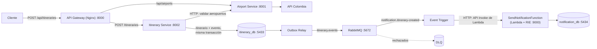

# Sistema de Itinerarios Personales

Sistema distribuido para la planificación y gestión de itinerarios de viaje, desarrollado como proyecto académico para la asignatura **Arquitecturas de Software Emergentes**.

El proyecto busca aplicar tres enfoques arquitectónicos: microservicios, arquitectura basada en eventos y arquitectura serverless.

## Contenido

- [Descripción y objetivos](#descripción-y-objetivos)
- [Arquitectura](#arquitectura)
- [Instalación y ejecución](#instalación-y-ejecución)
- [Pruebas](#pruebas)
- [Documentación adicional](#documentación-adicional)
- [Desarrollo por fases, ramas y etiquetas](#desarrollo-por-fases-ramas-y-etiquetas)
- [Uso de Claude Code](#uso-de-claude-code)
- [Contexto académico](#contexto-académico)

## Descripción y objetivos

### Objetivo general

Diseñar e implementar un sistema distribuido que permita consultar aeropuertos colombianos, gestionar itinerarios de viaje y procesar notificaciones de forma asíncrona, aplicando principios de modularidad, desacoplamiento, resiliencia y observabilidad.

### Objetivos específicos

- Consultar aeropuertos colombianos mediante la API pública API Colombia.
- Desacoplar la integración externa mediante el patrón Adapter.
- Visualizar aeropuertos en un mapa interactivo con Plotly JS.
- Implementar operaciones CRUD para itinerarios.
- Validar aeropuertos mediante comunicación HTTP entre microservicios.
- Publicar eventos de integración mediante RabbitMQ.
- Procesar notificaciones con una función serverless.
- Aplicar arquitectura hexagonal y conceptos básicos de Domain-Driven Design (DDD).
- Incorporar persistencia independiente, migraciones, pruebas y documentación de API.
- Preparar mecanismos de resiliencia, caché y observabilidad.

### Alcance

El sistema estará compuesto por:

1. **Airport Service:** consulta y normalización de información de aeropuertos.
2. **Itinerary Service:** creación, consulta, actualización y eliminación de itinerarios, con su Outbox Relay.
3. **Sistema de notificaciones:** Event Trigger + SendNotificationFunction + su base de datos.
4. **SendNotificationFunction:** función serverless que simula la notificación y guarda el historial.
5. **API Gateway (Nginx):** punto único de entrada en el puerto 8000; enruta, limita solicitudes y propaga headers, sin lógica de negocio.
6. **Frontend:** interfaz de gestión de itinerarios y visualización de aeropuertos.

La implementación se desarrolla progresivamente, siguiendo las fases definidas en la documentación del proyecto.

## Arquitectura

El sistema utiliza microservicios con responsabilidades delimitadas, comunicación HTTP para las operaciones que necesitan una respuesta inmediata y mensajería asíncrona para los eventos de integración.

Cada microservicio de negocio tiene su propia base de datos y es responsable de sus propios datos.

Se aplican arquitectura hexagonal, el patrón Adapter y conceptos de DDD para mantener separadas las reglas de negocio y los detalles de infraestructura.



Todos los diagramas están en [`docs/05-diagramas.md`](docs/05-diagramas.md): componentes, clases, relacional, secuencia, resiliencia y despliegue.

### Tecnologías

| Área | Tecnología |
|---|---|
| Backend | Python 3.12, FastAPI, Pydantic |
| Persistencia | PostgreSQL (una base por servicio) |
| ORM y migraciones | SQLAlchemy y Alembic |
| Comunicación síncrona | HTTP / REST |
| API Gateway | Nginx (imagen oficial `nginx:1.30.6-alpine-otel`, con el módulo de OpenTelemetry; ADR-009 y ADR-036) |
| Mensajería | RabbitMQ (pika) |
| Caché | Redis |
| Serverless | Imagen oficial de AWS Lambda para Python 3.12 con el Runtime Interface Emulator (ADR-008) |
| Frontend | HTML, CSS, JavaScript |
| Visualización | Plotly JS |
| Contenedores | Docker y Docker Compose (`docker-compose.yml` en la raíz, ADR-041) |
| Observabilidad | OpenTelemetry, Jaeger, Prometheus y Grafana |
| Documentación API | Swagger / OpenAPI y AsyncAPI |
| Pruebas | pytest, TestClient de FastAPI y respx |

## Instalación y ejecución

El sistema se levanta con **Docker Compose** (camino recomendado). El arranque manual, componente por componente,
se conserva para desarrollar y está en un documento aparte.

### Con Docker Compose (recomendado)

Desde la Fase 10 todo el sistema (15 contenedores) se levanta con Docker Compose. Requisito: **Docker Desktop**
encendido (en Windows con WSL 2; en Mac con Apple Silicon las imágenes se construyen para `arm64` sin opciones
adicionales). Los comandos son **iguales en PowerShell, CMD y la Terminal de macOS (zsh)** y se ejecutan desde la
raíz del repositorio (o cualquier subcarpeta: Compose busca `docker-compose.yml` hacia arriba).

**Si antes se usó el modo manual**, detener esos contenedores, porque ocupan los mismos puertos:

```
docker stop api-gateway send-notification-function notification-postgres itinerary-rabbitmq itinerary-postgres airport-redis grafana prometheus jaeger
```

**Levantar todo** (la primera vez construye las imágenes, unos minutos; las siguientes, segundos):

```
docker compose up -d --build
docker compose ps
```

Listo cuando las dos migraciones aparecen `Exited (0)` y `airport-service`, `itinerary-service` y `api-gateway`
aparecen `healthy`. Entonces:

| Qué | Dónde |
|---|---|
| Frontend (mapa y CRUD) | http://localhost:8000 |
| Swagger de Airport e Itinerary Service | http://localhost:8001/docs y http://localhost:8002/docs |
| Panel de RabbitMQ (`guest` / `guest`) | http://localhost:15672 |
| Jaeger | http://localhost:16686 |
| Prometheus (destinos) | http://localhost:9090/targets |
| Grafana (`admin` / `admin`) | http://localhost:3000 |

**Comandos del día a día:**

| Acción | Comando |
|---|---|
| Ver el estado | `docker compose ps -a` |
| Ver los logs de un componente (Ctrl+C para salir) | `docker compose logs -f outbox-relay` |
| Detener y encender un componente | `docker compose stop event-trigger` / `docker compose start event-trigger` |
| Reconstruir tras un cambio de código | `docker compose up -d --build airport-service` |
| Consultar una base | `docker compose exec itinerary-postgres psql -U itinerary -d itinerary_db` |
| Reprocesar la DLQ | `docker compose run --rm event-trigger python -m app.replay_dlq --all` |
| Detener todo (conserva los datos) | `docker compose down` |
| Detener todo y **borrar** los datos | `docker compose down -v` |

Variables opcionales (nivel de log, trazas, rate limit del gateway, usuario de Grafana): copiar `.env.example` como
`.env` en la raíz (`Copy-Item` en PowerShell, `copy` en CMD, `cp` en zsh). Sin `.env` se usan los mismos valores
por defecto.

#### Qué hace Compose por nosotros

La tabla [Qué pasa si se omite un paso](docs/07-ejecucion-manual.md#qué-pasa-si-se-omite-un-paso) describe los errores del modo manual. Con
Compose, `depends_on` impone el orden: las migraciones esperan a su PostgreSQL, la API, el relay y la función esperan
a que su migración termine con éxito, y el relay y el trigger esperan a RabbitMQ. Si un componente se detiene después,
el comportamiento es el de esa tabla (por ejemplo, con `docker compose stop event-trigger` los mensajes se acumulan en
la cola). Detalles en ADR-041 y en el diagrama de despliegue de [`docs/05-diagramas.md`](docs/05-diagramas.md).

#### Problemas frecuentes

| Síntoma | Causa | Solución |
|---|---|---|
| `Bind for 0.0.0.0:5433 failed: port is already allocated` | Hay contenedores del modo manual (o un `uvicorn`) en ese puerto | Detenerlos (comando de arriba) o cerrar el `uvicorn` |
| `dependency failed to start: ... itinerary-migrations exited (1)` | La migración falló | `docker compose logs itinerary-migrations` |
| 502 `UPSTREAM_UNAVAILABLE` justo después de `up` | El servicio aún está arrancando | Esperar a que `docker compose ps` lo muestre `healthy` |
| 502 tras reconstruir un servicio (`up --build <servicio>`) | El contenedor nuevo puede tener otra IP y Nginx guardó la anterior (ADR-041) | `docker compose restart api-gateway` |
| Los datos del modo manual no aparecen | Compose usa sus propios volúmenes | Es lo esperado; las bases empiezan vacías |

### Modo manual (desarrollo)

Para desarrollar un componente con recarga automática o depurarlo desde su entorno virtual, el orden de arranque
completo (nueve pasos, con comandos para PowerShell, CMD y zsh) y la tabla de qué pasa si se omite un paso están en
[`docs/07-ejecucion-manual.md`](docs/07-ejecucion-manual.md). No se puede usar a la vez que Docker Compose: ocupan
los mismos puertos.

### Demostraciones

Con el sistema levantado, los recorridos para mostrarlo funcionando (crear un itinerario y seguirlo hasta
`notification_history`, evento duplicado, evento en la DLQ y su reprocesamiento, trazas en Jaeger y métricas en
Grafana) están en [`docs/08-demostraciones.md`](docs/08-demostraciones.md).

## Pruebas

| Nivel | Componente | Pruebas | Necesita |
|---|---|---|---|
| Unitarias, integración y contrato | `services/airport-service` | 203 | Nada (Redis opcional) |
| Unitarias, integración y contrato | `services/itinerary-service` | 195 | PostgreSQL y RabbitMQ para las de integración |
| Unitarias, integración y contrato | `serverless/send-notification-function` | 70 | PostgreSQL para las de integración |
| Unitarias e integración | `serverless/event-trigger` | 86 | RabbitMQ y la función para las de integración |
| Paquete compartido | `libs/observability` | 18 | Nada |
| Configuración de Nginx | `gateway` | 53 | Docker (y el gateway real para 3 *smoke*) |
| Punta a punta | `tests/e2e` | 14 | El sistema con el simulador (abajo) |

Sin los servicios, las pruebas de integración quedan **SKIPPED** (no fallan). Las de integración usan bases propias
(`itinerary_db_test`, `notification_db_test`) y colas con nombres `test-<id>.`: se pueden correr durante una
demostración sin perder datos.

Cada componente se prueba desde su carpeta, con su entorno virtual activado (CLAUDE.md 4.3; en la función el archivo es
`requirements-dev.txt`, igual que en `libs/observability`). El comando es igual en PowerShell, CMD y zsh:

```
pytest -v
```

**Pruebas de punta a punta.** Levantan el sistema completo con el simulador de API Colombia (sin internet):

PowerShell y CMD:

```powershell
docker compose -f docker-compose.yml -f docker-compose.e2e.yml up -d --build --wait
cd tests\e2e
py -3.12 -m venv .venv
.venv\Scripts\activate
pip install -r requirements.txt
pytest -v
```

macOS (zsh):

```bash
docker compose -f docker-compose.yml -f docker-compose.e2e.yml up -d --build --wait
cd tests/e2e
python3.12 -m venv .venv
source .venv/bin/activate
pip install -r requirements.txt
pytest -v
```

(En PowerShell, `.venv\Scripts\Activate.ps1` en lugar de `activate`.) Para volver a usar la API Colombia real:
`docker compose up -d` (sin el segundo archivo) recrea Airport Service con la dirección real.

**Contrato de Airport Service.** Si cambias su API a propósito, regenera `docs/openapi/airport-service.json` desde
`services/airport-service` y revisa el diff: `$env:UPDATE_CONTRACTS = "1"; pytest tests/test_openapi_contract.py`
(PowerShell), `set UPDATE_CONTRACTS=1 && pytest tests/test_openapi_contract.py` (CMD) o
`UPDATE_CONTRACTS=1 pytest tests/test_openapi_contract.py` (zsh).

## Documentación adicional

| Documento | Contenido |
|---|---|
| [`docs/01-planificacion.md`](docs/01-planificacion.md) | Objetivos, alcance, requisitos y fases (planificación de la Fase 0) |
| [`docs/02-arquitectura.md`](docs/02-arquitectura.md) | Arquitectura general, responsabilidades, persistencia, resiliencia, observabilidad y despliegue |
| [`docs/03-dominio.md`](docs/03-dominio.md) | Dominio, contextos delimitados y lenguaje ubicuo |
| [`docs/04-comunicacion-y-eventos.md`](docs/04-comunicacion-y-eventos.md) | Comunicación HTTP, eventos, Outbox y serverless (FaaS, Event Trigger, DLQ) |
| [`docs/05-diagramas.md`](docs/05-diagramas.md) | Diagramas en Mermaid: general, componentes, clases, relacional, secuencia, resiliencia y despliegue |
| [`docs/06-decisiones-arquitectonicas.md`](docs/06-decisiones-arquitectonicas.md) | Registro de decisiones técnicas (ADR-001 a ADR-043) |
| [`docs/07-ejecucion-manual.md`](docs/07-ejecucion-manual.md) | Arranque manual, componente por componente (modo desarrollo) |
| [`docs/08-demostraciones.md`](docs/08-demostraciones.md) | Demostraciones de punta a punta y de observabilidad |
| [`docs/10-historial-de-fases.md`](docs/10-historial-de-fases.md) | Resumen de lo que aportó cada fase |
| [`docs/asyncapi/asyncapi.yaml`](docs/asyncapi/asyncapi.yaml) | Contrato del evento `ItineraryCreatedEvent` y cómo se publica y se consume |
| [`docs/openapi/airport-service.json`](docs/openapi/airport-service.json) | Contrato HTTP publicado de Airport Service |
| [`CONTRIBUTING.md`](CONTRIBUTING.md) | Flujo de trabajo del equipo: issues, ramas, commits, pull requests y revisión |

| Componente | Documentación |
|---|---|
| API Gateway y frontend | [`gateway/README.md`](gateway/README.md) |
| Airport Service | [`services/airport-service/README.md`](services/airport-service/README.md) |
| Itinerary Service y Outbox Relay | [`services/itinerary-service/README.md`](services/itinerary-service/README.md) |
| SendNotificationFunction | [`serverless/send-notification-function/README.md`](serverless/send-notification-function/README.md) |
| Event Trigger y reprocesamiento de la DLQ | [`serverless/event-trigger/README.md`](serverless/event-trigger/README.md) |

## Desarrollo por fases, ramas y etiquetas

El desarrollo sigue un enfoque incremental. Cada fase incluye explicación, estructura de archivos, implementación cuando corresponda, instrucciones de ejecución, pruebas y una lista de verificación.

El flujo de trabajo del equipo (issues, ramas, commits, pull requests y revisión) está en [`CONTRIBUTING.md`](CONTRIBUTING.md).

### Estado de las fases

| Fase | Nombre | Estado |
|---|---|---|
| 0 | Planificación y arquitectura | Completada |
| 1 | Airport Service | Completada |
| 2 | Resiliencia y caché | Completada |
| 3 | Itinerary Service | Completada |
| 4 | Eventos y RabbitMQ | Completada |
| 5 | Transactional Outbox | Completada |
| 6 | Serverless | Completada |
| 7 | API Gateway | Completada |
| 8 | Frontend | Completada |
| 9 | Observabilidad | Completada |
| 10 | Docker y Docker Compose | Completada |
| 11 | Pruebas | Completada |
| 12 | Documentación y entrega | En curso |

**Última fase completada:** Fase 11 — Pruebas. **En curso:** Fase 12 — Documentación y entrega. Lo que aportó cada
fase está resumido en [`docs/10-historial-de-fases.md`](docs/10-historial-de-fases.md).

El equipo trabaja en **Windows 11** (PowerShell y CMD) y en **macOS con Apple Silicon** (zsh). Los README dan los
comandos para las tres terminales; la tabla de equivalencias está en [`CLAUDE.md`](CLAUDE.md), sección 4.2.

### Ramas del repositorio

**La versión integrada y vigente del sistema está siempre en `main`.** Las demás ramas son de consulta.

| Rama | Contenido | Etiqueta |
|---|---|---|
| `main` | Todas las fases fusionadas: versión vigente | — |
| `fase-1-airport-service` | Fase 1 — Airport Service. La rama se borró con la regla anterior; su estado se conserva en la etiqueta | `fase-1` |
| `fase-2-resiliencia` | Fase 2 — Resiliencia y caché. La rama se borró con la regla anterior; su estado se conserva en la etiqueta | `fase-2` |
| `fase-3-itinerary-service` | Fase 3 — Itinerary Service (CRUD, PostgreSQL, Alembic, validación de aeropuertos) | `fase-3` |
| `fase-4-eventos-rabbitmq` | Fase 4 — `ItineraryCreatedEvent`, RabbitMQ y AsyncAPI | `fase-4` |
| `fase-5-transactional-outbox` | Fase 5 — Transactional Outbox, Outbox Relay y mensajes venenosos | `fase-5` |
| `fase-6-serverless` | Fase 6 — SendNotificationFunction (AWS Lambda + RIE), Event Trigger, DLQ y su reprocesamiento | `fase-6` |
| `fase-7-api-gateway` | Fase 7 — API Gateway con Nginx (enrutamiento, rate limiting, correlation ID, propagación de `Authorization`) | `fase-7` |
| `fase-8-frontend` | Fase 8 — Frontend (mapa con Plotly JS, CRUD de itinerarios, estáticos servidos por Nginx) | `fase-8` |
| `fase-9-observabilidad` | Fase 9 — Observabilidad (logs JSON, OpenTelemetry y Jaeger, Prometheus y Grafana, `libs/observability`) | `fase-9` |
| `fase-10-docker-compose` | Fase 10 — Docker y Docker Compose (imágenes de todos los componentes, migraciones automáticas, orden de arranque) | `fase-10` |
| `fase-11-pruebas` | Fase 11 — Pruebas (bases de integración propias, contratos HTTP y de eventos, punta a punta sobre Docker Compose) | `fase-11` |

- Cada rama `fase-N-...` se **conserva después del merge como archivo de solo lectura**: muestra los commits de cada entrega de esa fase. No se trabaja en ellas después de fusionarlas; cualquier corrección sale de una rama nueva desde `main`.
- Las ramas auxiliares (`chore/`, `fix/`, `docs/`) se borran después del merge.
- Cada etiqueta `fase-N` apunta al commit del merge de esa fase en `main`. Para ver el sistema tal como quedó al cerrar una fase: `git switch --detach fase-3`.

## Uso de Claude Code

El equipo usa [Claude Code](https://claude.com/claude-code) como herramienta de desarrollo (asistente de programación). Las reglas que sigue en este repositorio están en [`CLAUDE.md`](CLAUDE.md), y cada cambio que propone lo revisa, confirma y sube un integrante del equipo, que es el autor del commit.

Los commits y las descripciones de pull request **no llevan la línea de coautoría** de Claude (`Co-Authored-By`); está desactivada en `.claude/settings.json`. Los commits de la Fase 3 sí la conservan porque son anteriores a esta regla, y el equipo decidió no volver a reescribir el historial de `main`.

## Contexto académico

| | |
|---|---|
| Universidad | Universidad Central |
| Asignatura | Arquitecturas de Software Emergentes |
| Docente | Otoniel Humberto Castañeda Rodriguez |
| Periodo académico | 2026-2 |
| Integrantes | Juan David Gutierrez Rincón, Santiago Chilito García y Gustavo Rincón Araujo |
