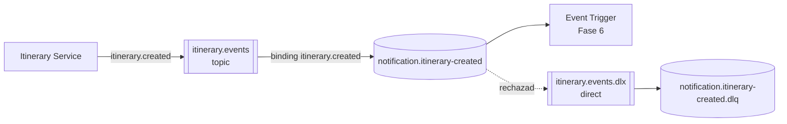
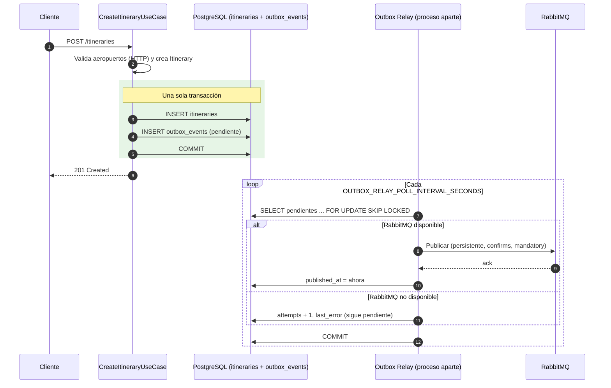
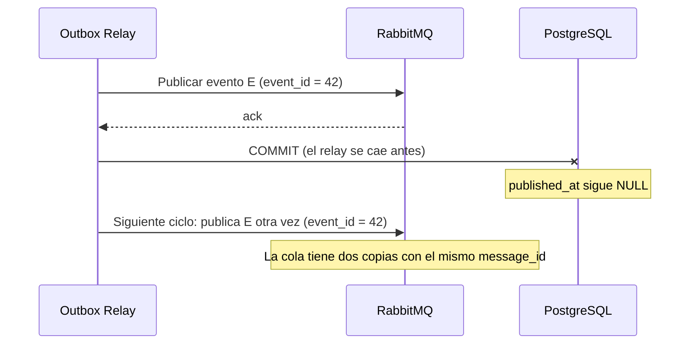
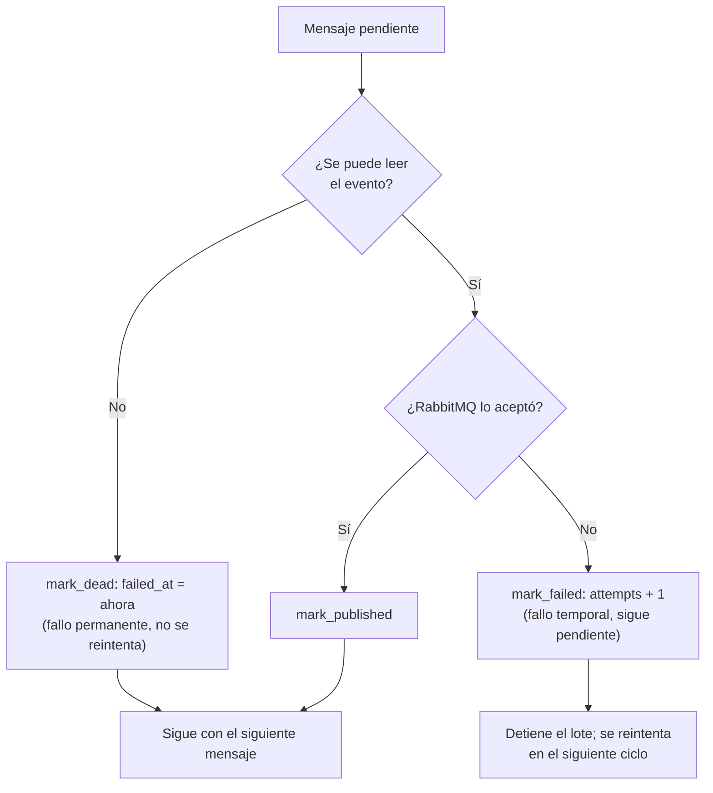

# 04. Comunicación y eventos

## 1. Objetivo

Definir cómo se comunicarán los componentes del Sistema de Itinerarios Personales.

Se utilizarán dos mecanismos principales:

- HTTP/REST para operaciones síncronas.
- RabbitMQ para mensajería asíncrona basada en eventos.

## 2. Comunicación HTTP

### 2.1. Consulta de aeropuertos

El consumidor realizará una solicitud a Airport Service.

Airport Service consultará su puerto de salida, implementado mediante el Adapter correspondiente, para obtener información de API Colombia.

La respuesta se transformará al modelo interno antes de entregarse al consumidor.

### 2.2. Validación de itinerarios

Antes de guardar un itinerario, Itinerary Service consultará Airport Service para verificar los aeropuertos de salida y llegada.

Si alguno no existe, el itinerario no deberá persistirse como válido.

Si Airport Service no está disponible, Itinerary Service deberá gestionar el fallo sin confundirlo con una respuesta que indique que el aeropuerto no existe.

## 3. Comunicación basada en eventos

### 3.1. Evento de integración

El evento inicial será:

`ItineraryCreatedEvent`

Su propósito es comunicar a otros componentes que se ha creado un itinerario.

El consumidor inicial será el sistema de notificaciones.

### 3.2. Contrato del evento (versión 1, ADR-020)

El contrato definitivo está en [`asyncapi/asyncapi.yaml`](asyncapi/asyncapi.yaml). Resumen:

| Campo | Tipo | Significado |
|---|---|---|
| `event_id` | UUID | Identificador único del evento; clave de idempotencia del consumidor |
| `event_type` | texto | Siempre `itinerary.created` |
| `event_version` | entero | Versión del contrato (`1`) |
| `occurred_at` | fecha ISO 8601 en UTC (`Z`) | Momento en que ocurrió el hecho |
| `producer` | texto | Siempre `itinerary-service` |
| `correlation_id` | texto | Header `X-Correlation-ID` de la solicitud HTTP (o un UUID generado) |
| `data.itinerary_id` | UUID | Itinerario creado |
| `data.traveler_name` | texto | Nombre del viajero |
| `data.traveler_email` | texto o `null` | Destinatario de la notificación simulada (Fase 6) |
| `data.departure_airport_id` / `data.arrival_airport_id` | entero | Referencias por ID al catálogo de aeropuertos |
| `data.travel_date` | fecha ISO 8601 con zona horaria | Fecha de salida en la zona del viajero |
| `data.duration_minutes` | entero | Duración estimada |

Formato de serialización: JSON en UTF-8. Las propiedades AMQP repiten los metadatos clave
(`message_id = event_id`, `correlation_id`, `type = itinerary.created`, `app_id = itinerary-service`,
header `event_version`), para que un consumidor pueda leerlos sin abrir el cuerpo.

### 3.3. RabbitMQ (ADR-021)

| Concepto | Qué es | Nombre en el proyecto |
|---|---|---|
| **Exchange** | Recibe los mensajes publicados y los copia a las colas según la routing key | `itinerary.events` (topic, durable) |
| **Routing key** | Etiqueta del mensaje que usa el exchange para enrutarlo | `itinerary.created` |
| **Queue** | Guarda los mensajes hasta que un consumidor los procese | `notification.itinerary-created` (durable) |
| **Dead letter exchange** | Recibe los mensajes que el consumidor rechazó | `itinerary.events.dlx` (direct, durable) |
| **Dead letter queue** | Guarda los mensajes fallidos para revisarlos | `notification.itinerary-created.dlq` (durable) |
| **Consumer** | Recibe y procesa mensajes | Event Trigger + `SendNotificationFunction` (Fase 6) |
| **Acknowledgement** | El consumidor confirma que terminó de procesar | ACK manual, solo al terminar |



Garantías del lado del productor (`RabbitMQEventPublisher`, librería `pika`):

- **Durabilidad:** exchanges y colas durables, y mensajes persistentes (`delivery_mode=2`): sobreviven a un reinicio de RabbitMQ.
- **Publisher confirms:** RabbitMQ confirma cada mensaje; si lo rechaza, la publicación falla.
- **`mandatory=True`:** si el mensaje no llega a ninguna cola, RabbitMQ lo devuelve y la publicación falla en vez de perderse en silencio.
- **Timeout** de 3 segundos (`RABBITMQ_TIMEOUT_SECONDS`) para no quedarse esperando si RabbitMQ no responde.
  Desde la Fase 5 quien publica es el Outbox Relay, no la solicitud HTTP (sección 7).
- Mientras no exista el consumidor, el productor declara toda la topología (las declaraciones son idempotentes).

### 3.4. Tratamiento de errores

- **Del lado del productor (Fase 5):** `POST /itineraries` no habla con RabbitMQ. Guarda el itinerario y el evento
  en la misma transacción (tabla `outbox_events`) y responde **201**. El Outbox Relay publica el evento después: si
  RabbitMQ falla, el evento sigue pendiente y se reintenta, sin perderse (sección 7). En la Fase 4 un fallo de
  RabbitMQ perdía el evento (sección 6).
- **Del lado del consumidor (Fase 6):** confirmará (ACK) solo después de procesar. La entrega es
  **al menos una vez**, así que un mensaje puede repetirse: el consumidor será **idempotente** usando `event_id`.
  Un mensaje que no se pueda procesar se rechazará sin reencolar y RabbitMQ lo moverá a la DLQ.

## 4. Llamada HTTP, evento, evento de dominio y evento de integración

| | Llamada HTTP | Evento | Evento de dominio | Evento de integración |
|---|---|---|---|---|
| Qué es | Una **petición**: "haz esto / dame esto" y espero la respuesta | Un **hecho** que ya ocurrió: "se creó un itinerario" | Un hecho relevante **dentro** de un contexto de negocio | Un hecho que un contexto **anuncia a otros** mediante un contrato público |
| Quién lo conoce | Cliente y servidor | Productor y quien se suscriba | Solo el contexto que lo genera | Varios servicios |
| Acoplamiento | Temporal: el servidor debe estar disponible ya | El productor no espera al consumidor | Interno, puede cambiar libremente | Público: un cambio incompatible exige nueva versión |
| Ejemplo en el proyecto | Itinerary → `GET /airports/{id}` de Airport Service | `itinerary.created` en RabbitMQ | No se modela aún: el agregado no emite eventos internos | `ItineraryCreatedEvent` v1 |
| Dónde vive en el código | `HttpAirportCatalogAdapter` | — | Sería la capa `domain` | `app/application/events.py` |

**Por qué `ItineraryCreatedEvent` es de integración y no de dominio:** es un contrato que otro contexto
(Notificaciones) lee, tiene versión (`event_version`) y solo expone los datos que promete, no el modelo
interno completo. Por eso vive en la capa de **aplicación** y no en el dominio: el dominio no sabe que
existen otros servicios. Un evento de dominio y uno de integración pueden estar relacionados (el segundo
puede construirse a partir del primero), pero no tienen que ser el mismo objeto ni el mismo formato.

**Por qué la validación de aeropuertos es HTTP y la notificación es un evento:** para guardar un itinerario
*necesitamos la respuesta* de Airport Service antes de continuar (síncrono). En cambio, la notificación
puede ocurrir después y su fallo no debe impedir crear el itinerario (asíncrono).

## 5. Diferencias entre HTTP y eventos

| Característica | HTTP/REST | Evento |
|---|---|---|
| Interacción | Solicitud y respuesta | Publicación y consumo |
| Acoplamiento temporal | El consumidor espera una respuesta | El productor no necesita esperar al consumidor final |
| Uso principal | Consultar o validar aeropuertos | Comunicar la creación de itinerarios |
| Fallos | Deben gestionarse en la solicitud | Deben gestionarse durante publicación y consumo |
| Tecnología | FastAPI y HTTP | RabbitMQ |

## 6. Publicación directa (Fase 4) y el problema de double write

> **Histórico.** Esta sección describe la Fase 4 (ADR-022, reemplazada). La Fase 5 resuelve el problema con el
> Transactional Outbox (sección 7). Se conserva porque explica **por qué** existe el Outbox.

En la Fase 4, `CreateItineraryUseCase` seguía este orden (ADR-022):

1. Valida los aeropuertos por HTTP.
2. Guarda el itinerario en PostgreSQL y hace **commit**.
3. Construye `ItineraryCreatedEvent` y lo **publica** en RabbitMQ.

Se publica *después* del commit porque publicar antes podría anunciar un itinerario que luego no se guarda
(por ejemplo, si el commit falla). Pero así aparece el problema de **double write** ("doble escritura"):
son **dos escrituras en dos sistemas distintos** (PostgreSQL y RabbitMQ) sin una transacción común.

| Situación | Resultado |
|---|---|
| Commit ✅ y publicación ✅ | Correcto |
| Commit ❌ | No se publica nada (correcto) |
| Commit ✅ y publicación ❌ (RabbitMQ caído) | **El itinerario existe pero nadie se entera: el evento se perdió** |
| Commit ✅ y el proceso se detiene antes de publicar | **Igual: evento perdido** |

En la Fase 4 se demostraba deteniendo RabbitMQ y creando un itinerario: la API respondía 201 y el log
mostraba `Evento perdido`. Desde la Fase 5 el mismo experimento termina con el evento publicado
(ver el README de Itinerary Service).

## 7. Transactional Outbox (Fase 5)

El **Transactional Outbox** ("bandeja de salida transaccional") convierte las dos escrituras del double write
en **una sola**. El evento no se envía a RabbitMQ durante la solicitud: se guarda como una fila de la tabla
`outbox_events`, en la **misma base de datos y la misma transacción** que el itinerario. Una transacción se
confirma completa o no se confirma nada, así que **el itinerario y su evento se guardan juntos o no se guarda
ninguno**. Después, un proceso aparte, el **Outbox Relay**, publica en RabbitMQ los eventos pendientes.

Decisiones: ADR-006 (patrón), ADR-024 (tabla), ADR-025 (relay), ADR-026 (registro en la misma transacción)
y ADR-027 (mensajes venenosos).

### 7.1. Flujo



El caso de uso sigue el orden **guardar → registrar el evento → commit** (ADR-026). El evento se registra
**antes** del commit porque solo así queda dentro de la misma transacción. El caso de uso sigue sin conocer
RabbitMQ ni la tabla: llama al puerto `EventPublisher`, que en la API implementa `OutboxEventPublisher`.

Cómo quedan las situaciones de la sección 6:

| Situación | Fase 4 | Fase 5 |
|---|---|---|
| Commit ✅ y RabbitMQ disponible | Evento publicado | Evento publicado por el relay (unos segundos después) |
| Commit ❌ | No se publica nada | No se guarda ni el itinerario ni el evento |
| Commit ✅ y RabbitMQ caído | **Evento perdido** | El evento **espera** en `outbox_events` y se publica cuando RabbitMQ vuelve |
| Commit ✅ y el proceso se detiene | **Evento perdido** | El evento ya está guardado; el relay lo publica |

La tabla `outbox_events`:

| Columna | Significado |
|---|---|
| `id` | Igual al `event_id`: una fila por evento |
| `aggregate_type`, `aggregate_id` | Qué originó el evento (`itinerary` y su id) |
| `event_type`, `event_version` | `itinerary.created`, versión `1` |
| `payload` (JSONB) | El evento completo con la forma del contrato (sección 3.2) |
| `occurred_at` | Cuándo ocurrió; el relay publica del más antiguo al más nuevo |
| `published_at` | `NULL` mientras está pendiente |
| `attempts`, `last_error` | Intentos fallidos y último error |
| `failed_at` | Fallo permanente de un mensaje venenoso (sección 7.4) |

Un evento está **pendiente** si `published_at IS NULL AND failed_at IS NULL`. El índice parcial
`ix_outbox_events_pending` contiene solo esas filas, así que buscar pendientes sigue siendo rápido aunque la
tabla crezca con los eventos ya publicados, que se conservan (la limpieza queda como mejora futura).

### 7.2. Outbox Relay

Es un proceso aparte de la API, con su propio comando (desde `services/itinerary-service`, con el entorno
virtual activado; igual en PowerShell y CMD):

```powershell
python -m app.outbox_relay
```

| Variable | Por defecto | Significado |
|---|---|---|
| `OUTBOX_RELAY_POLL_INTERVAL_SECONDS` | `2.0` | Pausa entre ciclos |
| `OUTBOX_RELAY_BATCH_SIZE` | `10` | Máximo de eventos por ciclo |

En cada ciclo, dentro de **una** transacción:

1. Toma hasta `OUTBOX_RELAY_BATCH_SIZE` pendientes con `SELECT ... FOR UPDATE SKIP LOCKED`.
   `FOR UPDATE` bloquea esas filas hasta el commit; `SKIP LOCKED` hace que otro relay las **salte** en vez de
   esperarlas. Así se pueden correr dos relays a la vez y nunca toman el mismo evento.
2. Por cada evento: lo reconstruye desde `payload` (`ItineraryCreatedEvent.from_dict`), lo publica con el mismo
   `RabbitMQEventPublisher` de la Fase 4 y lo marca con `published_at`.
3. Hace **un solo commit** por lote. Un commit por evento liberaría los bloqueos del resto del lote antes de
   publicarlos.

Si RabbitMQ falla, el evento suma un intento, sigue pendiente y se detiene el lote: con RabbitMQ caído,
intentar los demás solo alargaría el ciclo. Si un ciclo falla por completo (por ejemplo, PostgreSQL caído), el
relay registra el error y sigue con el siguiente ciclo, sin terminar el proceso. Si un ciclo procesa un lote
completo, el siguiente empieza sin esperar, para vaciar rápido los pendientes acumulados.

### 7.3. Entrega "al menos una vez": duplicados e idempotencia

El relay **primero publica y después marca** `published_at`. Si el relay se detiene (o PostgreSQL falla)
**entre** la publicación y el commit, la marca se pierde, la transacción se deshace y el evento **se publica
otra vez** en el siguiente ciclo. Como el commit es por lote, puede repetirse hasta un lote completo.



El orden contrario (marcar y después publicar) evitaría los duplicados, pero podría marcar como publicado un
evento que nunca salió: es decir, perderlo, que es justo lo que el Outbox evita. Por eso se elige **al menos
una vez**: ningún evento se pierde, pero alguno puede llegar repetido.

Consecuencia para el consumidor (Fase 6): debe ser **idempotente**. Idempotente significa que procesar el mismo
mensaje dos veces deja el mismo resultado que procesarlo una. La clave es el `event_id`, que viaja en el cuerpo
y como `message_id` de AMQP: si `SendNotificationFunction` ya registró una notificación con ese `event_id`, ignora
la copia y confirma el mensaje (ACK). La prueba `test_si_el_relay_cae_antes_del_commit_el_evento_se_publica_dos_veces`
demuestra el duplicado con PostgreSQL y RabbitMQ reales.

### 7.4. Mensajes venenosos: fallo temporal vs. fallo permanente (ADR-027)

Un **mensaje venenoso** (*poison message*) es un mensaje que **siempre** falla al procesarse, por mucho
que se reintente. Si se trata igual que un fallo pasajero, se reintenta para siempre: llena el log y,
como el relay toma primero los más antiguos, unos cuantos mensajes así pueden ocupar todo el lote
(`OUTBOX_RELAY_BATCH_SIZE`) y dejar sin publicar a los eventos válidos que vienen detrás.

Por eso el Outbox Relay separa dos tipos de fallo:

| Tipo | Ejemplo | ¿Se arregla reintentando? | Qué hace el relay |
|---|---|---|---|
| **Temporal** | RabbitMQ caído (`EventPublishError`) | Sí, cuando vuelva RabbitMQ | Suma `attempts` y guarda `last_error`. El evento **sigue pendiente**, se detiene el lote y se reintenta en el siguiente ciclo, **sin máximo de intentos** |
| **Permanente** | `payload` ilegible o `event_type` desconocido | No | Suma `attempts`, guarda `last_error` y marca **`failed_at`**. El mensaje **deja de estar pendiente**, no se vuelve a leer y el lote **continúa** con los demás |

- **Pendiente** significa `published_at IS NULL AND failed_at IS NULL`. Esa es la condición de la consulta
  del relay y del índice parcial `ix_outbox_events_pending`.
- **No hay máximo de intentos para los fallos temporales.** Un máximo descartaría eventos válidos si RabbitMQ
  estuviera caído mucho tiempo, que es justo lo que el Outbox debe evitar.
- La fila descartada **no se borra**: queda en `outbox_events` con su error para revisarla. Después de
  corregirla, se vuelve a dejar pendiente poniendo `failed_at` en `NULL`.



**Relación con la DLQ de RabbitMQ.** Es la misma idea que la *dead letter queue* de la sección 3.3,
pero en el otro extremo del flujo:

| | `failed_at` en la outbox | DLQ `notification.itinerary-created.dlq` |
|---|---|---|
| Dónde actúa | En el **productor**, antes de publicar | En el **consumidor** (Fase 6), después de publicar |
| Qué aparta | Mensajes que el relay no puede convertir en evento | Mensajes que el consumidor rechaza sin reencolar |
| Para qué | Que no bloqueen la publicación de los demás | Que no bloqueen el consumo de los demás |

Un mensaje descartado con `failed_at` nunca llega a RabbitMQ, así que tampoco llega a la DLQ.

## 8. Integración serverless

El evento publicado en RabbitMQ deberá llegar al componente responsable de ejecutar SendNotificationFunction.

El mecanismo de integración dependerá de la plataforma serverless elegida.

No se asumirá que RabbitMQ puede activar directamente cualquier función sin un adaptador, consumidor o integración compatible.

## 9. AsyncAPI

La especificación está en [`asyncapi/asyncapi.yaml`](asyncapi/asyncapi.yaml) (AsyncAPI 3.0) y documenta:

- Canales de comunicación.
- Mensajes.
- Contratos de eventos.
- Productores y consumidores.
- Protocolos y mecanismos de transporte.

La especificación corresponde al contrato implementado: la prueba
`services/itinerary-service/tests/application/test_asyncapi_contract.py` falla si el evento del código y el de
AsyncAPI dejan de coincidir. Para verla de forma gráfica, pegar el archivo en https://studio.asyncapi.com.

## 10. Evolución del contrato

Los cambios incompatibles en un evento deberán gestionarse mediante una estrategia explícita de versionado y compatibilidad.
