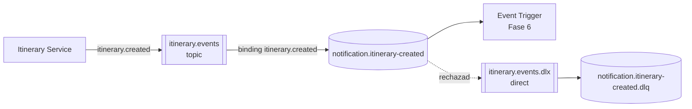

# 04. Comunicación y eventos

## 1. Objetivo

Definir cómo se comunicarán los componentes del Sistema de Itinerarios Personales.

Se utilizarán dos mecanismos principales:

- HTTP/REST para operaciones síncronas.
- RabbitMQ para mensajería asíncrona basada en eventos.

## 2. Comunicación HTTP

### 2.1. Consulta de aeropuertos

El consumidor realizará una solicitud a Airport Service.

Airport Service consultará su puerto de salida, implementado mediante el Adapter correspondiente, para obtener información de API Colombia.

La respuesta se transformará al modelo interno antes de entregarse al consumidor.

### 2.2. Validación de itinerarios

Antes de guardar un itinerario, Itinerary Service consultará Airport Service para verificar los aeropuertos de salida y llegada.

Si alguno no existe, el itinerario no deberá persistirse como válido.

Si Airport Service no está disponible, Itinerary Service deberá gestionar el fallo sin confundirlo con una respuesta que indique que el aeropuerto no existe.

## 3. Comunicación basada en eventos

### 3.1. Evento de integración

El evento inicial será:

`ItineraryCreatedEvent`

Su propósito es comunicar a otros componentes que se ha creado un itinerario.

El consumidor inicial será el sistema de notificaciones.

### 3.2. Contrato del evento (versión 1, ADR-020)

El contrato definitivo está en [`asyncapi/asyncapi.yaml`](asyncapi/asyncapi.yaml). Resumen:

| Campo | Tipo | Significado |
|---|---|---|
| `event_id` | UUID | Identificador único del evento; clave de idempotencia del consumidor |
| `event_type` | texto | Siempre `itinerary.created` |
| `event_version` | entero | Versión del contrato (`1`) |
| `occurred_at` | fecha ISO 8601 en UTC (`Z`) | Momento en que ocurrió el hecho |
| `producer` | texto | Siempre `itinerary-service` |
| `correlation_id` | texto | Header `X-Correlation-ID` de la solicitud HTTP (o un UUID generado) |
| `data.itinerary_id` | UUID | Itinerario creado |
| `data.traveler_name` | texto | Nombre del viajero |
| `data.traveler_email` | texto o `null` | Destinatario de la notificación simulada (Fase 6) |
| `data.departure_airport_id` / `data.arrival_airport_id` | entero | Referencias por ID al catálogo de aeropuertos |
| `data.travel_date` | fecha ISO 8601 con zona horaria | Fecha de salida en la zona del viajero |
| `data.duration_minutes` | entero | Duración estimada |

Formato de serialización: JSON en UTF-8. Las propiedades AMQP repiten los metadatos clave
(`message_id = event_id`, `correlation_id`, `type = itinerary.created`, `app_id = itinerary-service`,
header `event_version`), para que un consumidor pueda leerlos sin abrir el cuerpo.

### 3.3. RabbitMQ (ADR-021)

| Concepto | Qué es | Nombre en el proyecto |
|---|---|---|
| **Exchange** | Recibe los mensajes publicados y los copia a las colas según la routing key | `itinerary.events` (topic, durable) |
| **Routing key** | Etiqueta del mensaje que usa el exchange para enrutarlo | `itinerary.created` |
| **Queue** | Guarda los mensajes hasta que un consumidor los procese | `notification.itinerary-created` (durable) |
| **Dead letter exchange** | Recibe los mensajes que el consumidor rechazó | `itinerary.events.dlx` (direct, durable) |
| **Dead letter queue** | Guarda los mensajes fallidos para revisarlos | `notification.itinerary-created.dlq` (durable) |
| **Consumer** | Recibe y procesa mensajes | Event Trigger + `SendNotificationFunction` (Fase 6) |
| **Acknowledgement** | El consumidor confirma que terminó de procesar | ACK manual, solo al terminar |

Garantías del lado del productor (`RabbitMQEventPublisher`, librería `pika`):

- **Durabilidad:** exchanges y colas durables, y mensajes persistentes (`delivery_mode=2`): sobreviven a un reinicio de RabbitMQ.
- **Publisher confirms:** RabbitMQ confirma cada mensaje; si lo rechaza, la publicación falla.
- **`mandatory=True`:** si el mensaje no llega a ninguna cola, RabbitMQ lo devuelve y la publicación falla en vez de perderse en silencio.
- **Timeout** de 3 segundos (`RABBITMQ_TIMEOUT_SECONDS`) para no bloquear la solicitud HTTP si RabbitMQ no responde.
- Mientras no exista el consumidor, el productor declara toda la topología (las declaraciones son idempotentes).

### 3.4. Tratamiento de errores

- **Del lado del productor (Fase 4):** si RabbitMQ falla después del commit, `POST /itineraries` responde **201**
  (el itinerario sí existe) y se registra un `ERROR` "Evento perdido" con el id del itinerario y el `event_id`
  (ADR-022). Ver la sección 6.
- **Del lado del consumidor (Fase 6):** confirmará (ACK) solo después de procesar. La entrega es
  **al menos una vez**, así que un mensaje puede repetirse: el consumidor será **idempotente** usando `event_id`.
  Un mensaje que no se pueda procesar se rechazará sin reencolar y RabbitMQ lo moverá a la DLQ.

## 4. Llamada HTTP, evento, evento de dominio y evento de integración

| | Llamada HTTP | Evento | Evento de dominio | Evento de integración |
|---|---|---|---|---|
| Qué es | Una **petición**: "haz esto / dame esto" y espero la respuesta | Un **hecho** que ya ocurrió: "se creó un itinerario" | Un hecho relevante **dentro** de un contexto de negocio | Un hecho que un contexto **anuncia a otros** mediante un contrato público |
| Quién lo conoce | Cliente y servidor | Productor y quien se suscriba | Solo el contexto que lo genera | Varios servicios |
| Acoplamiento | Temporal: el servidor debe estar disponible ya | El productor no espera al consumidor | Interno, puede cambiar libremente | Público: un cambio incompatible exige nueva versión |
| Ejemplo en el proyecto | Itinerary → `GET /airports/{id}` de Airport Service | `itinerary.created` en RabbitMQ | No se modela aún: el agregado no emite eventos internos | `ItineraryCreatedEvent` v1 |
| Dónde vive en el código | `HttpAirportCatalogAdapter` | — | Sería la capa `domain` | `app/application/events.py` |

**Por qué `ItineraryCreatedEvent` es de integración y no de dominio:** es un contrato que otro contexto
(Notificaciones) lee, tiene versión (`event_version`) y solo expone los datos que promete, no el modelo
interno completo. Por eso vive en la capa de **aplicación** y no en el dominio: el dominio no sabe que
existen otros servicios. Un evento de dominio y uno de integración pueden estar relacionados (el segundo
puede construirse a partir del primero), pero no tienen que ser el mismo objeto ni el mismo formato.

**Por qué la validación de aeropuertos es HTTP y la notificación es un evento:** para guardar un itinerario
*necesitamos la respuesta* de Airport Service antes de continuar (síncrono). En cambio, la notificación
puede ocurrir después y su fallo no debe impedir crear el itinerario (asíncrono).

## 5. Diferencias entre HTTP y eventos

| Característica | HTTP/REST | Evento |
|---|---|---|
| Interacción | Solicitud y respuesta | Publicación y consumo |
| Acoplamiento temporal | El consumidor espera una respuesta | El productor no necesita esperar al consumidor final |
| Uso principal | Consultar o validar aeropuertos | Comunicar la creación de itinerarios |
| Fallos | Deben gestionarse en la solicitud | Deben gestionarse durante publicación y consumo |
| Tecnología | FastAPI y HTTP | RabbitMQ |

## 6. Publicación directa (Fase 4) y el problema de double write

En la Fase 4, `CreateItineraryUseCase` sigue este orden (ADR-022):

1. Valida los aeropuertos por HTTP.
2. Guarda el itinerario en PostgreSQL y hace **commit**.
3. Construye `ItineraryCreatedEvent` y lo **publica** en RabbitMQ.

Se publica *después* del commit porque publicar antes podría anunciar un itinerario que luego no se guarda
(por ejemplo, si el commit falla). Pero así aparece el problema de **double write** ("doble escritura"):
son **dos escrituras en dos sistemas distintos** (PostgreSQL y RabbitMQ) sin una transacción común.

| Situación | Resultado |
|---|---|
| Commit ✅ y publicación ✅ | Correcto |
| Commit ❌ | No se publica nada (correcto) |
| Commit ✅ y publicación ❌ (RabbitMQ caído) | **El itinerario existe pero nadie se entera: el evento se perdió** |
| Commit ✅ y el proceso se detiene antes de publicar | **Igual: evento perdido** |

Se puede demostrar deteniendo RabbitMQ y creando un itinerario (ver el README de Itinerary Service):
la API responde 201 y el log muestra `Evento perdido`.

## 7. Transactional Outbox (Fase 5)

Itinerary Service deberá incorporar posteriormente el patrón Transactional Outbox para reducir el riesgo de que se guarde un itinerario sin que quede registrado el evento que debe publicarse.

La idea consiste en guardar, dentro de una misma transacción de base de datos, el itinerario y un registro del evento pendiente.

Un proceso independiente publicará posteriormente los eventos pendientes en RabbitMQ.

La publicación y el consumo requerirán manejo de duplicados y recuperación ante fallos.

## 8. Integración serverless

El evento publicado en RabbitMQ deberá llegar al componente responsable de ejecutar SendNotificationFunction.

El mecanismo de integración dependerá de la plataforma serverless elegida.

No se asumirá que RabbitMQ puede activar directamente cualquier función sin un adaptador, consumidor o integración compatible.

## 9. AsyncAPI

La especificación está en [`asyncapi/asyncapi.yaml`](asyncapi/asyncapi.yaml) (AsyncAPI 3.0) y documenta:

- Canales de comunicación.
- Mensajes.
- Contratos de eventos.
- Productores y consumidores.
- Protocolos y mecanismos de transporte.

La especificación corresponde al contrato implementado: la prueba
`services/itinerary-service/tests/application/test_asyncapi_contract.py` falla si el evento del código y el de
AsyncAPI dejan de coincidir. Para verla de forma gráfica, pegar el archivo en https://studio.asyncapi.com.

## 10. Evolución del contrato

Los cambios incompatibles en un evento deberán gestionarse mediante una estrategia explícita de versionado y compatibilidad.
