# 05. Diagramas arquitectónicos

Todos los diagramas están en Mermaid (GitHub los dibuja directamente) y describen el sistema **tal como está
implementado**: los diagramas de clases salen del código de `app/` de cada componente y el relacional, de las
migraciones de Alembic.

| Sección | Diagrama | Qué responde |
|---|---|---|
| [1](#1-arquitectura-general) | Arquitectura general | ¿Qué piezas hay y cómo se conectan? |
| [2](#2-diagrama-de-componentes) | Componentes | ¿Qué capas y puertos tiene cada componente? |
| [3](#3-diagramas-de-clases) | Clases | ¿Qué clases implementan el dominio, los puertos y los adaptadores? |
| [4](#4-diagrama-relacional) | Relacional | ¿Qué tablas hay y en qué base vive cada una? |
| [5](#5-secuencia-de-creación-de-un-itinerario) | Secuencia | ¿Qué pasa, en orden, al crear un itinerario? (y 5.1 fallos del consumidor, 5.2 gateway) |
| [6](#6-flujo-de-resiliencia-de-airport-service) | Resiliencia | ¿Qué hace Airport Service cuando API Colombia falla? |
| [7](#7-despliegue-con-docker-compose-fase-10) | Despliegue | ¿Qué contenedores, redes y puertos hay? (y 7.1 observabilidad) |

## 1. Arquitectura general

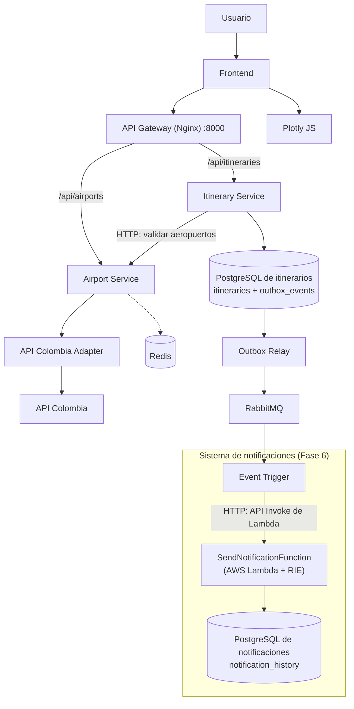

El diagrama representa la arquitectura implementada. Los componentes se incorporaron por fases: el gateway llegó en la Fase 7 (Nginx, ADR-009) y el frontend en la Fase 8 (ADR-033), servido por el propio gateway. La llamada Itinerary → Airport es interna y no pasa por el gateway.

El sistema de notificaciones está formado por el Event Trigger, la función y su base de datos `notification_db` (ADR-029). No hay un microservicio de notificaciones adicional.

## 2. Diagrama de componentes

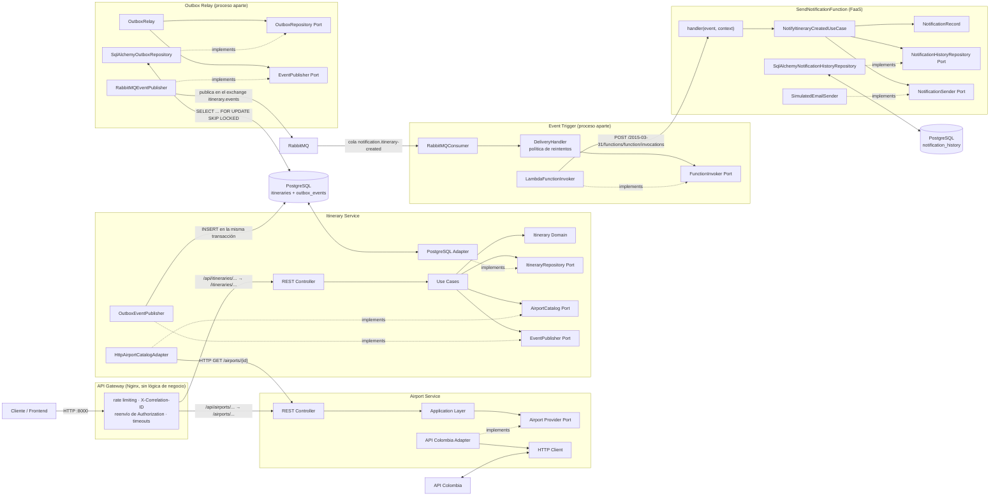

Las flechas punteadas representan una relación de implementación conceptual de los puertos, no una llamada en tiempo de ejecución.

El API Gateway (Fase 7) solo enruta hacia los controladores REST de cada servicio; no conoce sus capas internas ni tiene lógica de negocio (ADR-009). Itinerary Service no accede a las capas internas de Airport Service: el adaptador `HttpAirportCatalogAdapter` llama a su API REST. Los casos de uso tampoco hablan directamente con RabbitMQ: usan el puerto `EventPublisher`, implementado en la Fase 4 por un publicador de RabbitMQ y en la Fase 5 por un adaptador Outbox, que registra el evento antes del commit, en la misma transacción del itinerario (ADR-013, ADR-026).

El mismo puerto `EventPublisher` tiene dos adaptadores, uno en cada proceso: en la API, `OutboxEventPublisher` guarda el evento en `outbox_events`; en el Outbox Relay, `RabbitMQEventPublisher` (el de la Fase 4, sin cambios) lo publica en RabbitMQ. El relay lee y marca los pendientes con su propio puerto, `OutboxRepository` (ADR-025).

En el sistema de notificaciones (Fase 6), el Event Trigger separa la **política** (`DeliveryHandler`, capa de aplicación) de los adaptadores: el consumidor de RabbitMQ y el cliente HTTP de la función (ADR-031). La función sigue la arquitectura hexagonal por dentro: el handler de Lambda es el adaptador de entrada, como una ruta FastAPI (ADR-028).

## 3. Diagramas de clases

Un diagrama por componente con lógica de negocio. Se muestran las clases del dominio, los puertos, los casos de uso y
los adaptadores; se omiten las rutas FastAPI, los esquemas Pydantic de la API y las excepciones.

Cómo leerlos:

| En el diagrama | Significado |
|---|---|
| `«Puerto»` sobre el nombre | Clase abstracta (`ABC`) de la capa `application`: el contrato que usa el caso de uso |
| Línea punteada con punta de triángulo vacío | La clase **implementa** el puerto |
| Flecha continua | La clase **usa** a la otra (la recibe en su constructor) |
| Flecha punteada con punta abierta | La clase **crea o lee** objetos del otro tipo |
| Rombo relleno | Composición: una clase es parte de la otra (`Coordinates` dentro de `Airport`) |
| Rombo vacío con la etiqueta `inner` | El Decorator envuelve a otro objeto del mismo puerto |
| Método subrayado | Método de clase (`@classmethod`), por ejemplo `Itinerary.create(...)` |

Los diagramas se leen de izquierda a derecha: a la izquierda están quienes **usan** o **implementan** (casos de
uso y adaptadores) y a la derecha, aquello de lo que dependen (puertos y dominio). Esa es la **regla de
dependencias** de la arquitectura hexagonal: los casos de uso solo apuntan a puertos y al dominio, los adaptadores de
`infrastructure` apuntan hacia los puertos que implementan y ninguna flecha sale del dominio hacia afuera.

### 3.1. Airport Service: patrón Adapter y Decorators

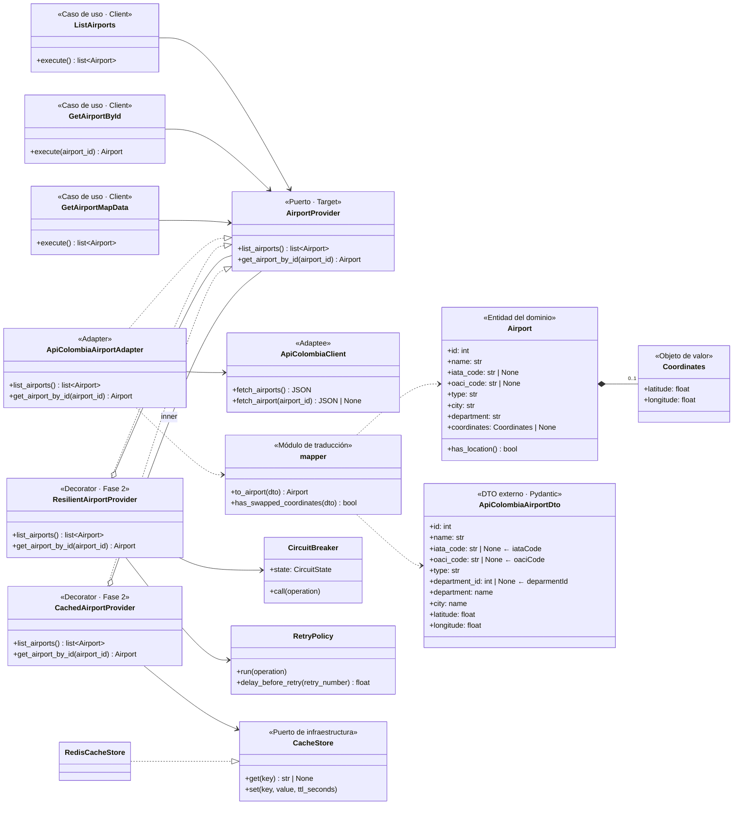

| Rol del patrón Adapter | Clase | Capa |
|---|---|---|
| Target (la interfaz que esperan los casos de uso) | `AirportProvider` | `application/ports.py` |
| Client (quien usa el Target) | `ListAirports`, `GetAirportById`, `GetAirportMapData` | `application/use_cases.py` |
| Adapter (traduce la interfaz externa a la interna) | `ApiColombiaAirportAdapter` + funciones de `mapper.py` | `infrastructure/api_colombia/` |
| Adaptee (la interfaz externa incompatible) | `ApiColombiaClient` y el JSON de API Colombia (`ApiColombiaAirportDto`) | `infrastructure/api_colombia/` |

`main.py` (`build_airport_provider`) arma la cadena `CachedAirportProvider(ResilientAirportProvider(ApiColombiaAirportAdapter(ApiColombiaClient)))`.
Los tres implementan el mismo puerto, así que los casos de uso no saben si hay caché ni resiliencia (patrón
Decorator, ADR-007 y ADR-014). `ApiColombiaAirportDto` es el único lugar donde aparece el nombre externo con error
ortográfico (`deparmentId`); `mapper.py` corrige las coordenadas intercambiadas, convierte `"N/A"` en `None` y
deja `coordinates = None` cuando llegan `0, 0` (capa anticorrupción).

### 3.2. Itinerary Service: API

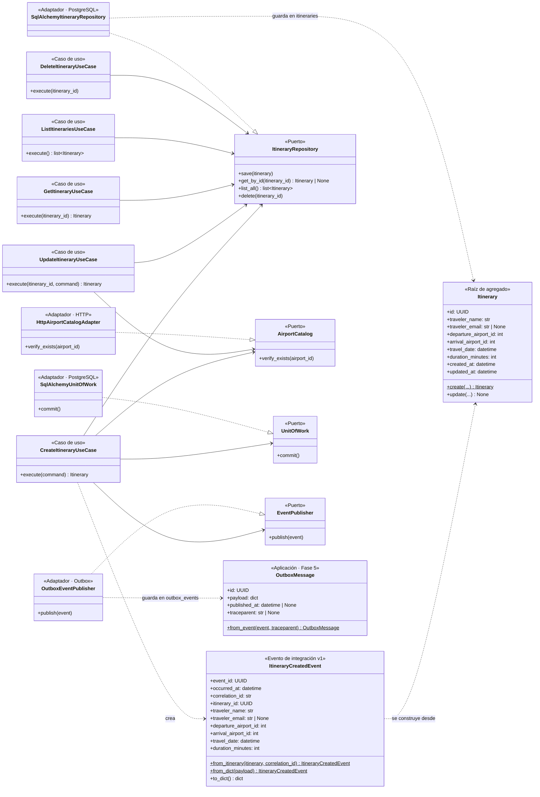

`CreateItineraryUseCase` es el caso de uso central: valida los dos aeropuertos con `AirportCatalog`
(`HttpAirportCatalogAdapter` llama a `GET /airports/{id}` de Airport Service), crea el `Itinerary` con
`Itinerary.create(...)` (reglas del dominio), lo guarda, registra el `ItineraryCreatedEvent` con `EventPublisher` y
**después** hace `commit` con `UnitOfWork`. Como `OutboxEventPublisher` usa la misma sesión de SQLAlchemy que el
repositorio, el itinerario y el evento se confirman en la misma transacción (Transactional Outbox, ADR-026).

El evento vive en `application/events.py` y no en el dominio: es un contrato público con otros servicios, no una
regla del negocio (ADR-020). `OutboxMessage` es la fila de `outbox_events` vista desde la aplicación.

### 3.3. Itinerary Service: Outbox Relay

El relay es otro proceso (`python -m app.outbox_relay`) con el mismo código del servicio. Reutiliza los puertos
`EventPublisher` y `UnitOfWork` con otros adaptadores.

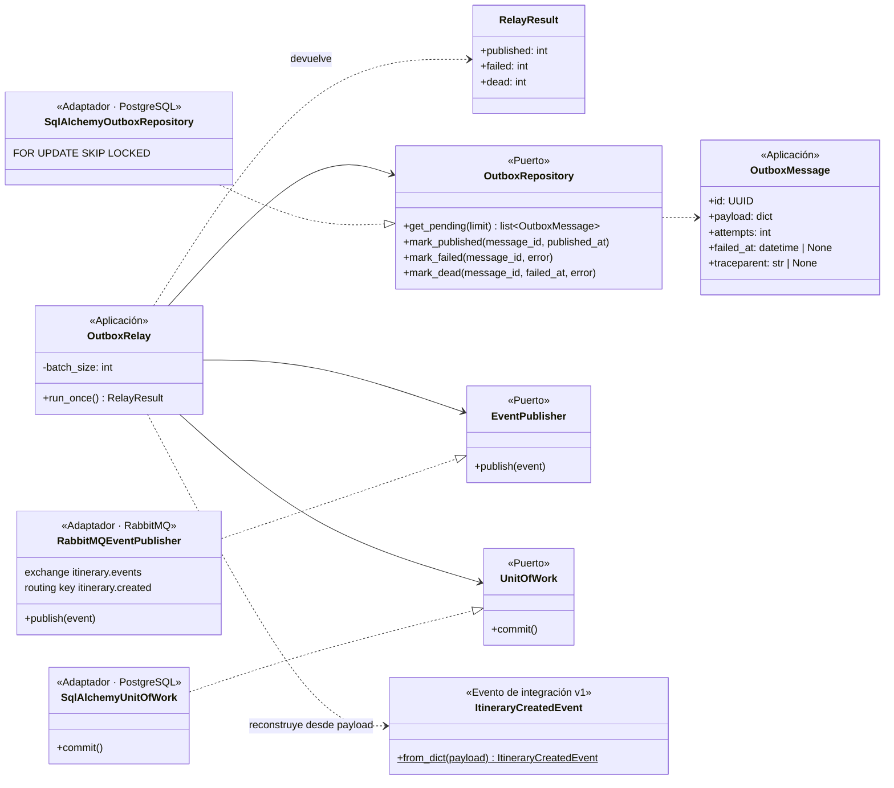

En cada ciclo, `run_once` lee hasta `batch_size` pendientes, reconstruye cada evento con
`ItineraryCreatedEvent.from_dict`, lo publica y lo marca (`mark_published`); si RabbitMQ falla, `mark_failed` y se
detiene el lote; si el mensaje es ilegible, `mark_dead` y sigue con el siguiente (ADR-025, ADR-027). Al final hace
un solo `commit`.

### 3.4. SendNotificationFunction

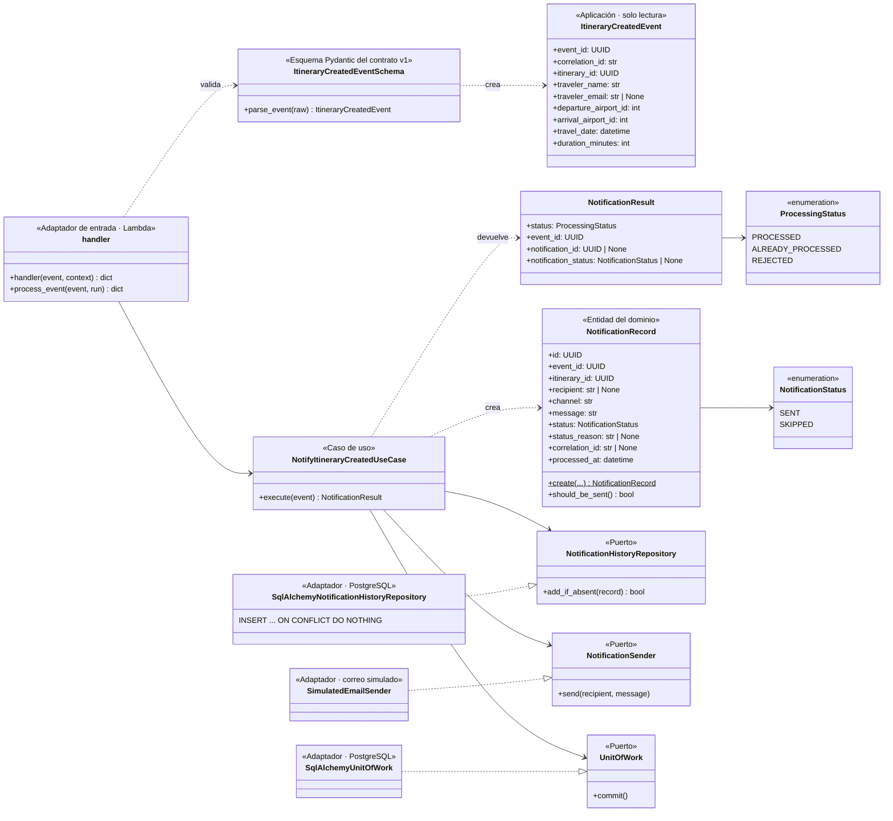

`handler` y `parse_event` son funciones (no clases), pero cumplen el papel de adaptador de entrada: igual que una
ruta FastAPI, reciben la entrada de la plataforma, la convierten al modelo de la aplicación y llaman al caso de uso
(ADR-028). Un evento que no cumple el contrato produce `InvalidEventError` y la respuesta `REJECTED`; un fallo de
PostgreSQL produce `TransientError`.

El caso de uso es **idempotente**: `add_if_absent` inserta con `ON CONFLICT (event_id) DO NOTHING` y devuelve
`False` si el evento ya estaba; en ese caso responde `ALREADY_PROCESSED` sin volver a enviar (ADR-030). La función
tiene su **propia** clase `ItineraryCreatedEvent`: no importa código de Itinerary Service, solo comparten el contrato
publicado en AsyncAPI.

## 4. Diagrama relacional

El sistema tiene **dos bases de datos PostgreSQL independientes**, cada una propiedad de un solo componente
(ADR-004, ADR-016, ADR-029). Airport Service no tiene base relacional: su fuente de verdad es API Colombia y solo
usa Redis como caché. Las tablas salen de las migraciones de Alembic (`services/itinerary-service/alembic/versions/`
y `serverless/send-notification-function/alembic/versions/`); cada base tiene además la tabla `alembic_version`,
que Alembic usa para saber qué migración está aplicada.

### 4.1. `itinerary_db` (Itinerary Service, contenedor `itinerary-postgres`, puerto 5433)

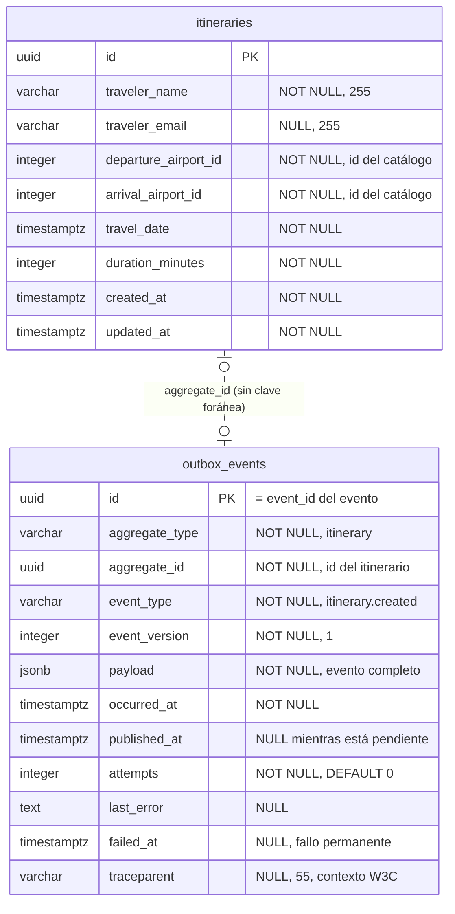

| Migración | Qué hace |
|---|---|
| `a3f1e2b4c5d0` (Fase 3) | Crea `itineraries` |
| `b7c2d9e1f4a6` (Fase 5) | Crea `outbox_events` y el índice parcial `ix_outbox_events_pending` |
| `c4d8e2f6a9b1` (Fase 5) | Agrega `failed_at` y redefine el índice parcial (ADR-027) |
| `e6f0a4b8c1d9` (Fase 9) | Agrega `traceparent` (ADR-037) |

- **Índice parcial `ix_outbox_events_pending`** sobre `occurred_at`, solo con las filas
  `published_at IS NULL AND failed_at IS NULL`: contiene únicamente los eventos pendientes, que son los que busca el
  relay en orden de llegada. Los eventos publicados se conservan, pero no ocupan el índice.
- **Sin clave foránea entre `outbox_events` y `itineraries`.** Cada itinerario creado tiene un evento
  (`aggregate_id` = `itineraries.id`), pero la relación es lógica: al borrar un itinerario su evento se conserva,
  porque el evento describe algo que ya ocurrió y puede estar pendiente de publicar.
- **Los aeropuertos se referencian por id** (`departure_airport_id`, `arrival_airport_id`): el catálogo vive en otro
  contexto (Airport Service), así que no hay tabla de aeropuertos ni clave foránea (CLAUDE.md, sección 8.1).

### 4.2. `notification_db` (SendNotificationFunction, contenedor `notification-postgres`, puerto 5434)

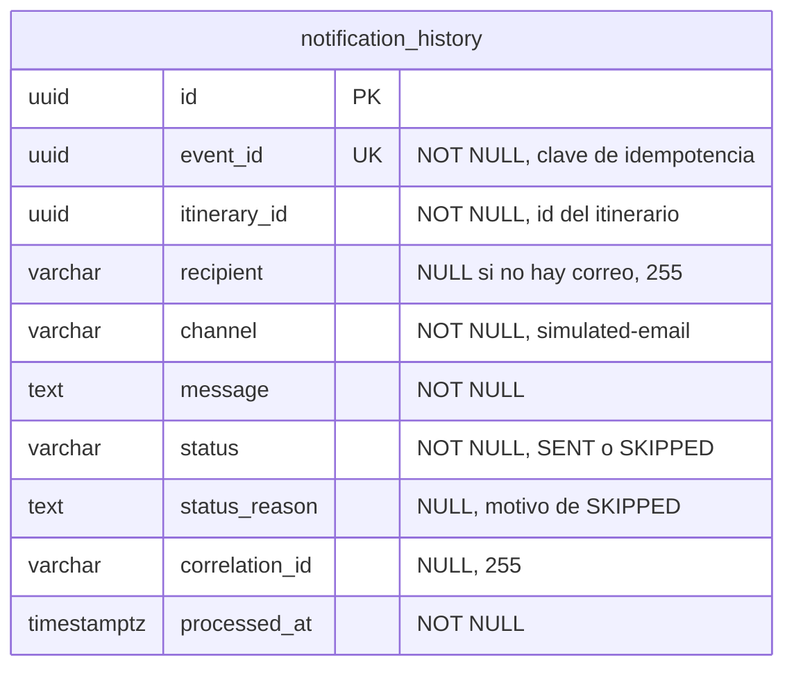

| Migración | Qué hace |
|---|---|
| `d1e5f7a3b9c2` (Fase 6) | Crea `notification_history` con sus dos restricciones |

- **`uq_notification_history_event_id`** (único sobre `event_id`): es lo que hace idempotente a la función. Si el
  mismo evento llega dos veces, el segundo `INSERT ... ON CONFLICT (event_id) DO NOTHING` no inserta nada (ADR-030).
- **`ck_notification_history_status`**: `status IN ('SENT', 'SKIPPED')`.
- **`itinerary_id` está en otra base** (`itinerary_db`): no puede haber clave foránea entre bases. La función solo
  conoce lo que trae el evento.

### 4.3. Referencias entre bases

| Columna | Apunta a | Cómo se mantiene |
|---|---|---|
| `itineraries.departure_airport_id` / `arrival_airport_id` | Aeropuerto de API Colombia (Airport Service) | Itinerary Service lo valida por HTTP antes de guardar |
| `outbox_events.aggregate_id` | `itineraries.id` (misma base) | Se escribe en la misma transacción que el itinerario |
| `notification_history.itinerary_id` | `itineraries.id` (otra base) | Llega en el evento `ItineraryCreatedEvent` |
| `notification_history.event_id` | `outbox_events.id` (otra base) | Es el mismo `event_id` del evento |
| `notification_history.correlation_id` | El `X-Correlation-ID` de la solicitud original | Viaja en el evento |

Ningún servicio lee ni escribe la base de otro (CLAUDE.md, sección 7.2): la única forma de que un dato pase de una
base a la otra es el evento.

## 5. Secuencia de creación de un itinerario

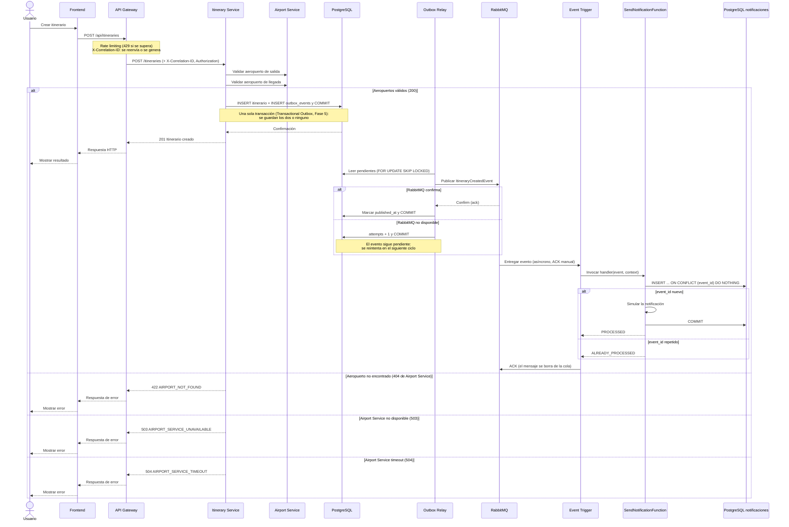

**Nota:** desde la Fase 5 la solicitud HTTP no publica en RabbitMQ: guarda el itinerario y su evento en la misma transacción y responde 201. El Outbox Relay, un proceso aparte, publica el evento después y lo reintenta si RabbitMQ no está disponible (ADR-025, ADR-026). La entrega es "al menos una vez": puede haber duplicados, y la función es idempotente con `event_id` (ADR-030). En la Fase 4 la publicación era directa, tras el commit (ADR-022), y un fallo de RabbitMQ perdía el evento. El detalle está en `docs/04-comunicacion-y-eventos.md` (secciones 6 a 8), la topología de RabbitMQ en la sección 3.3 de ese mismo documento y el contrato en `docs/asyncapi/asyncapi.yaml`. Los fallos del lado del consumidor (función o base de datos caídas, evento inválido, reprocesamiento de la DLQ) están en la sección 5.1.

### 5.1. Fallos en el consumidor: reintentos, DLQ y reprocesamiento (Fase 6)

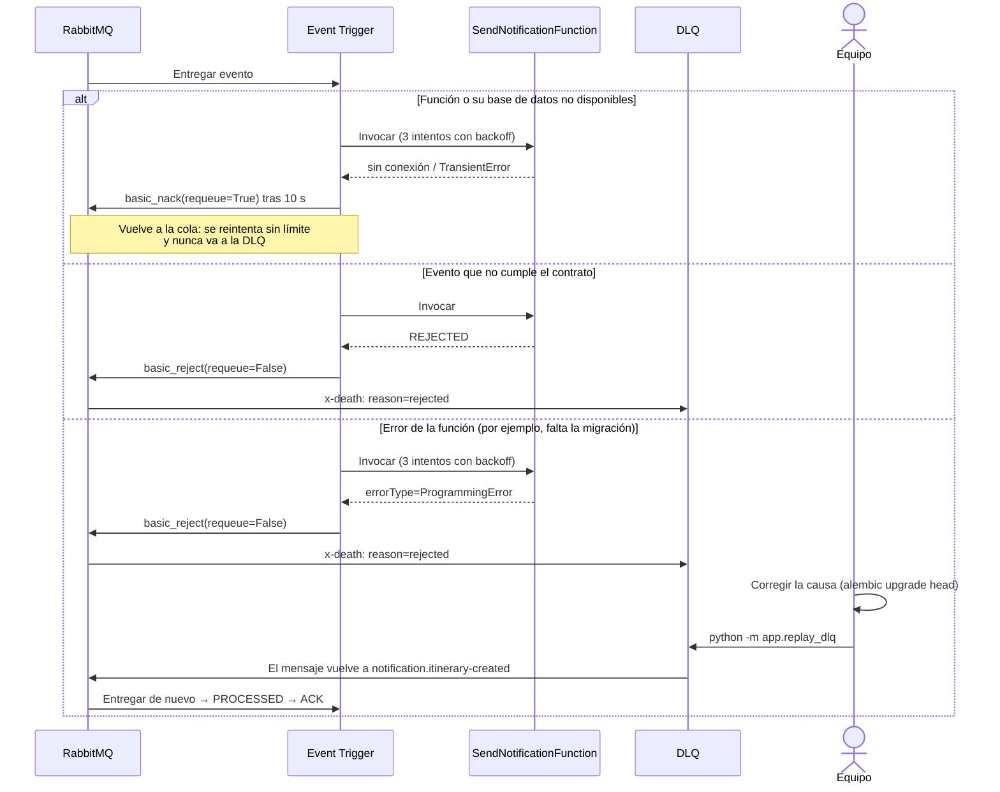

### 5.2. Recorrido de una solicitud por el API Gateway (Fase 7)

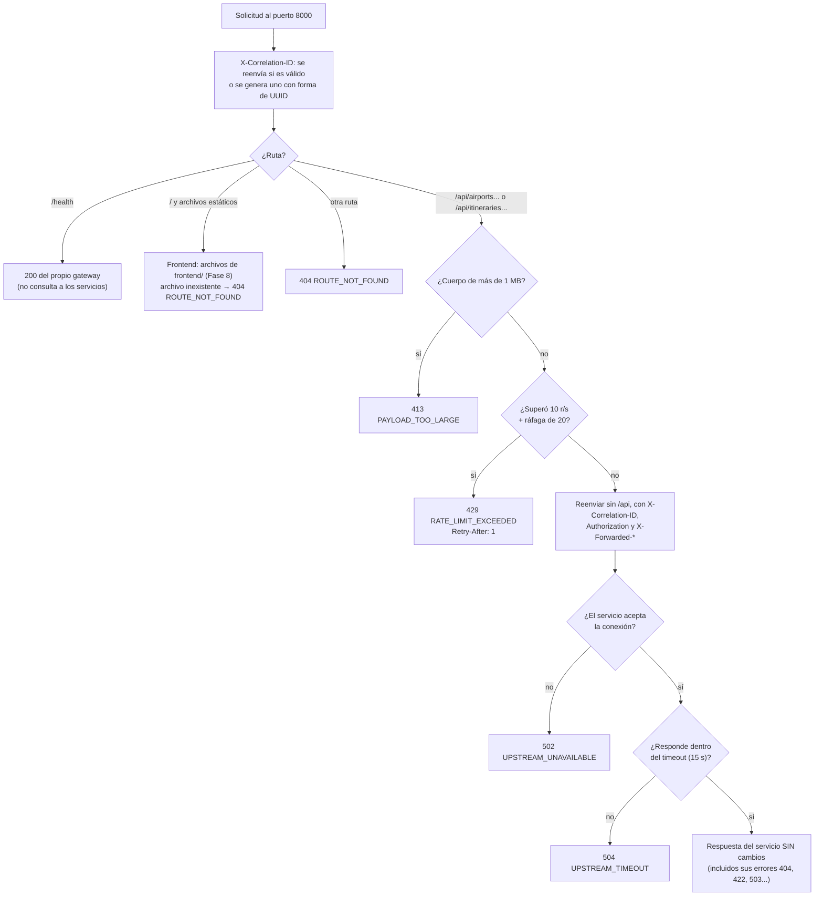

Los errores del gateway (404, 413, 429, 502 y 504) usan el formato único de errores y llevan el mismo `correlation_id` en el cuerpo y en el header. El gateway no reintenta: los reintentos están en los servicios (Fase 2) y reintentar un `POST` podría duplicar un itinerario (ADR-009).

## 6. Flujo de resiliencia de Airport Service

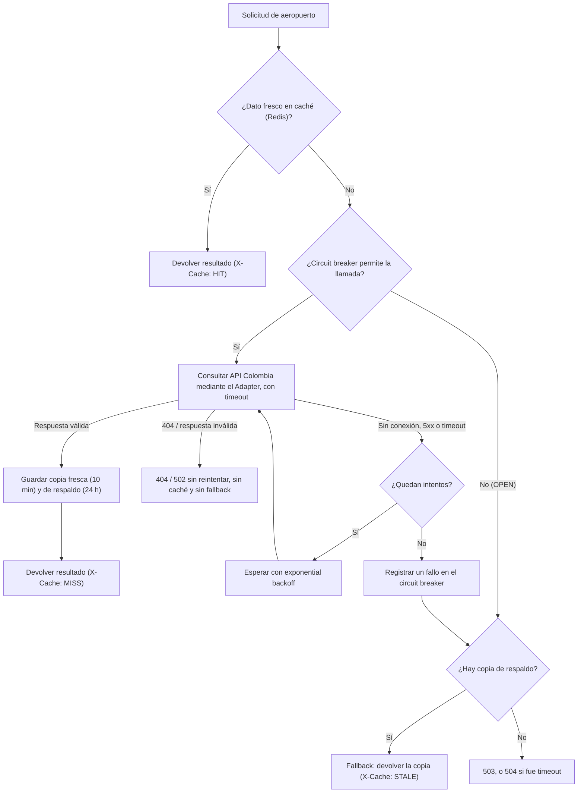

Orden aceptado en la Fase 2 (ADR-014): caché → circuit breaker → retry con backoff → llamada con timeout → fallback. El circuit breaker envuelve al retry, así que una consulta cuenta como un solo fallo cuando se agotaron sus reintentos. Un 404 no se reintenta, no se guarda en caché, no abre el circuito ni activa el fallback.

## 7. Despliegue con Docker Compose (Fase 10)

Cada caja es un servicio de `docker-compose.yml`; el puerto es el publicado en el equipo. Las bases de datos
solo están en su red (`itinerary-data`, `notification-data`); todo lo demás comparte la red `default` (ADR-041).

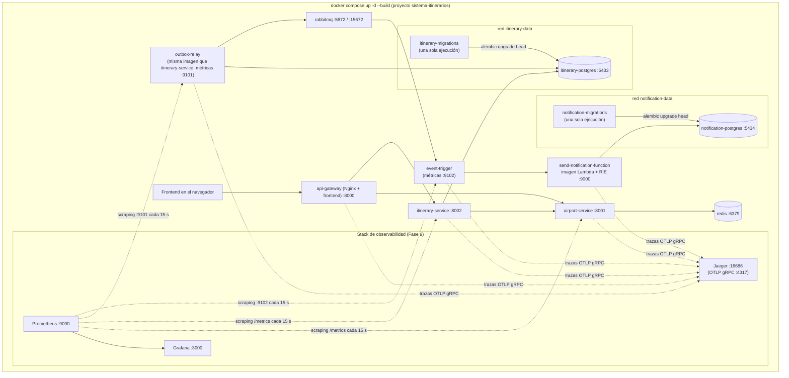

Orden de arranque que impone `depends_on` (las flechas se leen "espera a"):

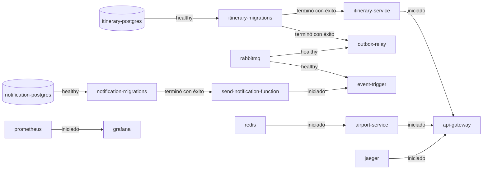

Hasta la Fase 9 cada contenedor se creaba con `docker run` y los procesos de Python se ejecutaban desde su entorno virtual, con el gateway llegando a ellos por `host.docker.internal`. Ese modo manual sigue documentado en [`07-ejecucion-manual.md`](07-ejecucion-manual.md) para desarrollar un componente con recarga automática.

### 7.1. Flujo de datos de observabilidad (Fase 9)

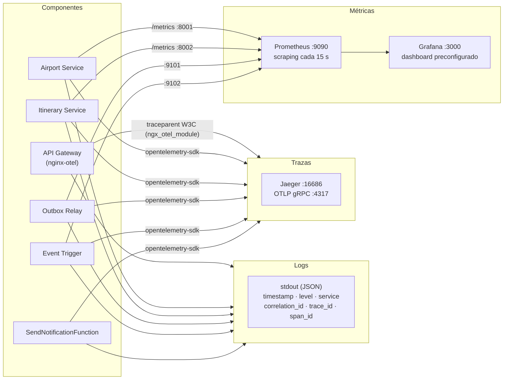

El `correlation_id` viaja en el header `X-Correlation-ID` desde el gateway hasta los logs del Outbox Relay y del Event Trigger, y queda guardado en `notification_history`. El `traceparent` W3C une los spans en una sola traza en Jaeger: el gateway lo inyecta, el Itinerary Service lo guarda en `outbox_events` (ADR-037) y el relay lo restaura al publicar en RabbitMQ.

## 8. Consideraciones

- Los diagramas representan el sistema implementado al cierre del proyecto (Fase 12): los de clases salen del código de `app/` y el relacional, de las migraciones de Alembic. Si el código cambia, el diagrama afectado se actualiza en el mismo pull request.
- Los nombres de endpoints, colas y contratos coinciden con la implementación; los contratos los verifican las pruebas de contrato (`docs/openapi/airport-service.json` y `docs/asyncapi/asyncapi.yaml`, ADR-042).
- Cada base de datos pertenece a un solo componente (ADR-004, ADR-029); en Docker Compose, cada una está además en su propia red (ADR-041).
- El dominio no depende de la infraestructura: ninguna flecha de los diagramas de clases sale del dominio (regla de dependencias, ADR-002).
- El `README.md` raíz incluye copias de los diagramas de secuencia, relacional y despliegue: si uno cambia, se actualiza en los dos lugares.
