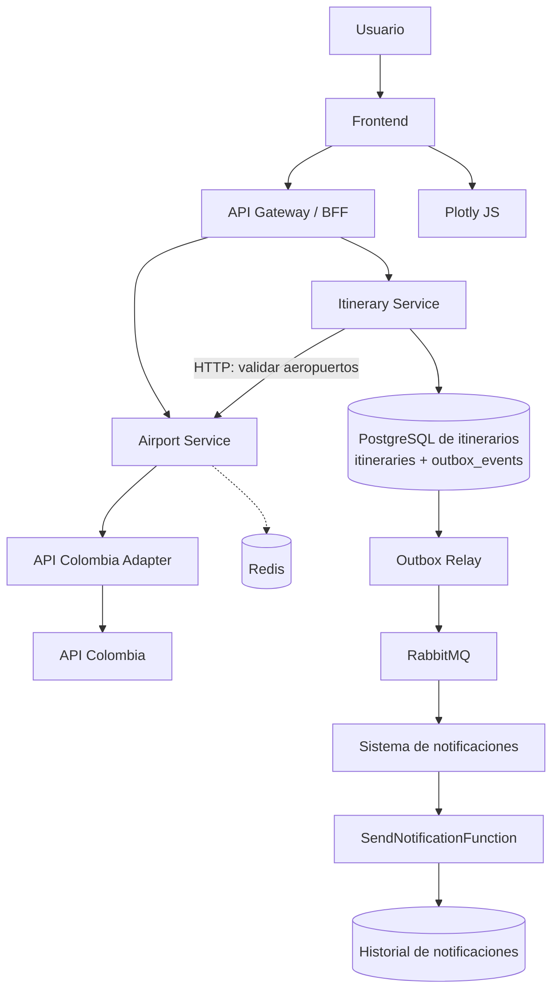
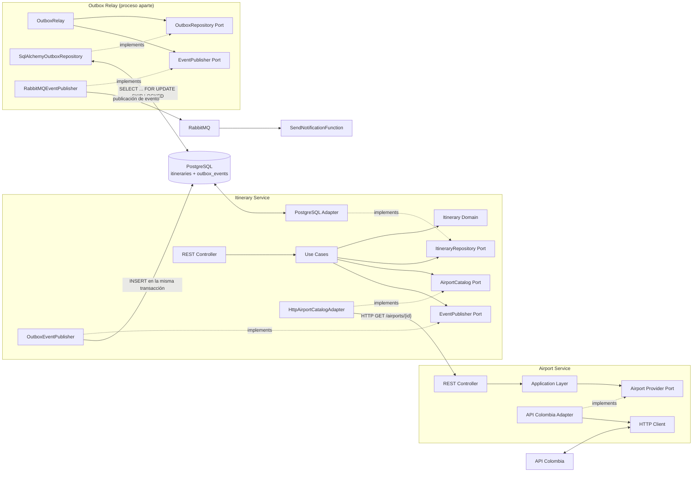
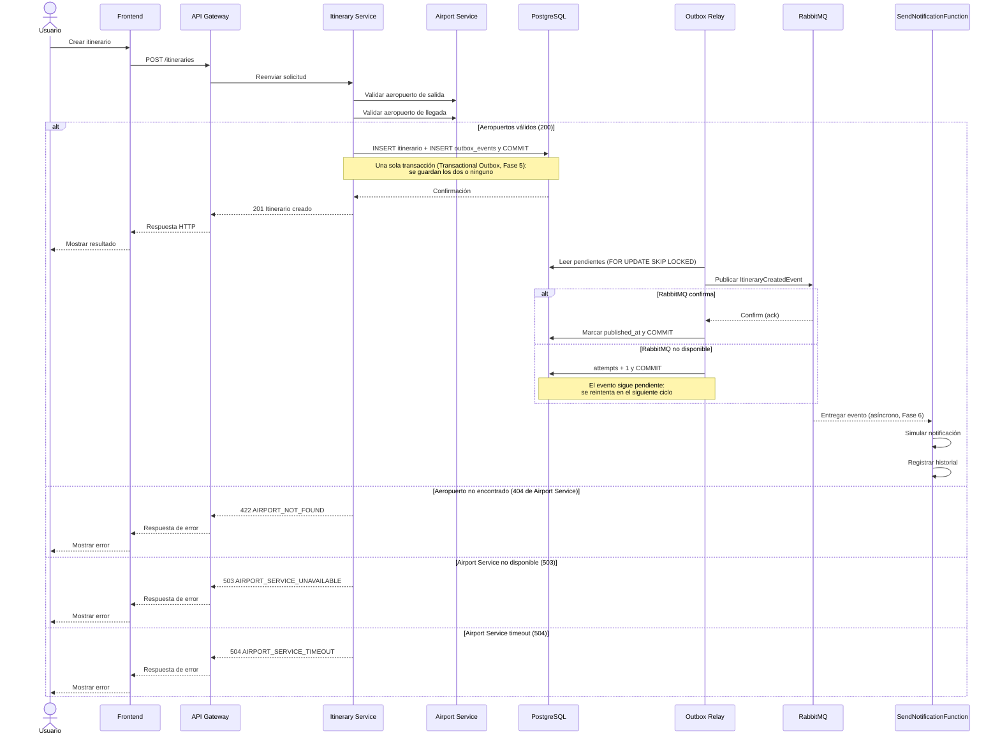
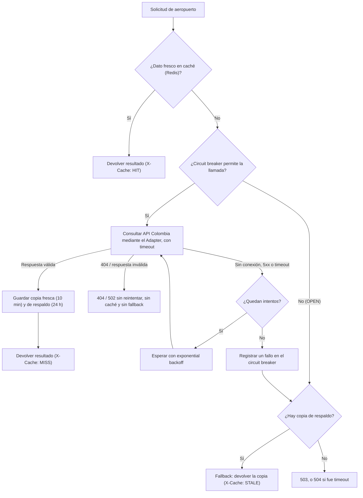
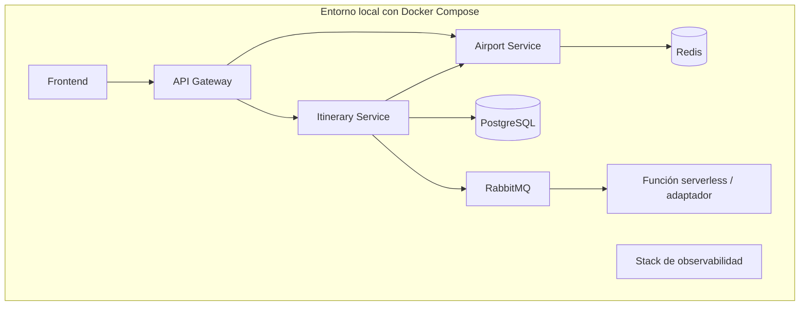

# 05. Diagramas arquitectónicos

## 1. Arquitectura general

El diagrama representa la arquitectura objetivo. Los componentes se incorporarán progresivamente, no todos desde la Fase 0.

La persistencia del historial de notificaciones se representa de forma conceptual; la tecnología definitiva queda pendiente de selección.

## 2. Diagrama de componentes

Las flechas punteadas representan una relación de implementación conceptual de los puertos, no una llamada en tiempo de ejecución.

Itinerary Service no accede a las capas internas de Airport Service: el adaptador `HttpAirportCatalogAdapter` llama a su API REST. Los casos de uso tampoco hablan directamente con RabbitMQ: usan el puerto `EventPublisher`, implementado en la Fase 4 por un publicador de RabbitMQ y en la Fase 5 por un adaptador Outbox, que registra el evento antes del commit, en la misma transacción del itinerario (ADR-013, ADR-026).

El mismo puerto `EventPublisher` tiene dos adaptadores, uno en cada proceso: en la API, `OutboxEventPublisher` guarda el evento en `outbox_events`; en el Outbox Relay, `RabbitMQEventPublisher` (el de la Fase 4, sin cambios) lo publica en RabbitMQ. El relay lee y marca los pendientes con su propio puerto, `OutboxRepository` (ADR-025).

## 3. Secuencia de creación de un itinerario

**Nota:** desde la Fase 5 la solicitud HTTP no publica en RabbitMQ: guarda el itinerario y su evento en la misma transacción y responde 201. El Outbox Relay, un proceso aparte, publica el evento después y lo reintenta si RabbitMQ no está disponible (ADR-025, ADR-026). La entrega es "al menos una vez": puede haber duplicados y el consumidor debe ser idempotente con `event_id`. En la Fase 4 la publicación era directa, tras el commit (ADR-022), y un fallo de RabbitMQ perdía el evento. El detalle está en `docs/04-comunicacion-y-eventos.md` (secciones 6 y 7), la topología de RabbitMQ en la sección 3.3 y el contrato en `docs/asyncapi/asyncapi.yaml`.

## 4. Flujo de resiliencia de Airport Service

Orden aceptado en la Fase 2 (ADR-014): caché → circuit breaker → retry con backoff → llamada con timeout → fallback. El circuit breaker envuelve al retry, así que una consulta cuenta como un solo fallo cuando se agotaron sus reintentos. Un 404 no se reintenta, no se guarda en caché, no abre el circuito ni activa el fallback.

## 5. Despliegue previsto

El despliegue completo se definirá y validará en la Fase 10. La integración de observabilidad se desarrollará en la Fase 9.

## 6. Consideraciones

- Los diagramas representan el diseño previsto.
- Los nombres de endpoints, colas y contratos deberán coincidir con la implementación final.
- La propiedad de las bases de datos se mantendrá por servicio.
- Los detalles de infraestructura no deberán introducir dependencias directas en el dominio.
