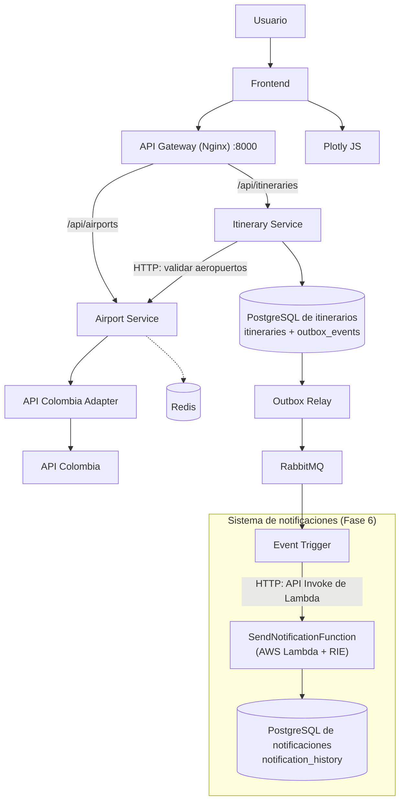
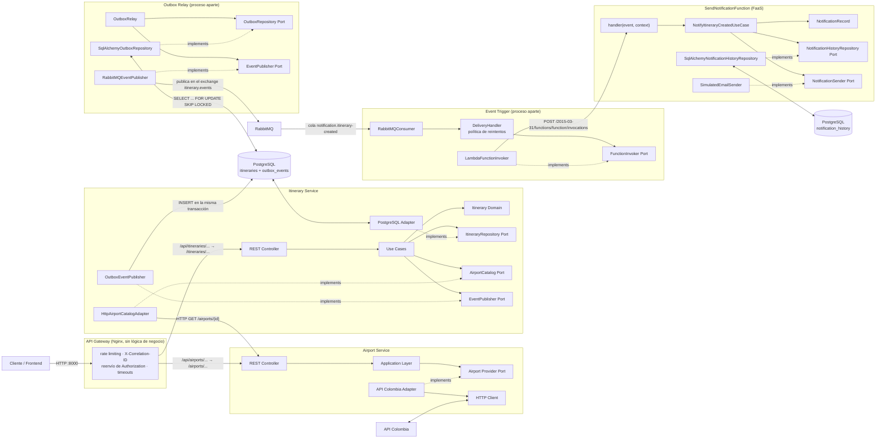
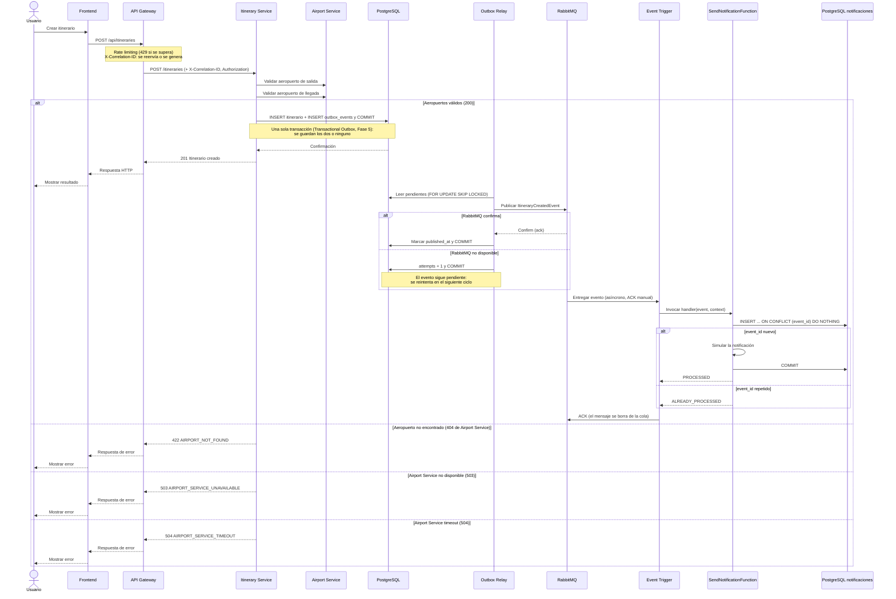
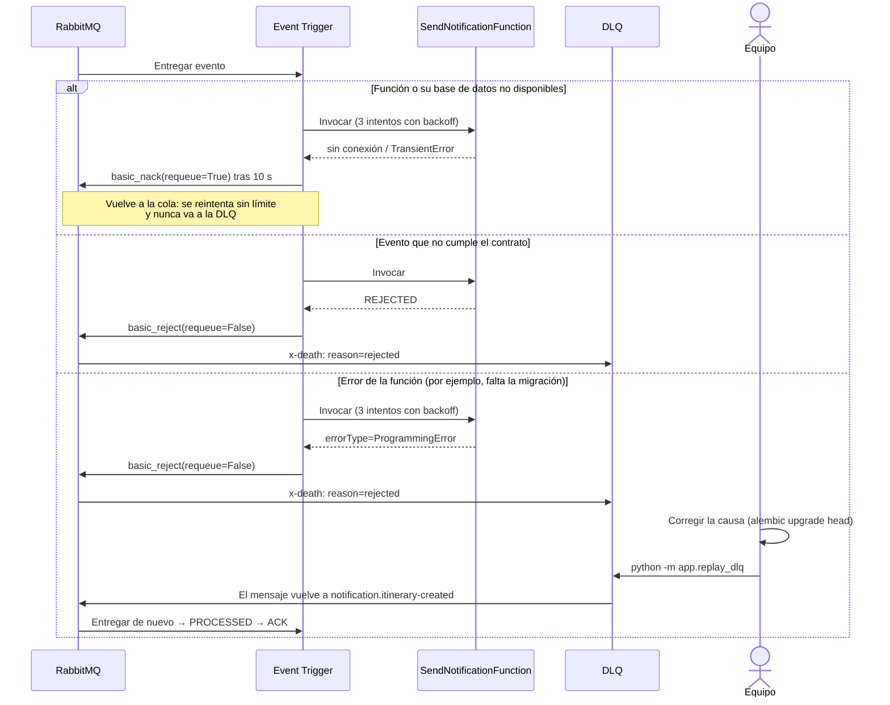
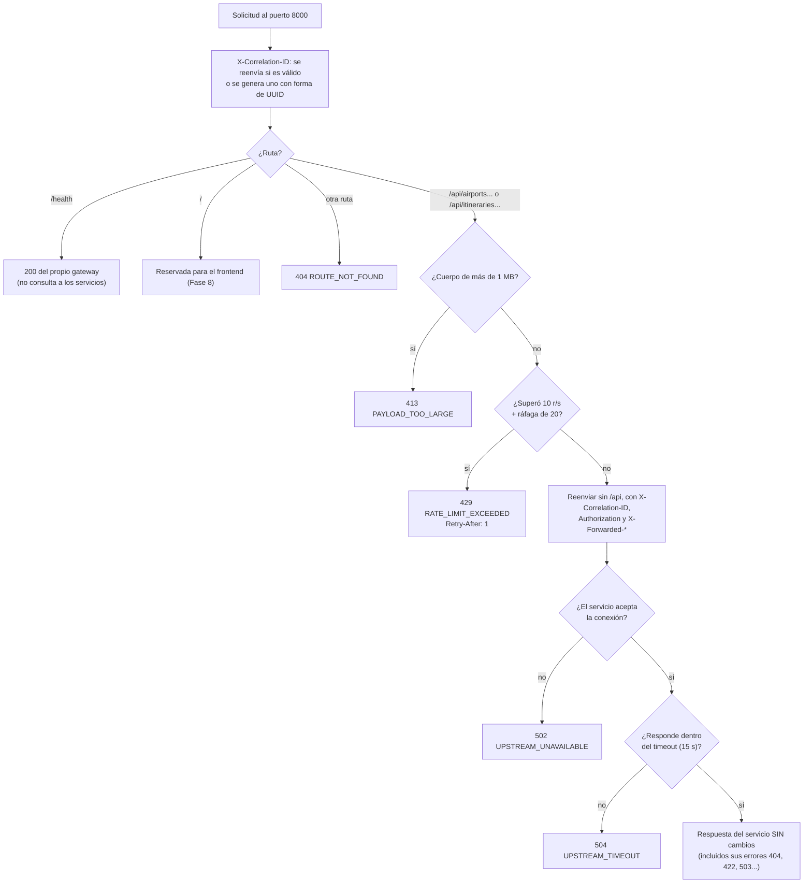
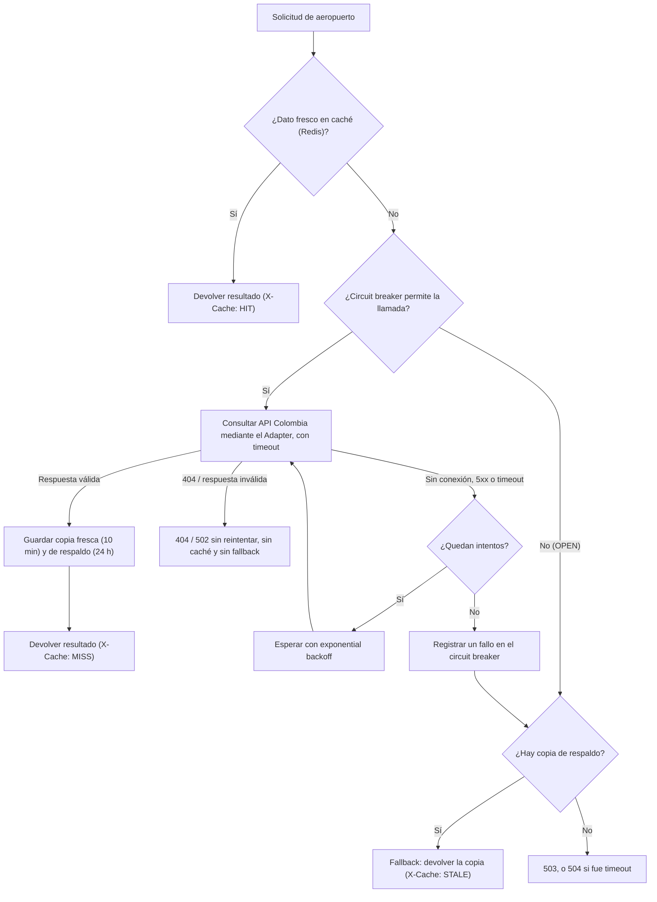
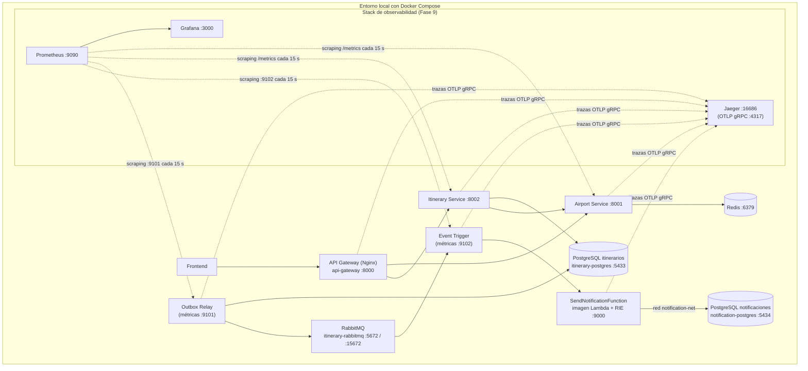
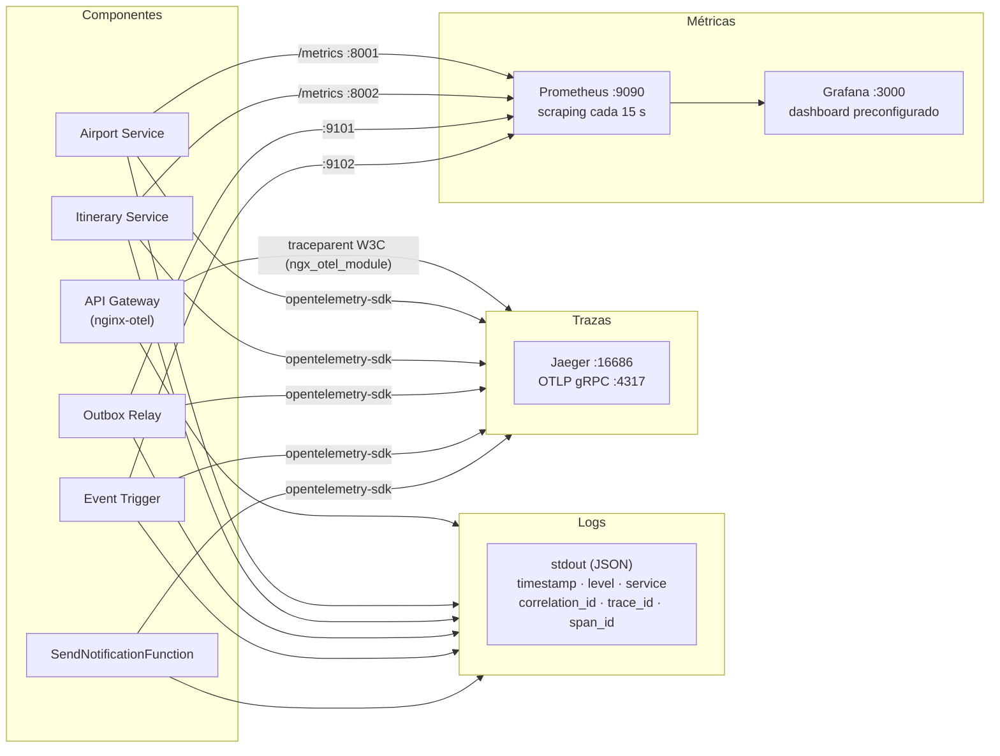

# 05. Diagramas arquitectónicos

## 1. Arquitectura general

El diagrama representa la arquitectura objetivo. Los componentes se incorporan progresivamente: el gateway llegó en la Fase 7 (Nginx, ADR-009) y el frontend llega en la Fase 8. La llamada Itinerary → Airport es interna y no pasa por el gateway.

El sistema de notificaciones está formado por el Event Trigger, la función y su base de datos `notification_db` (ADR-029). No hay un microservicio de notificaciones adicional.

## 2. Diagrama de componentes

Las flechas punteadas representan una relación de implementación conceptual de los puertos, no una llamada en tiempo de ejecución.

El API Gateway (Fase 7) solo enruta hacia los controladores REST de cada servicio; no conoce sus capas internas ni tiene lógica de negocio (ADR-009). Itinerary Service no accede a las capas internas de Airport Service: el adaptador `HttpAirportCatalogAdapter` llama a su API REST. Los casos de uso tampoco hablan directamente con RabbitMQ: usan el puerto `EventPublisher`, implementado en la Fase 4 por un publicador de RabbitMQ y en la Fase 5 por un adaptador Outbox, que registra el evento antes del commit, en la misma transacción del itinerario (ADR-013, ADR-026).

El mismo puerto `EventPublisher` tiene dos adaptadores, uno en cada proceso: en la API, `OutboxEventPublisher` guarda el evento en `outbox_events`; en el Outbox Relay, `RabbitMQEventPublisher` (el de la Fase 4, sin cambios) lo publica en RabbitMQ. El relay lee y marca los pendientes con su propio puerto, `OutboxRepository` (ADR-025).

En el sistema de notificaciones (Fase 6), el Event Trigger separa la **política** (`DeliveryHandler`, capa de aplicación) de los adaptadores: el consumidor de RabbitMQ y el cliente HTTP de la función (ADR-031). La función sigue la arquitectura hexagonal por dentro: el handler de Lambda es el adaptador de entrada, como una ruta FastAPI (ADR-028).

## 3. Secuencia de creación de un itinerario

**Nota:** desde la Fase 5 la solicitud HTTP no publica en RabbitMQ: guarda el itinerario y su evento en la misma transacción y responde 201. El Outbox Relay, un proceso aparte, publica el evento después y lo reintenta si RabbitMQ no está disponible (ADR-025, ADR-026). La entrega es "al menos una vez": puede haber duplicados, y la función es idempotente con `event_id` (ADR-030). En la Fase 4 la publicación era directa, tras el commit (ADR-022), y un fallo de RabbitMQ perdía el evento. El detalle está en `docs/04-comunicacion-y-eventos.md` (secciones 6 a 8), la topología de RabbitMQ en la sección 3.3 y el contrato en `docs/asyncapi/asyncapi.yaml`. Los fallos del lado del consumidor (función o base de datos caídas, evento inválido, reprocesamiento de la DLQ) están en la sección 3.1.

## 3.1. Fallos en el consumidor: reintentos, DLQ y reprocesamiento (Fase 6)

## 3.2. Recorrido de una solicitud por el API Gateway (Fase 7)

Los errores del gateway (404, 413, 429, 502 y 504) usan el formato único de errores y llevan el mismo `correlation_id` en el cuerpo y en el header. El gateway no reintenta: los reintentos están en los servicios (Fase 2) y reintentar un `POST` podría duplicar un itinerario (ADR-009).

## 4. Flujo de resiliencia de Airport Service

Orden aceptado en la Fase 2 (ADR-014): caché → circuit breaker → retry con backoff → llamada con timeout → fallback. El circuit breaker envuelve al retry, así que una consulta cuenta como un solo fallo cuando se agotaron sus reintentos. Un 404 no se reintenta, no se guarda en caché, no abre el circuito ni activa el fallback.

## 5. Despliegue previsto

El despliegue completo se definirá y validará en la Fase 10. Hasta entonces, cada contenedor se crea con `docker run` y los procesos de Python (servicios, relay y trigger) se ejecutan desde su entorno virtual. El gateway (contenedor `api-gateway`) llega a los servicios del equipo por `host.docker.internal`; en la Fase 10 usará los nombres de los contenedores; el orden de arranque está en el `README.md` raíz.

## 5.1. Flujo de datos de observabilidad (Fase 9)

El `correlation_id` viaja en el header `X-Correlation-ID` desde el gateway hasta los logs del Outbox Relay y del Event Trigger, y queda guardado en `notification_history`. El `traceparent` W3C une los spans en una sola traza en Jaeger: el gateway lo inyecta, el Itinerary Service lo guarda en `outbox_events` (ADR-037) y el relay lo restaura al publicar en RabbitMQ.

## 6. Consideraciones

- Los diagramas representan el diseño previsto.
- Los nombres de endpoints, colas y contratos deberán coincidir con la implementación final.
- La propiedad de las bases de datos se mantendrá por servicio.
- Los detalles de infraestructura no deberán introducir dependencias directas en el dominio.
