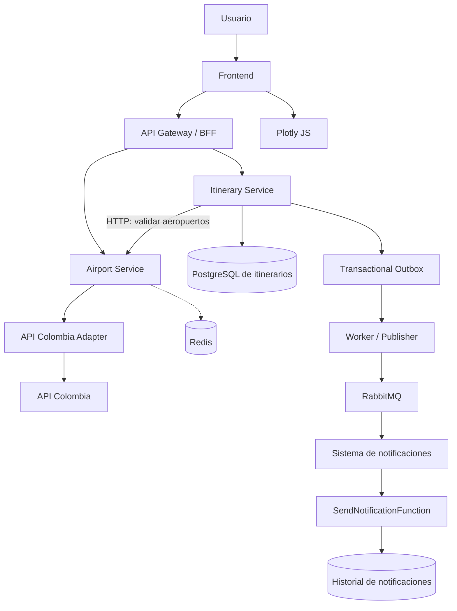
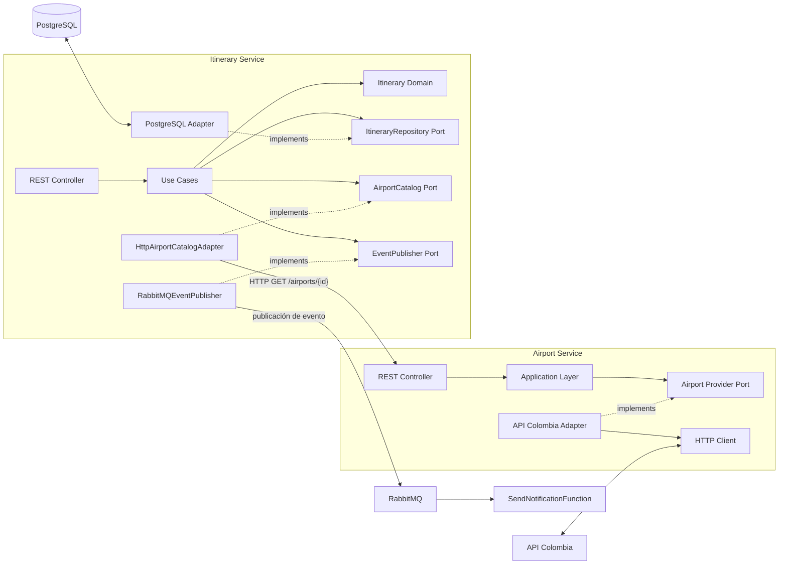
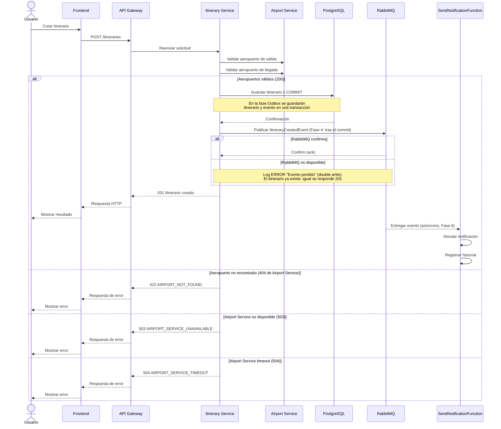
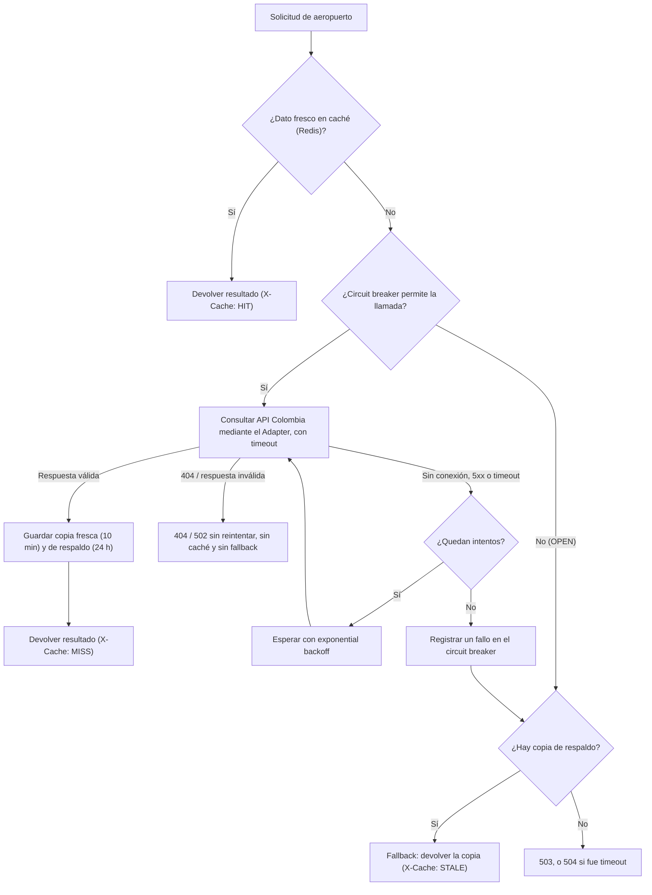
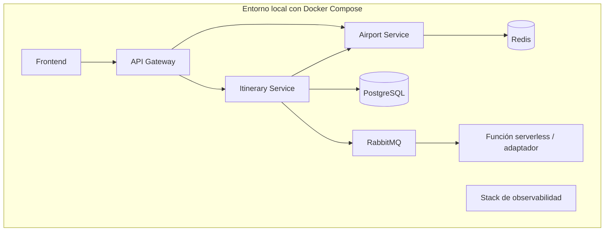

# 05. Diagramas arquitectónicos

## 1. Arquitectura general

El diagrama representa la arquitectura objetivo. Los componentes se incorporarán progresivamente, no todos desde la Fase 0.

La persistencia del historial de notificaciones se representa de forma conceptual; la tecnología definitiva queda pendiente de selección.

## 2. Diagrama de componentes

Las flechas punteadas representan una relación de implementación conceptual de los puertos, no una llamada en tiempo de ejecución.

Itinerary Service no accede a las capas internas de Airport Service: el adaptador `HttpAirportCatalogAdapter` llama a su API REST. Los casos de uso tampoco hablan directamente con RabbitMQ: usan el puerto `EventPublisher`, implementado en la Fase 4 por un publicador de RabbitMQ y en la Fase 5 por un adaptador Outbox (ADR-013).

## 3. Secuencia de creación de un itinerario

**Nota:** en la Fase 4 la publicación es directa y ocurre dentro de la solicitud, después del commit y antes de responder (ADR-022). El procesamiento de la notificación sí es independiente de la respuesta HTTP. La publicación directa se sustituirá por el mecanismo Outbox en la Fase 5. La topología de RabbitMQ está en `docs/04-comunicacion-y-eventos.md` (sección 3.3) y el contrato en `docs/asyncapi/asyncapi.yaml`.

## 4. Flujo de resiliencia de Airport Service

Orden aceptado en la Fase 2 (ADR-014): caché → circuit breaker → retry con backoff → llamada con timeout → fallback. El circuit breaker envuelve al retry, así que una consulta cuenta como un solo fallo cuando se agotaron sus reintentos. Un 404 no se reintenta, no se guarda en caché, no abre el circuito ni activa el fallback.

## 5. Despliegue previsto

El despliegue completo se definirá y validará en la Fase 10. La integración de observabilidad se desarrollará en la Fase 9.

## 6. Consideraciones

- Los diagramas representan el diseño previsto.
- Los nombres de endpoints, colas y contratos deberán coincidir con la implementación final.
- La propiedad de las bases de datos se mantendrá por servicio.
- Los detalles de infraestructura no deberán introducir dependencias directas en el dominio.
