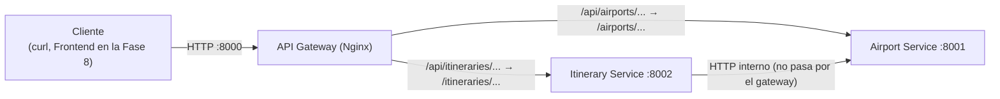

# API Gateway

Punto único de entrada del Sistema de Itinerarios Personales (Fase 7, [ADR-009](../docs/06-decisiones-arquitectonicas.md)).
Es **Nginx** en Docker con la imagen oficial `nginx:1.30.6-alpine` (arm64 y amd64) y una plantilla de configuración.

El gateway **no tiene lógica de negocio**: solo enruta, reenvía headers, aplica timeouts y responde sus
propios errores en el formato único del proyecto. Las reglas de negocio están en cada servicio.



## Rutas

| Ruta del gateway | Destino |
|---|---|
| `GET /health` | El propio gateway: `{"status":"ok","service":"api-gateway"}` (no consulta a los servicios) |
| `/` | Reservada para el frontend (Fase 8). Por ahora, un texto |
| `/api/airports`, `/api/airports/...` | Airport Service: `/airports`, `/airports/...` |
| `/api/itineraries`, `/api/itineraries/...` | Itinerary Service: `/itineraries`, `/itineraries/...` |
| Cualquier otra | 404 `ROUTE_NOT_FOUND` |

Swagger sigue en cada servicio: `http://localhost:8001/docs` y `http://localhost:8002/docs`.

## Headers

- **`Authorization`**: se reenvía tal cual al servicio, **sin validarlo** (preparación de JWT). Nunca se escribe en el log.
- **`X-Correlation-ID`**: si llega con un formato válido (letras, números, `.`, `_`, `-`; máximo 128) se reenvía. Si
  falta o no es válido, el gateway genera uno con forma de UUID. La respuesta siempre lo trae, también en los errores
  del gateway, y el log de acceso lo incluye.
- `Host`, `X-Real-IP`, `X-Forwarded-For` y `X-Forwarded-Proto`: datos del cliente original.

## Errores del gateway

Solo para los errores que genera el propio gateway. Los errores de los servicios (por ejemplo 404 `AIRPORT_NOT_FOUND`
o 503 `AIRPORT_SERVICE_UNAVAILABLE`) pasan **sin cambios**.

| Situación | Código | `code` |
|---|---|---|
| El servicio no acepta la conexión (apagado) | 502 | `UPSTREAM_UNAVAILABLE` |
| El servicio no responde a tiempo | 504 | `UPSTREAM_TIMEOUT` |
| La ruta no existe en el gateway | 404 | `ROUTE_NOT_FOUND` |
| El cuerpo supera 1 MB | 413 | `PAYLOAD_TOO_LARGE` |
| Se superó el límite de solicitudes | 429 | `RATE_LIMIT_EXCEEDED` (con header `Retry-After: 1`) |

```json
{
  "error": {
    "code": "UPSTREAM_UNAVAILABLE",
    "message": "El servicio interno no está disponible",
    "details": {"service": "airport-service"}
  },
  "correlation_id": "8017261d-7951-4fe9-fab7-e672e01bebeb"
}
```

## Rate limiting

Cada IP de origen puede hacer **10 solicitudes por segundo** a `/api/...`, con una **ráfaga de 20**. `/health` y `/`
no tienen límite.

Nginx usa el algoritmo *leaky bucket* (cubo con fuga). Cada IP tiene un cubo que se vacía a 10 solicitudes por segundo.
La ráfaga es lo que cabe en el cubo: hasta 20 solicitudes extra se atienden de inmediato (`nodelay`), en lugar de
esperar su turno. Con el cubo lleno, la solicitud se rechaza con 429 **antes** de llamar al servicio. Así, un cliente
que hace demasiadas solicitudes no llega a cargar los servicios.

El límite es por IP, no por servicio: agotarlo en `/api/airports` también afecta a `/api/itineraries`. En Docker Desktop,
todas las solicitudes hechas desde el propio equipo llegan con la misma IP, así que localmente el límite es compartido.

## Variables de entorno

El `Dockerfile` trae estos valores por defecto. Para cambiarlos se usa `-e NOMBRE=valor` o un `.env` copiado de
[`.env.example`](.env.example) con `--env-file`.

| Variable | Por defecto | Qué es |
|---|---|---|
| `AIRPORT_SERVICE_UPSTREAM` | `host.docker.internal:8001` | Dirección de Airport Service vista desde el contenedor |
| `ITINERARY_SERVICE_UPSTREAM` | `host.docker.internal:8002` | Dirección de Itinerary Service vista desde el contenedor |
| `GATEWAY_PROXY_CONNECT_TIMEOUT` | `2s` | Tiempo máximo para conectar con un servicio |
| `GATEWAY_PROXY_READ_TIMEOUT` | `15s` | Tiempo máximo entre dos lecturas de la respuesta (mayor que los timeouts internos) |
| `GATEWAY_RATE_LIMIT` | `10r/s` | Solicitudes por segundo por IP en `/api/` |
| `GATEWAY_RATE_BURST` | `20` | Solicitudes extra aceptadas de golpe antes de responder 429 |

`host.docker.internal` es el nombre con el que un contenedor llega al equipo. Docker Desktop lo crea en macOS y
Windows. En Linux hay que agregar `--add-host=host.docker.internal:host-gateway` a `docker run`. **No lo agregues en
Docker Desktop:** allí `host-gateway` añade también una dirección IPv6 que la red de Docker no alcanza, y la mitad de
las solicitudes terminaría en 502.

## Ejecutar

Requisitos: Docker Desktop encendido, y Airport Service (8001) e Itinerary Service (8002) corriendo con uvicorn, según
sus README. Los comandos `docker` son **idénticos en PowerShell, CMD y zsh** y se ejecutan desde la raíz del repositorio.

1. Construir la imagen (también después de cada cambio en `templates/`):

```bash
docker build -t api-gateway gateway
```

2. Validar la configuración (`nginx -t`):

```bash
docker run --rm api-gateway nginx -t
```

3. Ejecutar el gateway en el puerto 8000:

```bash
docker run -d --name api-gateway -p 8000:8000 api-gateway
```

4. Ver el log (una línea por solicitud con su `correlation_id`):

```bash
docker logs -f api-gateway
```

5. Detenerlo y borrar el contenedor (por ejemplo, para volver a crearlo tras reconstruir la imagen):

```bash
docker rm -f api-gateway
```

Con un `.env` propio (opcional):

**macOS (zsh):**

```bash
cp gateway/.env.example gateway/.env
docker run -d --name api-gateway -p 8000:8000 --env-file gateway/.env api-gateway
```

**PowerShell:**

```powershell
Copy-Item gateway\.env.example gateway\.env
docker run -d --name api-gateway -p 8000:8000 --env-file gateway\.env api-gateway
```

**CMD:**

```cmd
copy gateway\.env.example gateway\.env
docker run -d --name api-gateway -p 8000:8000 --env-file gateway\.env api-gateway
```

## Demostración

En zsh, las URL con `?` van entre comillas. En CMD, ejecutar antes `chcp 65001` para ver bien las tildes.

**macOS (zsh):**

```bash
curl -i http://localhost:8000/health
curl -i http://localhost:8000/api/airports/5 -H "X-Correlation-ID: demo-001"
curl -i http://localhost:8000/api/airports/9999
curl -i http://localhost:8000/api/itineraries
curl -i http://localhost:8000/api/no-existe
```

**PowerShell y CMD:**

```powershell
curl.exe -i http://localhost:8000/health
curl.exe -i http://localhost:8000/api/airports/5 -H "X-Correlation-ID: demo-001"
curl.exe -i http://localhost:8000/api/airports/9999
curl.exe -i http://localhost:8000/api/itineraries
curl.exe -i http://localhost:8000/api/no-existe
```

Qué se espera:

| Solicitud | Resultado |
|---|---|
| `/health` | 200 del gateway |
| `/api/airports/5` | 200 de Airport Service (Cali), con `X-Cache` del servicio y `X-Correlation-ID: demo-001` |
| `/api/airports/9999` | 404 `AIRPORT_NOT_FOUND` **del servicio** (pasa sin cambios) |
| `/api/itineraries` | 200 de Itinerary Service |
| `/api/no-existe` | 404 `ROUTE_NOT_FOUND` **del gateway** |

**Servicio apagado:** detener Airport Service (Ctrl+C en su terminal) y repetir `GET /api/airports/5`. El gateway
responde **502 `UPSTREAM_UNAVAILABLE`** con `"service": "airport-service"`.

**Rate limiting:** 30 solicitudes seguidas. Se esperan unas 21 respuestas 200 (1 + la ráfaga de 20) y después 429.
Al esperar un segundo, se aceptan otra vez.

**macOS (zsh):**

```bash
for i in $(seq 1 30); do curl -s -o /dev/null -w "%{http_code} " http://localhost:8000/api/airports/5; done; echo
curl -i http://localhost:8000/api/airports/5
```

**PowerShell:**

```powershell
1..30 | ForEach-Object { curl.exe -s -o NUL -w "%{http_code} " http://localhost:8000/api/airports/5 }
curl.exe -i http://localhost:8000/api/airports/5
```

**CMD:**

```cmd
for /L %i in (1,1,30) do @curl.exe -s -o NUL -w "%{http_code} " http://localhost:8000/api/airports/5
curl.exe -i http://localhost:8000/api/airports/5
```

La segunda solicitud, hecha justo después, responde `429 Too Many Requests` con `Retry-After: 1` y el error
`RATE_LIMIT_EXCEEDED`. El log del gateway (`docker logs api-gateway`) muestra `limiting requests ... zone "api_per_ip"`.

## Pruebas

Las pruebas están en `tests/` y usan **pytest** y **httpx** (`requirements-dev.txt`), con un entorno virtual propio en
`gateway/.venv`. Necesitan Docker Desktop encendido; sin Docker quedan omitidas (SKIPPED).

**Están aisladas:** no usan el gateway real ni los servicios reales. Cada sesión de pytest construye la imagen con la
etiqueta `api-gateway:test` y levanta sus propios contenedores del gateway en puertos libres. Esos contenedores apuntan a
servidores eco de Python (`tests/echo_server.py`) que devuelven lo que reciben. Al terminar se borran. Por eso no
crean ni borran datos y no gastan el límite de solicitudes del gateway de la demostración.

| Archivo | Qué comprueba |
|---|---|
| `test_config.py` | `nginx -t` y que la plantilla no deja variables sin reemplazar (`nginx -T`) |
| `test_routing.py` | Cada ruta llega al servicio correcto sin `/api`, con su método y su cuerpo; rutas desconocidas → 404; redirecciones traducidas |
| `test_headers.py` | `Authorization` se reenvía sin cambios; `X-Correlation-ID` se reenvía, se genera o se reemplaza si es inválido, y la respuesta trae uno solo; `X-Forwarded-*` |
| `test_errors.py` | 502 con un servicio apagado (puerto cerrado), 504 con un servicio lento (timeout de prueba de 1 s), 413, y un error del propio servicio que pasa sin cambios |
| `test_rate_limiting.py` | 429 en JSON con `Retry-After` tras la ráfaga, `/health` sin límite, límite por IP en los dos servicios, recuperación tras esperar (valores reales: 10 r/s, ráfaga 20) |
| `test_real_gateway.py` | *Smoke* contra el gateway real del puerto 8000: solo `GET`, se omiten si no está corriendo o si su servicio está apagado. Otra URL: variable `GATEWAY_URL` |

**macOS (zsh):**

```bash
cd gateway
python3.12 -m venv .venv
source .venv/bin/activate
python -m pip install --upgrade pip
pip install -r requirements-dev.txt
pytest -v
```

**PowerShell:**

```powershell
cd gateway
py -3.12 -m venv .venv
.\.venv\Scripts\Activate.ps1
python -m pip install --upgrade pip
pip install -r requirements-dev.txt
pytest -v
```

**CMD:**

```cmd
cd gateway
py -3.12 -m venv .venv
.venv\Scripts\activate.bat
python -m pip install --upgrade pip
pip install -r requirements-dev.txt
pytest -v
```

Resultado esperado: **40 pasan y 3 se omiten** sin el gateway real, y **43 pasan** con el gateway real y los dos
servicios encendidos. La primera vez tarda más porque descarga la imagen de Nginx.

## Problemas frecuentes

| Síntoma | Causa y solución |
|---|---|
| `docker: ... port is already allocated` | Ya hay algo en el puerto 8000 (por ejemplo, un contenedor `api-gateway` anterior): `docker rm -f api-gateway` |
| `Conflict. The container name "/api-gateway" is already in use` | El contenedor ya existe: `docker rm -f api-gateway` y volver a ejecutarlo |
| 502 `UPSTREAM_UNAVAILABLE` con el servicio encendido | El servicio no está en el puerto esperado (8001/8002) o la variable `*_UPSTREAM` apunta a otro lugar |
| El contenedor se detiene al arrancar (`docker logs api-gateway` muestra `host not found in upstream`) | Nginx no pudo resolver el nombre de un servicio. En Linux, agregar `--add-host=host.docker.internal:host-gateway` |
| Un cambio en `templates/` no se nota | Hay que reconstruir la imagen y volver a crear el contenedor (pasos 1, 5 y 3) |
| `zsh: no matches found` al usar `curl` | La URL tiene `?`: ponerla entre comillas |
| La mitad de las solicitudes da 502 en Docker Desktop | Se agregó `--add-host=host.docker.internal:host-gateway`: en Docker Desktop no hace falta y añade una IPv6 inalcanzable. Volver a crear el contenedor sin esa opción |
| 429 inesperados durante una demostración | Se superó el límite de 10 r/s (por ejemplo, con un bucle de `curl`). Esperar un segundo |
| Todas las pruebas quedan SKIPPED | Docker Desktop no está encendido |
| En Windows, las pruebas de enrutamiento dan 502 | El contenedor no llega al eco en `127.0.0.1`. Hacer que el eco escuche en todas las interfaces: `$env:GATEWAY_TEST_ECHO_HOST = "0.0.0.0"` (PowerShell) o `set GATEWAY_TEST_ECHO_HOST=0.0.0.0` (CMD), y aceptar el aviso del firewall si aparece |
