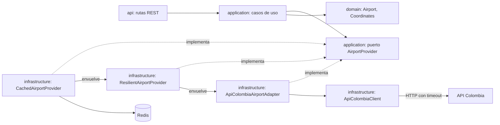
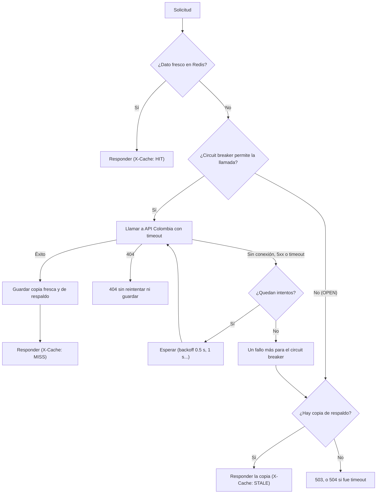

# Airport Service

Microservicio del **Catálogo de Aeropuertos** del Sistema de Itinerarios Personales.

**Estado:** Fase 1 (Airport Service) y Fase 2 (Resiliencia y caché) completadas.

## Qué hace

- Consulta los aeropuertos colombianos en la API pública [API Colombia](https://api-colombia.com)
  (`/Airport` y `/Airport/{id}`).
- Traduce la respuesta externa al modelo interno mediante el **patrón Adapter** (capa anticorrupción):
  - Corrige las coordenadas cuando llegan intercambiadas (API Colombia envía la longitud en `latitude`
    y la latitud en `longitude`).
  - Convierte los códigos faltantes (`"N/A"`) en `null`.
  - Trata las coordenadas `0, 0` como ubicación desconocida.
  - Omite los aeropuertos con datos inválidos en la lista (patrón *Tolerant Reader*).
- Expone una API REST con los aeropuertos y los datos listos para un mapa de Plotly.
- Responde los errores con un formato único y un *correlation ID*.
- Tolera fallos de API Colombia (Fase 2): **caché en Redis**, **timeout**, **retry con exponential
  backoff**, **circuit breaker** y **fallback** con la última copia válida. Ver
  [Resiliencia y caché](#resiliencia-y-caché).

Itinerary Service lo usará (Fase 3) para validar que los aeropuertos de un itinerario existan.

## Arquitectura hexagonal



Las dependencias apuntan hacia el dominio: el dominio no importa FastAPI, httpx, Redis ni Pydantic.
La caché y la resiliencia se agregan como **Decorators**: implementan el mismo puerto y envuelven
al Adapter, así que ni los casos de uso ni el Adapter cambiaron en la Fase 2.

| Rol del patrón Adapter | Elemento |
|---|---|
| Target | Puerto `AirportProvider` |
| Adapter | `ApiColombiaAirportAdapter` |
| Adaptee | `ApiColombiaClient` + JSON de API Colombia |
| Client | Casos de uso `ListAirports`, `GetAirportById`, `GetAirportMapData` |

```
airport-service/
├── app/
│   ├── domain/                  Airport, Coordinates y excepciones del dominio
│   ├── application/             puerto AirportProvider, casos de uso, excepciones de aplicación
│   ├── infrastructure/
│   │   ├── api_colombia/        client, DTO externo, mapper y Adapter
│   │   ├── resilience/          retry con backoff, circuit breaker y ResilientAirportProvider
│   │   └── cache/               almacén Redis, serialización, estado X-Cache y CachedAirportProvider
│   ├── api/                     rutas, esquemas, errores, dependencias, correlation ID y header X-Cache
│   ├── config.py                configuración por variables de entorno
│   ├── logging_config.py        logs en consola
│   └── main.py                  ensamblaje de la aplicación (composition root)
├── tests/                       pruebas de dominio, Adapter, resiliencia, caché, casos de uso y API
│   └── integration/             escenarios de la Fase 2 con la cadena completa
├── .env.example
├── pytest.ini
└── requirements.txt
```

## Requisitos

- Windows 11
- Python 3.12 (`py -3.12 --version`)
- Docker Desktop con WSL 2, para ejecutar Redis (opcional: sin Redis el servicio funciona, pero sin caché)
- Conexión a internet solo para ejecutar el servicio con datos reales (las pruebas no la necesitan
  ni necesitan Redis)

## Instalación

Una sola vez por equipo. Todos los comandos se ejecutan desde la carpeta del servicio.

PowerShell:

```powershell
cd $HOME\proyectos\sistema-itinerarios-personales\services\airport-service
# Solo la primera vez en el equipo, para permitir activar entornos virtuales:
Set-ExecutionPolicy -Scope CurrentUser -ExecutionPolicy RemoteSigned
py -3.12 -m venv .venv
.\.venv\Scripts\Activate.ps1
python -m pip install --upgrade pip
pip install -r requirements.txt
```

CMD:

```bat
cd %USERPROFILE%\proyectos\sistema-itinerarios-personales\services\airport-service
py -3.12 -m venv .venv
.venv\Scripts\activate.bat
python -m pip install --upgrade pip
pip install -r requirements.txt
```

Opcional: copiar `.env.example` como `.env` para cambiar la configuración
(`Copy-Item .env.example .env` en PowerShell, `copy .env.example .env` en CMD).

Si ya tenían el entorno de la Fase 1, basta con volver a ejecutar `pip install -r requirements.txt`
para instalar el cliente de Redis.

### Redis (Fase 2)

Con Docker Desktop abierto (el comando es igual en PowerShell y en CMD). Solo la primera vez:

```
docker run -d --name airport-redis -p 6379:6379 redis:7.4-alpine
```

Las siguientes veces: `docker start airport-redis`. Para detenerlo: `docker stop airport-redis`.
Comprobar que responde: `docker exec airport-redis redis-cli ping` (debe mostrar `PONG`).

En la Fase 10, Redis se levantará con Docker Compose junto con el resto del sistema.

## Ejecución

Con el entorno virtual activado y Redis en ejecución (el comando es igual en PowerShell y en CMD):

```
uvicorn app.main:app --port 8001
```

- Swagger: <http://localhost:8001/docs>
- Detener: `Ctrl+C`

Prueba rápida desde otra terminal (igual en PowerShell y en CMD; en CMD ejecutar antes `chcp 65001`
para ver bien las tildes):

```
curl.exe -i http://localhost:8001/airports/1
```

En la consola del servidor aparece un único aviso por respuesta cuando se corrigen coordenadas:

```
WARNING [app.infrastructure.api_colombia.adapter] API Colombia envió coordenadas intercambiadas en 51 de 52 aeropuertos: se corrigieron
```

> PowerShell 5.1 (`Invoke-RestMethod`) muestra mal las tildes porque la respuesta JSON no declara
> `charset`. Los datos son UTF-8 correctos: usar Swagger o `curl.exe` para las demostraciones.

## Pruebas

Las pruebas no usan internet ni Redis: API Colombia se simula con `respx`, Redis se reemplaza por un
almacén en memoria y las pruebas de API inyectan un proveedor falso. Las esperas del backoff y el reloj
del circuit breaker también se simulan, así que las pruebas no esperan de verdad.

PowerShell:

```powershell
cd $HOME\proyectos\sistema-itinerarios-personales\services\airport-service
.\.venv\Scripts\Activate.ps1
pytest -v
```

CMD:

```bat
cd %USERPROFILE%\proyectos\sistema-itinerarios-personales\services\airport-service
.venv\Scripts\activate.bat
pytest -v
```

Resultado esperado: `185 passed`. pytest muestra una advertencia de Starlette sobre `httpx` en
`TestClient`; es conocida y está pendiente para la Fase 11.

Solo los escenarios de la Fase 2 (la API funciona, tarda, no responde, consultas repetidas), igual en
PowerShell y en CMD:

```
pytest -v tests\integration
```

## Endpoints

| Método y ruta | Descripción | Éxito | Errores |
|---|---|---|---|
| `GET /airports` | Todos los aeropuertos, ordenados por id | 200 | 502, 503, 504 |
| `GET /airports/{id}` | Un aeropuerto por id (entero mayor que 0) | 200 | 404, 422, 502, 503, 504 |
| `GET /airports/map-data` | Aeropuertos con coordenadas, en arreglos para Plotly | 200 | 502, 503, 504 |
| `GET /health` | Estado del servicio (no consulta API Colombia) | 200 | — |

Todas las respuestas incluyen el header `X-Correlation-ID`. Si el cliente lo envía, se reutiliza.

Las respuestas que consultan aeropuertos incluyen el header `X-Cache`:

| `X-Cache` | Significado |
|---|---|
| `MISS` | No estaba en caché: se consultó API Colombia y se guardó |
| `HIT` | Dato fresco de Redis: no se consultó API Colombia |
| `STALE` | Fallback: API Colombia no estaba disponible y se respondió con la copia de respaldo |

### `GET /airports/{id}`

```
curl.exe http://localhost:8001/airports/1
```

```json
{
  "id": 1,
  "name": "Aeropuerto Internacional El Edén",
  "iata_code": "AXM",
  "oaci_code": "SKAR",
  "type": "Internacional",
  "city": "Armenia",
  "department": "Quindío",
  "coordinates": {"latitude": 4.4532428642135, "longitude": -75.7659806671205}
}
```

Un aeropuerto sin códigos o sin ubicación conocida tiene `iata_code`, `oaci_code` o `coordinates` en `null`.

### `GET /airports`

Devuelve una lista de objetos con el mismo formato de `GET /airports/{id}` (52 aeropuertos con los
datos actuales de API Colombia).

### `GET /airports/map-data`

La posición `i` de cada arreglo corresponde al mismo aeropuerto. Se excluyen los aeropuertos sin
coordenadas (51 de 52 con los datos actuales).

```json
{
  "count": 2,
  "ids": [1, 9],
  "names": ["Aeropuerto Internacional El Edén", "Aeropuerto Internacional José María Córdova"],
  "iata_codes": ["AXM", "MDE"],
  "cities": ["Armenia", "Rionegro"],
  "departments": ["Quindío", "Antioquia"],
  "types": ["Internacional", "Internacional"],
  "latitudes": [4.4532428642135, 6.1645330006573],
  "longitudes": [-75.7659806671205, -75.423110000511]
}
```

### `GET /health`

```json
{"status": "ok", "service": "airport-service"}
```

## Errores

Formato único (igual en todos los servicios del sistema):

```json
{
  "error": {
    "code": "AIRPORT_NOT_FOUND",
    "message": "El aeropuerto con id 9999 no existe",
    "details": {"airport_id": 9999}
  },
  "correlation_id": "e942c4fc-4a54-49f0-b72c-c675b6635fcd"
}
```

| HTTP | `code` | Cuándo ocurre |
|---|---|---|
| 404 | `AIRPORT_NOT_FOUND` | El aeropuerto no existe en API Colombia |
| 404 | `ROUTE_NOT_FOUND` | La ruta no existe |
| 405 | `METHOD_NOT_ALLOWED` | Método HTTP no soportado en la ruta |
| 422 | `VALIDATION_ERROR` | El id no es un entero mayor que 0 (no se consulta API Colombia) |
| 500 | `INTERNAL_ERROR` | Error inesperado del servicio |
| 502 | `AIRPORT_PROVIDER_BAD_RESPONSE` | API Colombia respondió algo inesperado: formato inválido, JSON inválido, código HTTP inesperado o una lista sin ningún aeropuerto válido |
| 503 | `AIRPORT_PROVIDER_UNAVAILABLE` | API Colombia no está disponible (sin conexión o error 5xx después de los reintentos) o el circuit breaker está abierto, y no hay copia de respaldo |
| 504 | `AIRPORT_PROVIDER_TIMEOUT` | API Colombia no respondió dentro del timeout en ningún intento, y no hay copia de respaldo |

Ejemplo de 422 (`GET /airports/0`):

```json
{
  "error": {
    "code": "VALIDATION_ERROR",
    "message": "Los datos de la solicitud no son válidos",
    "details": {"errors": [{"field": "airport_id", "message": "Input should be greater than 0"}]}
  },
  "correlation_id": "7651f689-d4e5-4bf7-832d-824d6dc0f761"
}
```

## Variables de entorno

Se leen del entorno o de un archivo `.env` en la carpeta del servicio (ver `.env.example`).

| Variable | Valor por defecto | Descripción |
|---|---|---|
| `SERVICE_NAME` | `airport-service` | Nombre que devuelve `GET /health` |
| `API_COLOMBIA_BASE_URL` | `https://api-colombia.com/api/v1` | URL base de API Colombia, sin barra final |
| `LOG_LEVEL` | `INFO` | Nivel de logs: `DEBUG`, `INFO`, `WARNING`, `ERROR`. Con `DEBUG` se ve cada corrección de coordenadas y cada HIT/MISS de caché |
| `API_COLOMBIA_TIMEOUT_SECONDS` | `3` | Segundos máximos de espera de cada llamada a API Colombia |
| `RETRY_MAX_ATTEMPTS` | `3` | Intentos totales por consulta (1 = sin reintentos) |
| `RETRY_BASE_DELAY_SECONDS` | `0.5` | Espera antes del primer reintento; se duplica en cada reintento |
| `RETRY_MAX_DELAY_SECONDS` | `4` | Espera máxima entre dos intentos |
| `CIRCUIT_BREAKER_FAILURE_THRESHOLD` | `3` | Consultas fallidas seguidas que abren el circuito |
| `CIRCUIT_BREAKER_RECOVERY_SECONDS` | `30` | Segundos que el circuito permanece abierto antes de la llamada de prueba |
| `REDIS_URL` | `redis://localhost:6379/0` | Conexión a Redis |
| `REDIS_TIMEOUT_SECONDS` | `0.5` | Espera máxima de cada operación con Redis |
| `CACHE_TTL_SECONDS` | `600` | Segundos que un dato se considera fresco (10 minutos) |
| `CACHE_STALE_TTL_SECONDS` | `86400` | Segundos que se guarda la copia de respaldo para el fallback (24 horas) |

El puerto (8001) se indica al ejecutar `uvicorn`.

## Resiliencia y caché

Recorrido de una consulta (por ejemplo `GET /airports/1`):



| Mecanismo | Qué hace | Dónde está |
|---|---|---|
| Timeout | Corta cada llamada a API Colombia que tarde más de `API_COLOMBIA_TIMEOUT_SECONDS` | `httpx.AsyncClient(timeout=...)` en `main.py`; el cliente lo traduce a `AirportProviderTimeoutError` |
| Retry | Repite la llamada si falla por disponibilidad (sin conexión, 5xx, timeout). No repite 404 ni 502 | `infrastructure/resilience/retry.py` |
| Exponential backoff | Duplica la espera entre intentos (0.5 s, 1 s, 2 s...) hasta un máximo | `RetryPolicy.delay_before_retry` |
| Circuit breaker | Tras 3 consultas fallidas seguidas deja de llamar a API Colombia durante 30 s y responde 503 al instante; luego permite una llamada de prueba | `infrastructure/resilience/circuit_breaker.py` |
| Caché | Guarda cada respuesta en Redis 10 minutos; las consultas repetidas no llaman a API Colombia | `infrastructure/cache/cached_provider.py` |
| Fallback | Si API Colombia no está disponible, responde la copia de respaldo (24 h) en lugar de un error | `CachedAirportProvider` |

Decisiones:

- **Orden:** caché → circuit breaker → retry con backoff → llamada con timeout → fallback. El circuit
  breaker está por fuera del retry: una consulta cuenta como un solo fallo cuando ya se agotaron sus
  reintentos.
- **Un 404 no se reintenta, no se guarda en caché, no abre el circuito ni activa el fallback.**
  Un 502 (respuesta inválida) tampoco se reintenta ni activa el fallback: el proveedor sí respondió.
- **Si Redis falla, el servicio sigue funcionando sin caché.** Se registra un warning y durante 30 s
  no se vuelve a intentar con Redis, para no esperar su timeout en cada solicitud.
- El estado del circuit breaker vive en la memoria del proceso: al reiniciar el servicio vuelve a `CLOSED`.

### Demostración de los escenarios

Todos los comandos se ejecutan en la carpeta del servicio, con el entorno virtual activado y Redis en
ejecución. Para cambiar una variable solo en la terminal actual:

| | PowerShell | CMD |
|---|---|---|
| Asignar | `$env:NOMBRE = "valor"` | `set NOMBRE=valor` |
| Quitar | `Remove-Item Env:NOMBRE` | `set NOMBRE=` |

**1. La API funciona y 4. consultas repetidas.** Iniciar el servicio con `uvicorn app.main:app --port 8001`
y, en otra terminal, consultar dos veces (igual en PowerShell y en CMD):

```
curl.exe -s -o NUL -D - http://localhost:8001/airports
curl.exe -s -o NUL -D - http://localhost:8001/airports
```

La primera respuesta trae `x-cache: MISS` y tarda lo que tarda API Colombia; la segunda trae
`x-cache: HIT` y responde en milisegundos. Las claves guardadas se pueden ver en Redis:

```
docker exec airport-redis redis-cli --scan --pattern "airport-service:*"
docker exec airport-redis redis-cli TTL airport-service:v1:airports
```

**2. La API tarda demasiado.** Detener el servicio (`Ctrl+C`), vaciar la caché para que no responda
desde Redis y simular un timeout muy corto:

```
docker exec airport-redis redis-cli FLUSHDB
```

PowerShell:

```powershell
$env:API_COLOMBIA_TIMEOUT_SECONDS = "0.001"
uvicorn app.main:app --port 8001
```

CMD:

```bat
set API_COLOMBIA_TIMEOUT_SECONDS=0.001
uvicorn app.main:app --port 8001
```

`curl.exe -i http://localhost:8001/airports/1` responde **504** `AIRPORT_PROVIDER_TIMEOUT`. En la
consola del servicio se ven los 3 intentos y las esperas del backoff:

```
WARNING [app.infrastructure.resilience.retry] Intento 1 de 3 falló (API Colombia no respondió a tiempo). Reintentando en 0.50 s
WARNING [app.infrastructure.resilience.retry] Intento 2 de 3 falló (API Colombia no respondió a tiempo). Reintentando en 1.00 s
WARNING [app.infrastructure.resilience.retry] Se agotaron los 3 intentos: API Colombia no respondió a tiempo
```

Detener el servicio y quitar la variable antes de seguir (`Remove-Item Env:API_COLOMBIA_TIMEOUT_SECONDS`
en PowerShell o `set API_COLOMBIA_TIMEOUT_SECONDS=` en CMD).

**3. La API no responde y circuit breaker.** Simular que API Colombia está caída apuntando a un puerto
cerrado:

PowerShell:

```powershell
$env:API_COLOMBIA_BASE_URL = "http://127.0.0.1:9"
uvicorn app.main:app --port 8001
```

CMD:

```bat
set API_COLOMBIA_BASE_URL=http://127.0.0.1:9
uvicorn app.main:app --port 8001
```

Ejecutar 4 veces (igual en PowerShell y en CMD):

```
curl.exe -s -o NUL -w "%{http_code} %{time_total}s\n" http://localhost:8001/airports/2
```

Las tres primeras responden **503** después de los reintentos (en Windows cada conexión rechazada
tarda unos 2 s, así que tardan unos 7 s). En la consola aparece
`Circuit breaker 'api-colombia': CLOSED -> OPEN` y la cuarta responde **503 al instante**, sin llamar
a API Colombia. Pasados 30 s el circuito pasa a `HALF_OPEN` y deja pasar una llamada de prueba.

**Fallback.** Con el servicio normal (sin variables), consultar `curl.exe -i http://localhost:8001/airports/1`
para que quede guardado. Borrar solo la copia fresca, como si hubieran pasado los 10 minutos:

```
docker exec airport-redis redis-cli DEL airport-service:v1:airport:1
```

Reiniciar el servicio apuntando a la API caída (escenario 3) y consultar de nuevo: responde **200** con
`x-cache: STALE` y los datos de respaldo. En la consola aparece
`Fallback: se responde airport-service:v1:airport:1 con datos de respaldo porque ...`.

**Redis caído.** `docker stop airport-redis` y consultar: el servicio responde 200 (siempre `MISS`,
nunca `HIT`) y registra una vez `Redis no disponible: se omite la caché durante 30 s`. Volver a
iniciarlo con `docker start airport-redis`.

## Limitaciones conocidas (Fase 2)

- El circuit breaker y la pausa de Redis viven en la memoria de cada proceso: con varias réplicas del
  servicio, cada una tiene su propio estado.
- El backoff no usa *jitter* (variación aleatoria de la espera). Con una sola instancia no hace falta;
  con muchos clientes reintentando a la vez convendría agregarlo.
- No hay invalidación manual de la caché: los datos se renuevan al vencer su TTL (API Colombia cambia
  muy poco).
