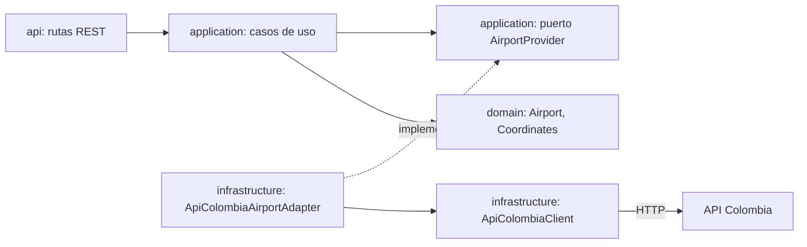

# Airport Service

Microservicio del **Catálogo de Aeropuertos** del Sistema de Itinerarios Personales.

## Qué hace

- Consulta los aeropuertos colombianos en la API pública [API Colombia](https://api-colombia.com)
  (`/Airport` y `/Airport/{id}`).
- Traduce la respuesta externa al modelo interno mediante el **patrón Adapter** (capa anticorrupción):
  - Corrige las coordenadas cuando llegan intercambiadas (API Colombia envía la longitud en `latitude`
    y la latitud en `longitude`).
  - Convierte los códigos faltantes (`"N/A"`) en `null`.
  - Trata las coordenadas `0, 0` como ubicación desconocida.
  - Omite los aeropuertos con datos inválidos en la lista (patrón *Tolerant Reader*).
- Expone una API REST con los aeropuertos y los datos listos para un mapa de Plotly.
- Responde los errores con un formato único y un *correlation ID*.

Itinerary Service lo usará (Fase 3) para validar que los aeropuertos de un itinerario existan.

## Arquitectura hexagonal



Las dependencias apuntan hacia el dominio: el dominio no importa FastAPI, httpx ni Pydantic.

| Rol del patrón Adapter | Elemento |
|---|---|
| Target | Puerto `AirportProvider` |
| Adapter | `ApiColombiaAirportAdapter` |
| Adaptee | `ApiColombiaClient` + JSON de API Colombia |
| Client | Casos de uso `ListAirports`, `GetAirportById`, `GetAirportMapData` |

```
airport-service/
├── app/
│   ├── domain/                  Airport, Coordinates y excepciones del dominio
│   ├── application/             puerto AirportProvider, casos de uso, excepciones de aplicación
│   ├── infrastructure/
│   │   └── api_colombia/        client, DTO externo, mapper y Adapter
│   ├── api/                     rutas, esquemas, manejador de errores, dependencias, correlation ID
│   ├── config.py                configuración por variables de entorno
│   ├── logging_config.py        logs en consola
│   └── main.py                  ensamblaje de la aplicación (composition root)
├── tests/                       pruebas de dominio, Adapter, casos de uso y API
├── .env.example
├── pytest.ini
└── requirements.txt
```

## Requisitos

- Windows 11
- Python 3.12 (`py -3.12 --version`)
- Conexión a internet solo para ejecutar el servicio con datos reales (las pruebas no la necesitan)

## Instalación

Una sola vez por equipo. Todos los comandos se ejecutan desde la carpeta del servicio.

PowerShell:

```powershell
cd $HOME\proyectos\sistema-itinerarios-personales\services\airport-service
# Solo la primera vez en el equipo, para permitir activar entornos virtuales:
Set-ExecutionPolicy -Scope CurrentUser -ExecutionPolicy RemoteSigned
py -3.12 -m venv .venv
.\.venv\Scripts\Activate.ps1
python -m pip install --upgrade pip
pip install -r requirements.txt
```

CMD:

```bat
cd %USERPROFILE%\proyectos\sistema-itinerarios-personales\services\airport-service
py -3.12 -m venv .venv
.venv\Scripts\activate.bat
python -m pip install --upgrade pip
pip install -r requirements.txt
```

Opcional: copiar `.env.example` como `.env` para cambiar la configuración
(`Copy-Item .env.example .env` en PowerShell, `copy .env.example .env` en CMD).

## Ejecución

Con el entorno virtual activado (el comando es igual en PowerShell y en CMD):

```
uvicorn app.main:app --port 8001
```

- Swagger: <http://localhost:8001/docs>
- Detener: `Ctrl+C`

Prueba rápida desde otra terminal (igual en PowerShell y en CMD; en CMD ejecutar antes `chcp 65001`
para ver bien las tildes):

```
curl.exe -i http://localhost:8001/airports/1
```

En la consola del servidor aparece un único aviso por respuesta cuando se corrigen coordenadas:

```
WARNING [app.infrastructure.api_colombia.adapter] API Colombia envió coordenadas intercambiadas en 51 de 52 aeropuertos: se corrigieron
```

> PowerShell 5.1 (`Invoke-RestMethod`) muestra mal las tildes porque la respuesta JSON no declara
> `charset`. Los datos son UTF-8 correctos: usar Swagger o `curl.exe` para las demostraciones.

## Pruebas

Las pruebas no usan internet: API Colombia se simula con `respx` y las pruebas de API inyectan un
proveedor falso.

PowerShell:

```powershell
cd $HOME\proyectos\sistema-itinerarios-personales\services\airport-service
.\.venv\Scripts\Activate.ps1
pytest -v
```

CMD:

```bat
cd %USERPROFILE%\proyectos\sistema-itinerarios-personales\services\airport-service
.venv\Scripts\activate.bat
pytest -v
```

Resultado esperado: `97 passed`. pytest muestra una advertencia de Starlette sobre `httpx` en
`TestClient`; es conocida y está pendiente para la Fase 11.

## Endpoints

| Método y ruta | Descripción | Éxito | Errores |
|---|---|---|---|
| `GET /airports` | Todos los aeropuertos, ordenados por id | 200 | 502, 503 |
| `GET /airports/{id}` | Un aeropuerto por id (entero mayor que 0) | 200 | 404, 422, 502, 503 |
| `GET /airports/map-data` | Aeropuertos con coordenadas, en arreglos para Plotly | 200 | 502, 503 |
| `GET /health` | Estado del servicio (no consulta API Colombia) | 200 | — |

Todas las respuestas incluyen el header `X-Correlation-ID`. Si el cliente lo envía, se reutiliza.

### `GET /airports/{id}`

```
curl.exe http://localhost:8001/airports/1
```

```json
{
  "id": 1,
  "name": "Aeropuerto Internacional El Edén",
  "iata_code": "AXM",
  "oaci_code": "SKAR",
  "type": "Internacional",
  "city": "Armenia",
  "department": "Quindío",
  "coordinates": {"latitude": 4.4532428642135, "longitude": -75.7659806671205}
}
```

Un aeropuerto sin códigos o sin ubicación conocida tiene `iata_code`, `oaci_code` o `coordinates` en `null`.

### `GET /airports`

Devuelve una lista de objetos con el mismo formato de `GET /airports/{id}` (52 aeropuertos con los
datos actuales de API Colombia).

### `GET /airports/map-data`

La posición `i` de cada arreglo corresponde al mismo aeropuerto. Se excluyen los aeropuertos sin
coordenadas (51 de 52 con los datos actuales).

```json
{
  "count": 2,
  "ids": [1, 9],
  "names": ["Aeropuerto Internacional El Edén", "Aeropuerto Internacional José María Córdova"],
  "iata_codes": ["AXM", "MDE"],
  "cities": ["Armenia", "Rionegro"],
  "departments": ["Quindío", "Antioquia"],
  "types": ["Internacional", "Internacional"],
  "latitudes": [4.4532428642135, 6.1645330006573],
  "longitudes": [-75.7659806671205, -75.423110000511]
}
```

### `GET /health`

```json
{"status": "ok", "service": "airport-service"}
```

## Errores

Formato único (igual en todos los servicios del sistema):

```json
{
  "error": {
    "code": "AIRPORT_NOT_FOUND",
    "message": "El aeropuerto con id 9999 no existe",
    "details": {"airport_id": 9999}
  },
  "correlation_id": "e942c4fc-4a54-49f0-b72c-c675b6635fcd"
}
```

| HTTP | `code` | Cuándo ocurre |
|---|---|---|
| 404 | `AIRPORT_NOT_FOUND` | El aeropuerto no existe en API Colombia |
| 404 | `ROUTE_NOT_FOUND` | La ruta no existe |
| 405 | `METHOD_NOT_ALLOWED` | Método HTTP no soportado en la ruta |
| 422 | `VALIDATION_ERROR` | El id no es un entero mayor que 0 (no se consulta API Colombia) |
| 500 | `INTERNAL_ERROR` | Error inesperado del servicio |
| 502 | `AIRPORT_PROVIDER_BAD_RESPONSE` | API Colombia respondió algo inesperado: formato inválido, JSON inválido, código HTTP inesperado o una lista sin ningún aeropuerto válido |
| 503 | `AIRPORT_PROVIDER_UNAVAILABLE` | API Colombia no está disponible: sin conexión, timeout o error 5xx |

Ejemplo de 422 (`GET /airports/0`):

```json
{
  "error": {
    "code": "VALIDATION_ERROR",
    "message": "Los datos de la solicitud no son válidos",
    "details": {"errors": [{"field": "airport_id", "message": "Input should be greater than 0"}]}
  },
  "correlation_id": "7651f689-d4e5-4bf7-832d-824d6dc0f761"
}
```

## Variables de entorno

Se leen del entorno o de un archivo `.env` en la carpeta del servicio (ver `.env.example`).

| Variable | Valor por defecto | Descripción |
|---|---|---|
| `SERVICE_NAME` | `airport-service` | Nombre que devuelve `GET /health` |
| `API_COLOMBIA_BASE_URL` | `https://api-colombia.com/api/v1` | URL base de API Colombia, sin barra final |
| `LOG_LEVEL` | `INFO` | Nivel de logs: `DEBUG`, `INFO`, `WARNING`, `ERROR`. Con `DEBUG` se ve cada corrección de coordenadas |

El puerto (8001) se indica al ejecutar `uvicorn`.

## Limitaciones conocidas (Fase 1)

- Sin caché, timeout configurable, reintentos ni circuit breaker: se agregan en la **Fase 2**.
  Por ahora se usa el timeout por defecto de httpx (5 segundos).
- Cada consulta llama a API Colombia.
